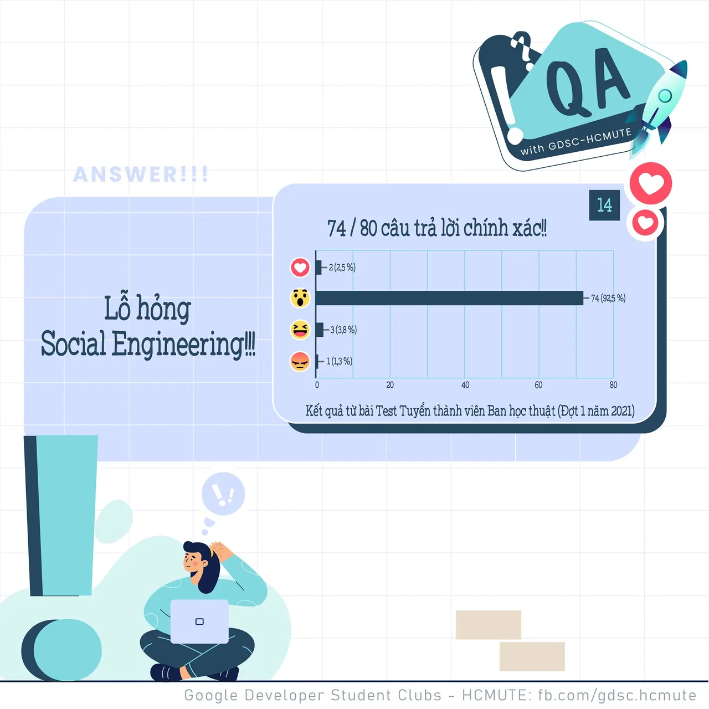

\[QA GDSC - Answer\]
  
Chào mọi người  
,

<!--truncate-->

  
 Với câu hỏi hôm qua, thì 𝑺𝒐𝒄𝒊𝒂𝒍 𝑬𝒏𝒈𝒊𝒏𝒆𝒆𝒓𝒊𝒏𝒈 không phải là 1 trong 10 lỗ hỏng bảo mật thường gặp, theo OWASP (Open Web Application Security Project). Tụi mình cùng đi sơ qua chủ đề thú vị này nhá!

  
 𝐈𝐧𝐣𝐞𝐜𝐭𝐢𝐨𝐧 (Lỗi chèn mã độc)  
\- Injection là lỗ hổng xảy ra do sự thiếu sót trong việc lọc các dữ liệu đầu vào không đáng tin cậy.  
\- Khi bạn truyền các dữ liệu chưa được lọc tới Database (Ví dụ như lỗ hổng SQL injection), tới trình duyệt (lỗ hổng XSS), tới máy chủ LDAP (lỗ hổng LDAP Injection) hoặc tới bất cứ vị trí nào khác. Vấn đề là kẻ tấn công có thể chèn các đoạn mã độc để gây ra lộ lọt dữ liệu và chiếm quyền kiểm soát trình duyệt của khách hàng.

  
 𝐁𝐫𝐨𝐤𝐞𝐧 𝐀𝐮𝐭𝐡𝐞𝐧𝐭𝐢𝐜𝐚𝐭𝐢𝐨𝐧  
\- Đây là nhóm các vấn đề có thể xảy ra trong quá trình xác thực. Có một lời khuyên là không nên tự phát triển các giải pháp mã hóa vì rất khó có thể làm được chính xác.  
Có rất nhiều rủi ro có thể gặp phải trong quá trình xác thực:  
\- URL có thể chứa Session ID và rò rỉ nó trong Referer Header của người dùng khác.  
\- Mật khẩu không được mã hóa hoặc dễ giải mã trong khi lưu trữ.  
\- Lỗ hổng Session Fixation.  
\- Tấn công Session Hijacking có thể xảy ra khi thời gian hét hạn của session không được triển khai đúng hoặc sử dụng HTTP (không bảo mật SSL)…

  
 Lỗ hổng 𝐗𝐒𝐒 (Cross-Site Scripting)  
\- Lỗ hổng XSS (Cross-site Scripting) là một lỗ hổng rất phổ biến. Kẻ tấn công chèn các đoạn mã JavaScript vào ứng dụng web. Khi đầu vào này không được lọc, chúng sẽ được thực thi mã độc trên trình duyệt của người dùng.  
\- Kẻ tấn công có thể lấy được cookie của người dùng trên hệ thông hoặc lừa người dùng đến các trang web độc hại.

  
 𝐒𝐨𝐜𝐢𝐚𝐥 𝐄𝐧𝐠𝐢𝐧𝐞𝐞𝐫𝐢𝐧𝐠  
\- Social Engineering được hiểu đơn giản là kỹ thuật tác động đến con người để đánh cắp thông tin hoặc nhằm đạt được một mục đích mong muốn.  
\- Kỹ thuật này dựa trên điểm yếu tâm lý và nhận thức sai lầm của người dùng về việc bảo mật thông tin. Theo đó, tin tặc chú trọng vào việc khai thác các thói quen tự nhiên của người dùng hơn là việc khai thác các lỗ hổng bảo mật của hệ thống.

  
 Các bạn có suy nghĩ như thế nào với đáp án lần này Để lại bình luận bên dưới để ad có thể hóng ké nha ^^  
---------------------------  
QA with GDSC - HCMUTE là chuyên mục do GDSC - HCMUTE thực hiện với mong muốn cung cấp các kiến thức và thông tin hữu ích, giúp các bạn có thêm các tips thú vị trong lĩnh vực Công nghệ Thông tin thông qua Question và Answer được lên sóng hàng ngày!
  
 Mọi ý kiến đóng góp, các bạn có thể liên hệ trực tiếp thông qua fanpage Google Developer Student Clubs - HCM UTE: [https://www.facebook.com/gdsc.hcmute](https://www.facebook.com/gdsc.hcmute)
  
\#GDSC #GoogleDeveloperStudentClubs #GDSC\_HCMUTE #GDSC\_QA

---

_Bài viết được lưu trữ từ [fanpage HCMUTE Developer Student Club](https://www.facebook.com/hcmute.dsc)._
