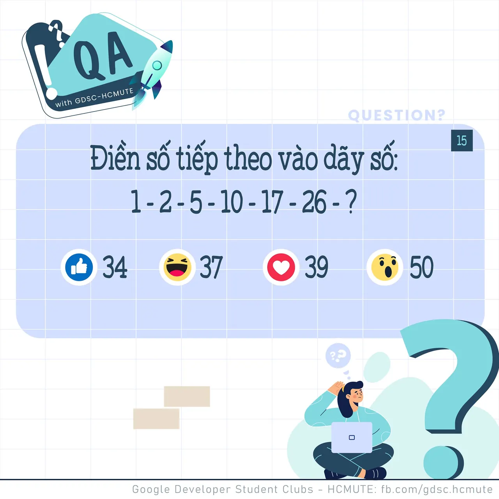
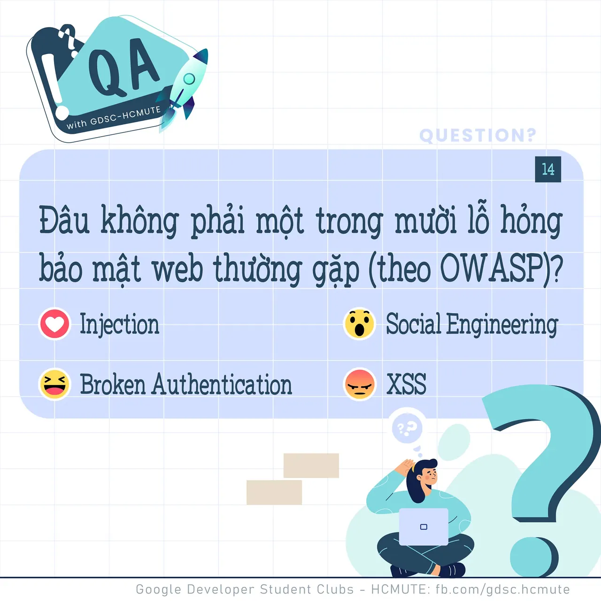

\[QA GDSC - Question\]
  
Chào buổi tối mọi người

<!--truncate-->

Tụi mình đã trở lại với một câu hỏi logic rồi đâyyyy!
  
Đ𝒊𝒆̂̀𝒏 𝒔𝒐̂́ 𝒕𝒊𝒆̂́𝒑 𝒕𝒉𝒆𝒐 𝒕𝒓𝒐𝒏𝒈 𝒅𝒂̃𝒚 𝒔𝒐̂́ 𝒔𝒂𝒖?
  
 Bình tĩnh tự tin và để lại React cũng như Comment để GDSC - HCMUTE chúng mình xem có bao nhiêu bạn vượt qua thử thách lần này nào
  
Đừng quên Like và Follow Page để đón chờ phần Answer được lên sóng vào ngày mai nha
  
---------------------------
  
 QA with GDSC HCMUTE là chuyên mục do GDSC - HCMUTE thực hiện với mong muốn cung cấp các kiến thức và thông tin hữu ích, giúp các bạn có thêm các tips thú vị trong lĩnh vực Công nghệ Thông tin thông qua Question và Answer được lên sóng hàng ngày!
  
 Mọi ý kiến đóng góp, các bạn có thể liên hệ trực tiếp thông qua fanpage Google Developer Student Clubs - HCM UTE: [https://www.facebook.com/gdsc.hcmute](https://www.facebook.com/gdsc.hcmute)  
\#GDSC #GoogleDeveloperStudentClubs #GDSC\_HCMUTE #GDSC\_QA

---

_Bài viết được lưu trữ từ [fanpage HCMUTE Developer Student Club](https://www.facebook.com/hcmute.dsc)._
