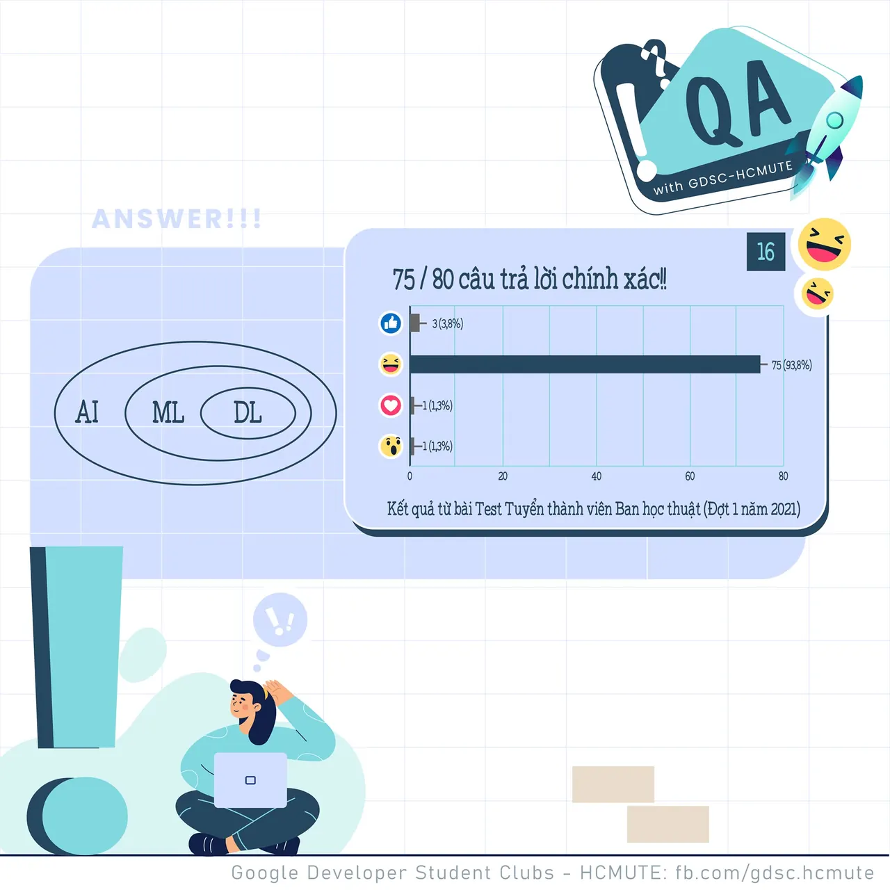

\[QA GDSC - Answer\]  
Chào mọi người chào mọi người

<!--truncate-->

,
  
Cuối tuần mọi người làm gì nhỉ? Cùng tụi mình xem qua đáp án của QA ngày hôm qua nhá ^^
  
 Câu hỏi về mối quan hệ của AI, ML và DL hôm qua đúng là không thể nào làm khó được các nhà thông thái của chúng ta đúng không nào. Không một ai trả lời sai với 100% lượt React Haha thì đáp án chính xác là AI &gt; ML &gt; DL !!
  
 AI: Trí tuệ nhân tạo là một ngành học được thành lập năm 1956, với mục tiêu là giúp máy tính bắt chước theo các hành vi của con người theo một cách nào đó. Thuật ngữ AI chưa đề cập đến các kỹ thuật cụ thể giúp máy tính có thể thực hiện việc đó như thế nào.
  
 ML: là một tập con của AI, bao gồm các kỹ thuật cho phép máy tính có khả năng tự khai phá các thông tin (“học”) từ dữ liệu đầu vào, mà không cần phải lập trình một cách tường minh. Theo đó, ML sẽ cố gắng bắt chước não bộ con người trong việc giải quyết các vấn đề, thông qua việc xây dựng các neuron nhân tạo được kết nối với nhau.
  
 DL: là một tập con của ML, được tạo nên từ sự kết hợp phức tạp của vô số các lớp mạng thần kinh nhân tạo.
  
 Các bạn có suy nghĩ thế nào với đáp án lần này? Để lại bình luận bên dưới để Ad cũng như các bạn có thể tham khảo nha ^^
  
---------------------------
  
 QA with GDSC - HCMUTE là chuyên mục do GDSC - HCMUTE thực hiện với mong muốn cung cấp các kiến thức và thông tin hữu ích, giúp các bạn có thêm các tips thú vị trong lĩnh vực Công nghệ Thông tin thông qua Question và Answer được lên sóng hàng ngày!
  
 Mọi ý kiến đóng góp, các bạn có thể liên hệ trực tiếp thông qua fanpage Google Developer Student Clubs - HCM UTE: [https://www.facebook.com/gdsc.hcmute](https://www.facebook.com/gdsc.hcmute)  
\#GDSC #GoogleDeveloperStudentClubs #GDSC\_HCMUTE #GDSC\_QA

---

_Bài viết được lưu trữ từ [fanpage HCMUTE Developer Student Club](https://www.facebook.com/hcmute.dsc)._
