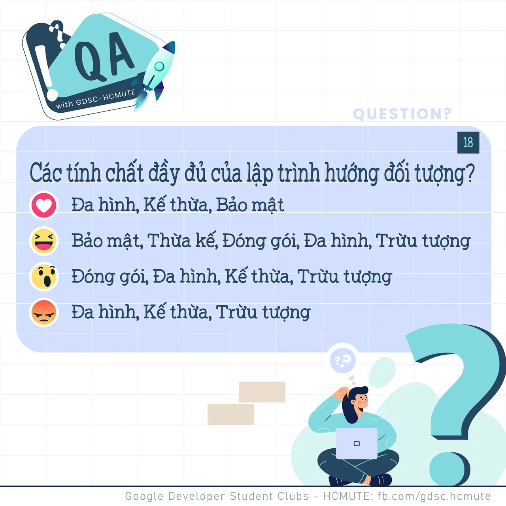

\[QA GDSC - Question\]
  
Chào buổi tối mọi người

<!--truncate-->

  
Có thể nói, lập trình hướng đối tượng (Object Oriented Programming) là kỹ thuật lập trình vô cùng quan trọng và cần thiết. Vậy hãy cùng tụi mình ôn lại các kiến thức của OOP qua Question hôm nay nào!

  
 Đ𝒂̂𝒖 𝒍𝒂̀ 𝒄𝒂́𝒄 𝒕𝒊́𝒏𝒉 𝒄𝒉𝒂̂́𝒕 𝒄𝒖̉𝒂 𝒍𝒂̣̂𝒑 𝒕𝒓𝒊̀𝒏𝒉 𝒉𝒖̛𝒐̛́𝒏𝒈 đ𝒐̂́𝒊 𝒕𝒖̛𝒐̛̣𝒏𝒈

  
 Bình tĩnh tự tin và để lại React cũng như Comment để GDSC - HCMUTE chúng mình xem có bao nhiêu bạn vượt qua thử thách lần này nào

  
Đừng quên Like và Follow Page để đón chờ phần Answer được lên sóng vào ngày mai nha  
---------------------------  
QA with GDSC HCMUTE là chuyên mục do GDSC - HCMUTE thực hiện với mong muốn cung cấp các kiến thức và thông tin hữu ích, giúp các bạn có thêm các tips thú vị trong lĩnh vực Công nghệ Thông tin thông qua Question và Answer được lên sóng hàng ngày!
  
 Mọi ý kiến đóng góp, các bạn có thể liên hệ trực tiếp thông qua fanpage Google Developer Student Clubs - HCM UTE: [https://www.facebook.com/gdsc.hcmute](https://www.facebook.com/gdsc.hcmute)
  
\#GDSC #GoogleDeveloperStudentClubs #GDSC\_HCMUTE #GDSC\_QA

---

_Bài viết được lưu trữ từ [fanpage HCMUTE Developer Student Club](https://www.facebook.com/hcmute.dsc)._
