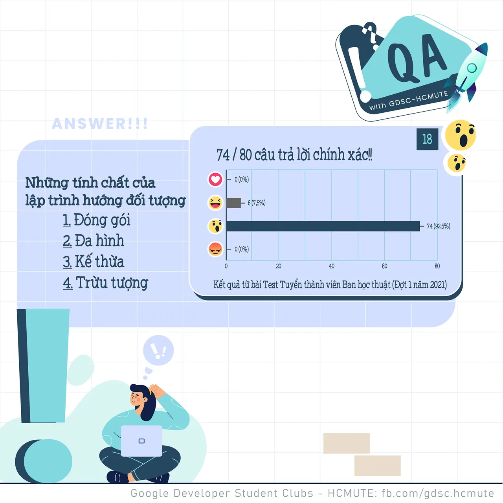

\[QA GDSC - Answer\]
  
Alo alo  
,

<!--truncate-->

  
 Câu hỏi hôm qua đúng là không thể làm khó được các nhà lập trình của chúng ta mà  
 Tụi mình nhận được 48/57 lượt react Wow - 4 𝒕𝒊́𝒏𝒉 𝒄𝒉𝒂̂́𝒕: Đóng gói, Đa hình, Kế thừa, Trừu tượng, cũng chính là đáp án chính xác!

  
 Lập trình hướng đối tượng (OOP) là một kỹ thuật lập trình cho phép lập trình viên tạo ra các đối tượng trong code trừu tượng hóa các đối tượng.
  
 Đối tượng bao gồm 2 phần là thuộc tính và phương thức
  
 Các tính chất cơ bản của hướng đối tượng gồm có: Tính đóng gói, đa hình, kế thừa và trừu tượng.

  
 Các bạn có suy nghĩ thế nào với đáp án lần này Để lại bình luận bên dưới để Ad cũng như các bạn có thể tham khảo nha ^^  
---------------------------  
QA with GDSC - HCMUTE là chuyên mục do GDSC - HCMUTE thực hiện với mong muốn cung cấp các kiến thức và thông tin hữu ích, giúp các bạn có thêm các tips thú vị trong lĩnh vực Công nghệ Thông tin thông qua Question và Answer được lên sóng hàng ngày!
  
 Mọi ý kiến đóng góp, các bạn có thể liên hệ trực tiếp thông qua fanpage Google Developer Student Clubs - HCM UTE: [https://www.facebook.com/gdsc.hcmute](https://www.facebook.com/gdsc.hcmute)
  
\#GDSC #GoogleDeveloperStudentClubs #GDSC\_HCMUTE #GDSC\_QA

---

_Bài viết được lưu trữ từ [fanpage HCMUTE Developer Student Club](https://www.facebook.com/hcmute.dsc)._
