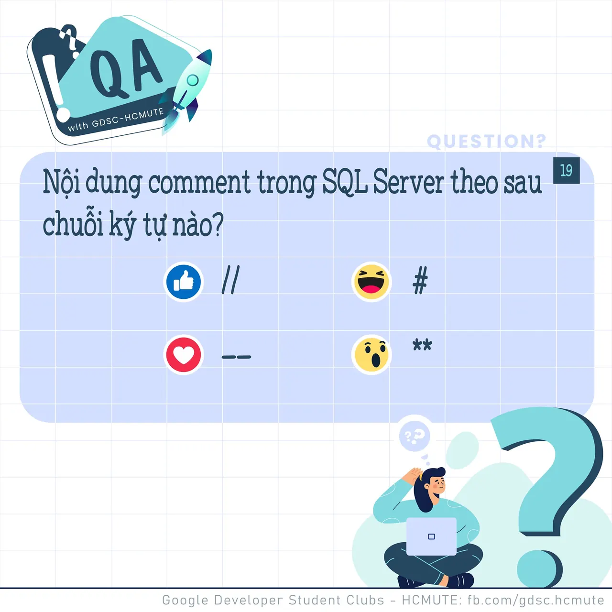

\[QA GDSC - Question\]  
Chào buổi tối mọi người  
 Cùng bắt đầu tháng 10 đầy năng lượng cùng tụi mình với một câu hỏi liên quan đến Database sau đây nhá ^^

<!--truncate-->

  
 𝑵𝒐̣̂𝒊 𝒅𝒖𝒏𝒈 𝒄𝒐𝒎𝒎𝒆𝒏𝒕 𝒕𝒓𝒐𝒏𝒈 𝑺𝑸𝑳 𝑺𝒆𝒓𝒗𝒆𝒓 đ𝒖̛𝒐̛̣𝒄 𝒗𝒊𝒆̂́𝒕 𝒕𝒉𝒆𝒐 𝒔𝒂𝒖 𝒄𝒉𝒖𝒐̂̃𝒊 𝒌𝒚́ 𝒕𝒖̛̣ 𝒏𝒂̀𝒐

  
 Bình tĩnh tự tin và để lại React cũng như Comment để GDSC - HCMUTE chúng mình xem có bao nhiêu bạn vượt qua thử thách lần này nào
  
Đừng quên Like và Follow Page để đón chờ phần Answer được lên sóng vào ngày mai nha  
---------------------------  
QA with GDSC HCMUTE là chuyên mục do GDSC - HCMUTE thực hiện với mong muốn cung cấp các kiến thức và thông tin hữu ích, giúp các bạn có thêm các tips thú vị trong lĩnh vực Công nghệ Thông tin thông qua Question và Answer được lên sóng hàng ngày!
  
 Mọi ý kiến đóng góp, các bạn có thể liên hệ trực tiếp thông qua fanpage Google Developer Student Clubs - HCM UTE: [https://www.facebook.com/gdsc.hcmute](https://www.facebook.com/gdsc.hcmute)
  
\#GDSC #GoogleDeveloperStudentClubs #GDSC\_HCMUTE #GDSC\_QA

---

_Bài viết được lưu trữ từ [fanpage HCMUTE Developer Student Club](https://www.facebook.com/hcmute.dsc)._
