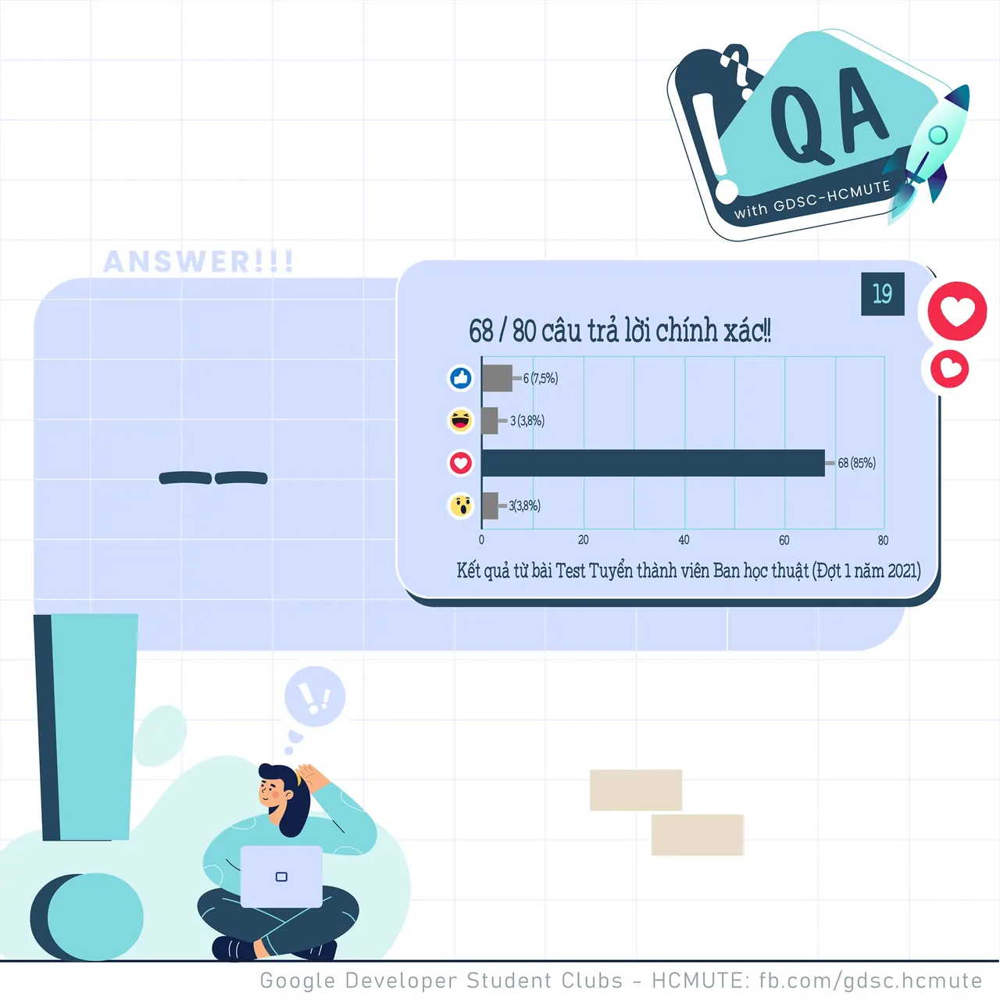

\[QA GDSC - Answer\]
  
Alo alo  
,

<!--truncate-->

  
 Kết thúc 1 tuần làm việc và học tập năng suất với Answer ngày hôm nay nào mọi người ơiiii!

  
 Đáp án chính xác của câu hỏi về comment trong SQL Server hôm qua chính là dấu --

  
 Nội dung comment trong SQL Server được viết theo sau chuỗi ký tự --

  
 Các ký hiệu còn lại “ // ” được dùng trong C/C++, dấu “ # ” được dùng trong python.

  
 Các bạn có suy nghĩ thế nào với đáp án lần này Để lại bình luận bên dưới để Ad cũng như các bạn có thể tham khảo nha ^^  
---------------------------  
QA with GDSC - HCMUTE là chuyên mục do GDSC - HCMUTE thực hiện với mong muốn cung cấp các kiến thức và thông tin hữu ích, giúp các bạn có thêm các tips thú vị trong lĩnh vực Công nghệ Thông tin thông qua Question và Answer được lên sóng hàng ngày!
  
 Mọi ý kiến đóng góp, các bạn có thể liên hệ trực tiếp thông qua fanpage Google Developer Student Clubs - HCM UTE: [https://www.facebook.com/gdsc.hcmute](https://www.facebook.com/gdsc.hcmute)
  
\#GDSC #GoogleDeveloperStudentClubs #GDSC\_HCMUTE #GDSC\_QA

---

_Bài viết được lưu trữ từ [fanpage HCMUTE Developer Student Club](https://www.facebook.com/hcmute.dsc)._
