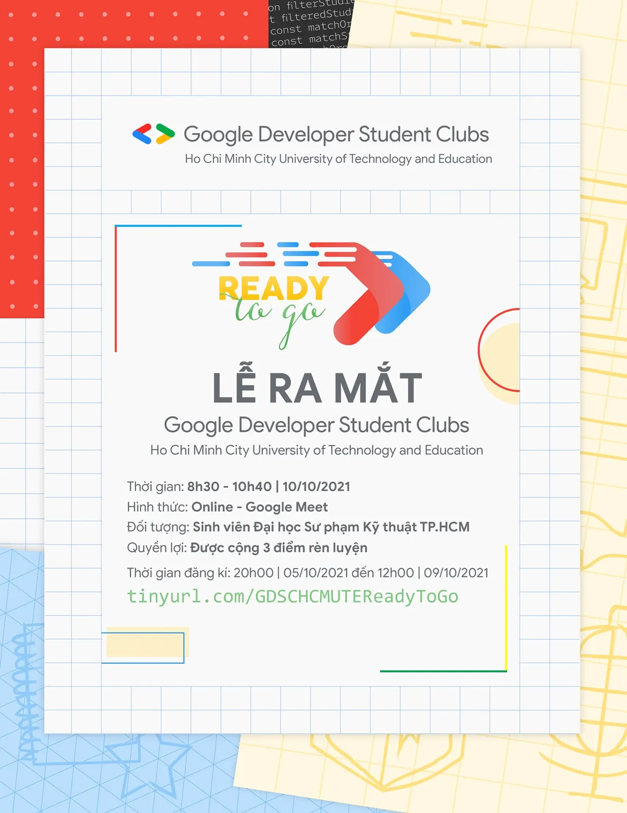

\[CHƯƠNG TRÌNH RA MẮT CÂU LẠC BỘ SINH VIÊN LẬP TRÌNH GOOGLE- HCMUTE | "READY TO GO"\]

<!--truncate-->

  
 Loa loa loa,

  
 Vậy là các bạn Tân Sinh viên cũng đã trải qua tuần học đầu tiên tại ngôi nhà chung HCMUTE rồi. Không biết mọi người có cảm nghĩ như thế nào về việc học tập và thích nghi môi trường đại học này nhỉ

  
 Và với mong muốn tạo cơ hội để các bạn có thể gặp gỡ, trao đổi, cũng như hiểu rõ hơn về CLB Sinh viên Lập trình Google thông qua các hoạt động và quá trình xây dựng CLB cho tới thời điểm hiện tại, GDSC - HCMUTE tụi mình rất vui khi được thông báo về việc tổ chức Chương trình RA MẮT CLB SINH VIÊN LẬP TRÌNH GOOGLE - "𝐑𝐄𝐀𝐃𝐘 𝐓𝐎 𝐆𝐎", chi tiết như sau:

  
 Cách thức tham gia:
  
\- Bước  
: Like Fanpage “Google Developer Student Clubs – HCM UTE” và chia sẻ bài viết ở chế độ công khai kèm hashtag #GDSC #GoogleDeveloperStudentClubs, #GDSC\_HCMUTE, #GDSC\_READYTOGO.
  
\- Bước  
: Kêu gọi tối thiểu 03 người bạn tương tác và tham gia.
  
\- Bước  
: Điền form đăng kí tham gia: [https://tinyurl.com/GDSCHCMUTEReadyToGo](https://tinyurl.com/GDSCHCMUTEReadyToGo)
  
\- Bước  
: Tham gia chương trình bằng cách xem livestream trên facebook fanpage “Google Developer Student Clubs – HCM UTE”.

  
 Thời gian: 8h30, ngày  
 tháng  
 năm  
.

  
 Hình thức: Chương trình trực tuyến: được tổ chức trên nền tảng live stream Facebook Fanpage “Google Developer Student Clubs – HCM UTE”.

  
Đối tượng tham gia: Sinh viên đang theo học tại trường Đại học Sư phạm Kỹ thuật TP.HCM và các trường Đại học - Cao đẳng khác trên toàn quốc.

  
 Số lượng tham gia: không giới hạn.

  
Quyền lợi: Đối với sinh viên theo học tại trường Đại học Sư phạm Kỹ thuật TP. Hồ Chí Minh được cộng 3 điểm rèn luyện khi tham gia chương trình.  
--------------------------  
Câu lạc bộ GDSC trường Đại học Sư phạm Kỹ Thuật TP.HCM vô cùng tự hào và vinh dự là một trong những trường đại học ở Việt Nam, trở thành thành viên mới của ngôi nhà GDSC trên toàn cầu. Với mong muốn tìm kiếm và kết nối các bạn sinh viên có niềm đam mê, yêu thích các công nghệ của Google nói riêng và công nghệ thông tin nói chung. Xây dựng Câu lạc bộ GDSC HCMUTE trở thành câu lạc bộ học thuật dành cho mọi người.
  
\#GDSC #GoogleDeveloperStudentClubs, #GDSC\_HCMUTE, #GDSC\_READYTOGO.
  
 Mọi ý kiến đóng góp, các bạn có thể liên hệ trực tiếp thông qua fanpage Google Developer Student Clubs - HCM UTE: [https://www.facebook.com/gdsc.hcmute](https://www.facebook.com/gdsc.hcmute)

---

_Bài viết được lưu trữ từ [fanpage HCMUTE Developer Student Club](https://www.facebook.com/hcmute.dsc)._
