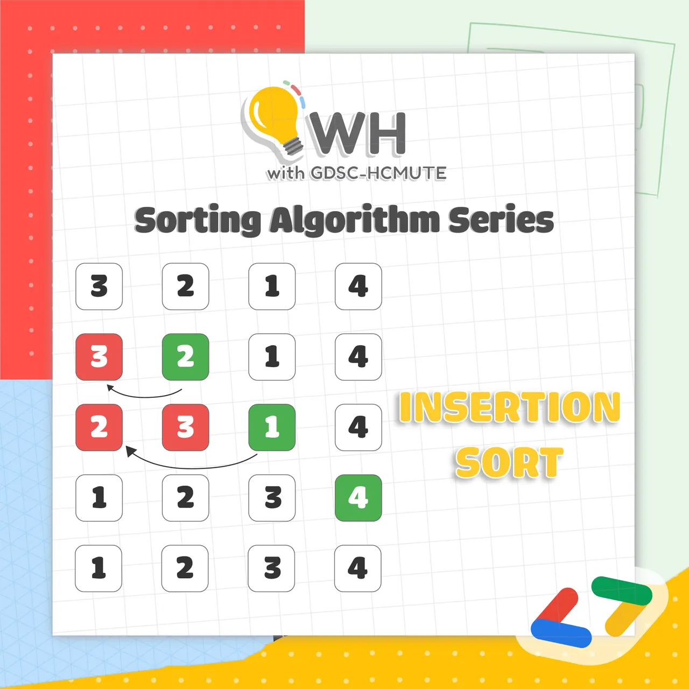

\[GDSC - HCMUTE | WH\]
  
Chào mọi người, chào mọi người

<!--truncate-->

 Chuyên mục WH with GDSC - HCMUTE đã quay trở lại rồi đâyyyyy
  
 Lần này, hãy cùng tụi mình "ngụp lặn" với chuỗi SORT các bạn nhá!
  
Mở đầu với các thông tin về 𝐈𝐍𝐒𝐄𝐑𝐓𝐈𝐎𝐍 𝐒𝐎𝐑𝐓 nào ^^  
----------------------
  
 𝐈𝐧𝐬𝐞𝐫𝐭𝐢𝐨𝐧 𝐬𝐨𝐫𝐭 𝐥𝐚̀ 𝐠𝐢̀?
  
 Sắp xếp chèn là một thuật toán sắp xếp đơn giản hoạt động tương tự như cách bạn sắp xếp các thẻ chơi trong tay.
  
 Mảng hầu như được chia thành một phần được sắp xếp và một phần chưa được sắp xếp. Các giá trị từ phần chưa được sắp xếp được chọn và đặt ở vị trí chính xác trong phần được sắp xếp.
  
 𝐓𝐡𝐮𝐚̣̂𝐭 𝐭𝐨𝐚́𝐧
  
 Thuật toán sắp xếp chèn thực hiện sắp xếp dãy số theo cách duyệt từng phần tử và chèn từng phần tử đó vào đúng vị trí trong mảng con(dãy số từ đầu đến phần tử phía trước nó) đã sắp xếp sao cho dãy số trong mảng sắp đã xếp đó vẫn đảm bảo tính chất của một dãy số tăng dần.
  
 Khởi tạo mảng với dãy con đã sắp xếp có k = 1 phần tử (phần tử đầu tiên, phần tử có chỉ số 0).
  
 Duyệt từng phần tử từ phần tử thứ 2, tại mỗi lần duyệt phần tử ở chỉ số i thì đặt phần tử đó vào một vị trí nào đó trong đoạn từ \[0…i\] sao cho dãy số từ \[0…i\] vẫn đảm bảo tính chất dãy số tăng dần. Sau mỗi lần duyệt, số phần tử đã được sắp xếp k trong mảng tăng thêm 1 phần tử.
  
 Lặp cho tới khi duyệt hết tất cả các phần tử của mảng.
  
 𝐕𝐢́ 𝐝𝐮̣:
  
 Hàng đầu tiên mô phỏng trạng thái ban đầu của mảng (dãy số chưa sắp xếp).
  
 Từ hàng thứ 2 trở đi, ta tìm chèn số đang xét vào vị trí thích hợp để đảm bảo dãy số vẫn tăng dần.
  
 Và khi lặp hết tất cả các số trong mảng, ta có trạng thái đã sắp xếp ở hàng cuối cùng.
  
 𝐂𝐨𝐝𝐞 𝐦𝐢𝐧𝐡 𝐡𝐨̣𝐚:
  
void insertionSort(int arr\[\], int n)  
&#123;  
int i, key, j;  
for (i = 1; i &lt; n; i++)  
&#123;  
key = arr\[i\];  
j = i-1;  
while (j &gt;= 0 && arr\[j\] &gt; key)  
&#123;  
arr\[j+1\] = arr\[j\];  
j = j-1;  
&#125;  
arr\[j+1\] = key;  
&#125;  
&#125;
  
Minh họa thuật toán bằng phần mềm: [https://visualgo.net/en/sorting](https://visualgo.net/en/sorting)
  
 Bạn có thể vào VisuAlgo.
  
 Chọn Insert ở thanh menu bên trên.
  
 Ấn vào nút Create ở phía dưới trang để tạo một dãy mới.
  
 Ấn vào Sort, rồi Go để chạy thuật toán.
  
 𝐔̛𝐮 𝐯𝐚̀ 𝐧𝐡𝐮̛𝐨̛̣𝐜
  
 Ưu điểm: Nếu danh sách đã gần đúng thứ tự, Insertion Sort sẽ chạy rất nhanh. Ví dụ bạn cần sắp xếp Highscore trong game.
  
 Nhược điểm: Độ phức tạp O(n2) không đủ nhanh với dữ liệu lớn.
  
 Đ𝐨̣̂ 𝐩𝐡𝐮̛́𝐜 𝐭𝐚̣𝐩
  
 Trường hợp tốt: O(n)
  
 Trung bình: O(n2)
  
 Trường hợp xấu: O(n2)
  
 Không gian bộ nhớ sử dụng: O(1)
  
--------------------
  
 Hãy để lại comment bên dưới để chúng mình có thể cùng trao đổi và học hỏi thêm các kiến thức các bạn nhá ^^
  
 Mọi ý kiến đóng góp, các bạn có thể liên hệ trực tiếp thông qua fanpage Google Developer Student Clubs - HCM UTE: [https://www.facebook.com/gdsc.hcmute](https://www.facebook.com/gdsc.hcmute)  
\#GDSC #GoogleDeveloperStudentClubs #GDSC\_HCMUTE  
\#WH\_with\_GDSC\_HCMUTE

---

_Bài viết được lưu trữ từ [fanpage HCMUTE Developer Student Club](https://www.facebook.com/hcmute.dsc)._
