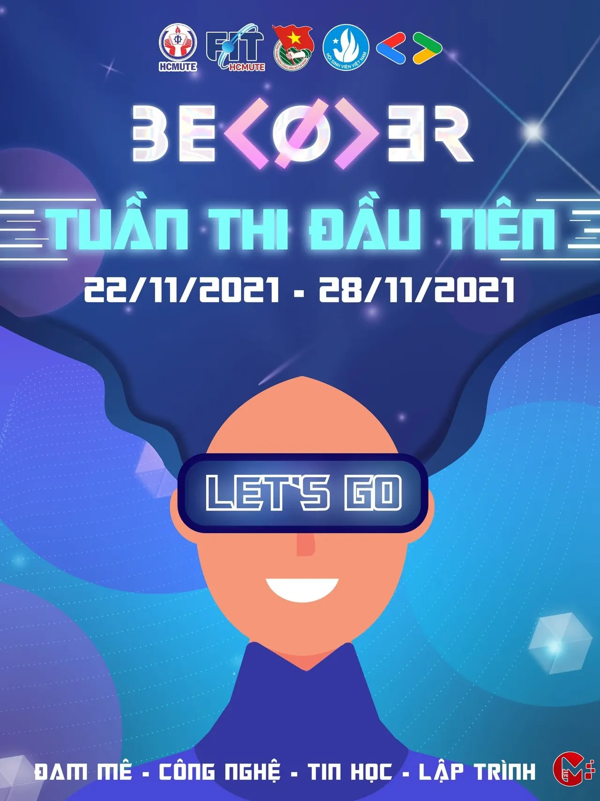

\[beCod3r 2021\]

<!--truncate-->

  
THÔNG BÁO: Tuần 1 BECODER bắt đầu từ 22/11/2021 đến 28/11/2021

  
Các bạn coder ới! Chuẩn bị sức để chạy chưa?  
-----------------------------------------  
Đến hẹn lại lênnnnnnnnnnn!  
Cơ hội thể hiện dành cho bạn trẻ đây rồiii. Còn chần chờ gì nữa, hãy cùng đến với beCod3r thui nào

  
Không để các bạn phải chờ lâu

  
Cuộc thi học thuật beCod3r chính thức khởi động tuần đầu tiên  
/  
/  
 \-  
/  
/  
, hứa hẹn những màn khởi vạch đầy ngoạn mục từ các thí sinh của chúng ta

  
Link khởi động: [https://www.hackerrank.com/becod3r](https://www.hackerrank.com/becod3r)
  
Những đội tham gia cuộc thi đừng quên lịch thi nhé.

  
Chuẩn bị thật tốt để đón chờ vòng sơ loại một vào ngày 28/11/2021 nào  
------------------------------------------  
Đối tượng tham gia : Sinh viên toàn trường ĐH Sư phạm Kỹ thuật TP.HCM đang theo học các khối ngành Công nghệ Thông tin hoặc đam mê lĩnh vực lập trình, tin học, công nghệ.
  
 Cách thức đăng ký: Sinh viên đăng ký tham gia cuộc thi theo đội, mỗi đội gồm 3 thành viên và chọn 1 bảng để dự thi:  
\+ Bảng không chuyên: dành cho sinh viên toàn trường ở tất cả các ngành (trừ sinh viên ngành Công nghệ Thông tin và Kỹ thuật Dữ liệu, riêng sinh viên khóa 2021 ở các ngành trên vẫn được đăng ký dự thi ở bảng này).  
\+ Bảng chuyên: dành cho sinh viên ngành Công nghệ Thông tin và Kỹ thuật Dữ liệu. Tuy nhiên, sinh viên các ngành còn lại vẫn có thể đăng ký dự thi ở bảng này.

  
 Thời gian đăng kí: từ ngày 18-25/11/2021.

  
Sinh viên đăng kí tại link: [https://itute.tiny.us/dk-becod3r](https://itute.tiny.us/dk-becod3r)  
Các đội thi tiến hành tạo tài khoản trên trang online HackerRank bằng tài khoản mail sinh viên.
  
Sau đó, các đội thi đăng nhập vào hệ thống và thực hiện các bài thi theo yêu cầu.

  
 Hình thức thi: Các đội thi sẽ tiến hành lập trình online để giải quyết các bài toán cơ bản và nâng cao khác nhau tương ứng với mỗi bảng. Ngôn ngữ lập trình được lựa chọn là ngôn ngữ C/C++ với 2 vòng thi:
  
\+ Vòng sơ loại: từ 08h00 đến 11h00 ngày 28/11/2021 và ngày 05/12/2021

  
Top 10 đội thi có tổng điểm 2 tuần cao nhất ở mỗi bảng sẽ lọt vào vòng chung kết xếp hạng.
  
\+ Vòng chung kết: Diễn ra vào ngày 12/12/2021. Top 5 đội thi xuất sắc nhất của mỗi bảng sẽ tiến hành làm việc nhóm và giải quyết đề thi mà Ban Tổ chức đưa ra tương ứng với mỗi bảng.

  
Lưu ý: Trong suốt quá trình diễn ra cuộc thi mọi hành vi gian lận, thi hộ, trao đổi với các đội thi khác thì đội thi sẽ bị loại.
  
 Cơ cấu giải thưởng :
  
2 giải Nhất: 1.000.000 đồng/giải.
  
2 giải Nhì: 800.000 đồng/giải.
  
2 giải Ba: 500.000 đồng/giải.
  
4 giải nhất tuần: 100.000 đồng/giải
  
Quyền lợi:  
\+ Cộng điểm rèn luyện theo quy định.  
\+ 3 đội thi xuất sắc nhất ở mỗi bảng sẽ được Ban Tổ chức cấp giấy chứng nhận tham gia cuộc thi học thuật cấp trường.  
------------------------------------------  
Quá thú vị và bổ ích đúng không nào, còn chần chừ gì mà không tham gia ngay thôi các bạn ơi!!

  
Thông tin thể lệ chi tiết xem tại: [https://itute.tiny.us/TheLebeCod3r](https://itute.tiny.us/TheLebeCod3r)
  
 Mọi thắc mắc, xin vui lòng liên hệ:
  
 Số điện thoại - Đ/c Nguyễn Đức Sáng - Trưởng Ban tổ chức [https://www.facebook.com/TheKaitoSang](https://www.facebook.com/TheKaitoSang)
  
 Số điện thoại - Đ/c Bùi Quốc Tĩnh - Thành viên Ban tổ chức  
[https://www.facebook.com/tinhbuiquoc1010](https://www.facebook.com/tinhbuiquoc1010)  
------------------------------------------  
Mọi ý kiến đóng góp, các bạn có thể liên hệ trực tiếp thông qua fanpage Google Developer Student Clubs - HCM UTE: [https://www.facebook.com/gdsc.hcmute](https://www.facebook.com/gdsc.hcmute)
  
\#GDSC #GoogleDeveloperStudentClubs #GDSC\_HCMUTE #beCod3r #BECODER\_2021 #FITUTE

---

_Bài viết được lưu trữ từ [fanpage HCMUTE Developer Student Club](https://www.facebook.com/hcmute.dsc)._
