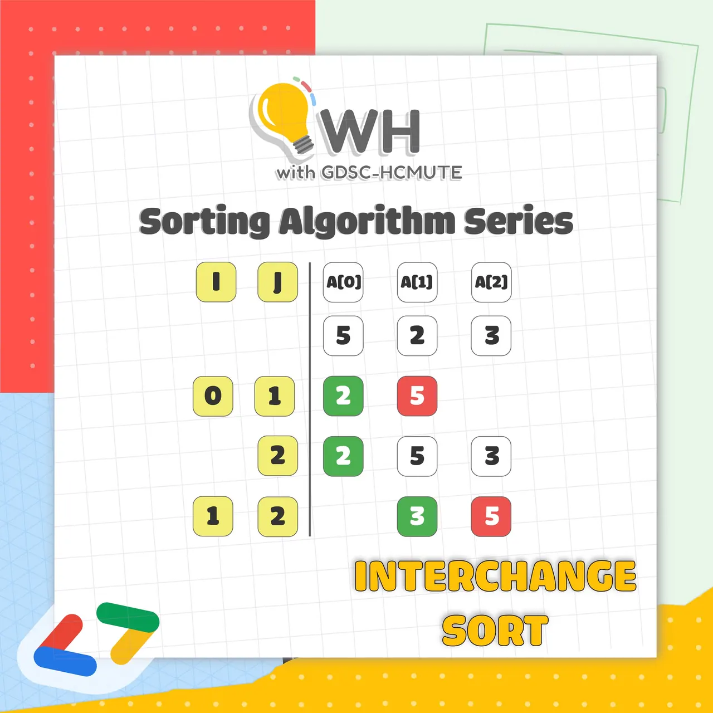

\[GDSC - HCMUTE | WH\]  
Chào mọi người, lại là GDSC và Sorting Algorithm Series đâyyy

<!--truncate-->

Sau khi mở đầu với 𝐈𝐍𝐒𝐄𝐑𝐓𝐈𝐎𝐍 𝐒𝐎𝐑𝐓, thì hôm nay chúng ta cùng tiếp tục với các thông tin về 𝐈𝐍𝐓𝐄𝐑𝐂𝐇𝐀𝐍𝐆𝐄 𝐒𝐎𝐑𝐓 nhé
  
----------------------
  
 𝐈𝐧𝐭𝐞𝐫𝐜𝐡𝐚𝐧𝐠𝐞 𝐬𝐨𝐫𝐭 𝐥𝐚̀ 𝐠𝐢̀?
  
 Như đã biết, để sắp xếp một dãy số, ta có thể xét các nghịch thế có trong dãy và triệt tiêu dần chúng đi. Ý tưởng chính của giải thuật là xuất phát từ đầu dãy, tìm tất cả nghịch thế chứa phần tử này, triệt tiêu chúng bằng … See more

---

_Bài viết được lưu trữ từ [fanpage HCMUTE Developer Student Club](https://www.facebook.com/hcmute.dsc)._
