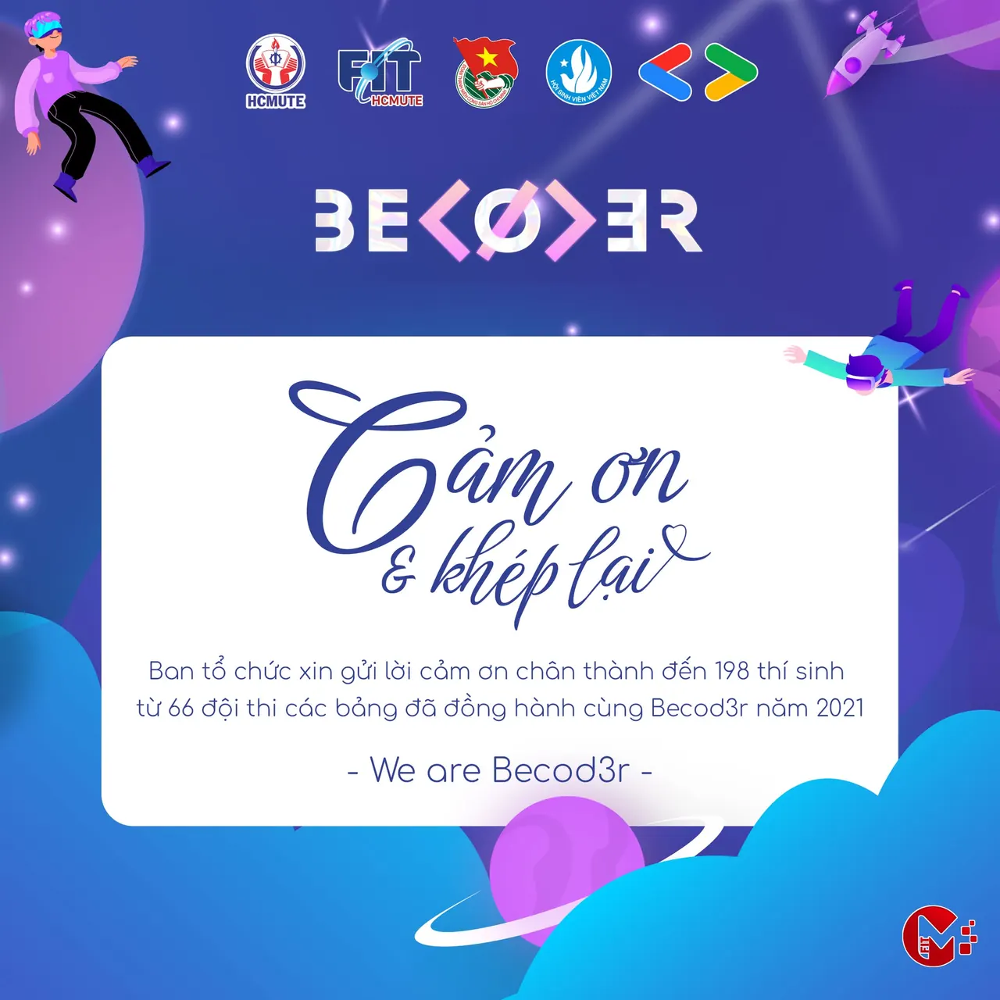

\[Tổng kết beCod3r 2021\]️
  
Như vậy là cuộc thi học thuật mang tên "beCod3r 2021" do Đoàn-Hội Khoa Công nghệ Thông tin kết hợp với CLB Sinh viên Lập trình Google HCMUTE tổ chức đã chính thức khép lại với những phần thi cực kỳ xuất sắc của các đội đến từ Bảng chuyên và Bảng không chuyên

<!--truncate-->

Thật vui mừng và đáng tự hào khi lần đầu tiên tổ chức nhưng cuộc thi học thuật này đã lan rộng đến các bạn sinh viên khối ngành CNTT và cả những ngành khác nữa của trường, thay mặt BTC xin trân trọng cảm ơn các bạn thí sinh đã dành thời gian ôn luyện và chiến đầu hết mình trong những bài thi tuần cũng như phần thi chung kết không kém phần hấp dẫn
  
Chúng mình hi vọng những kiến thức, công nghệ mà cuộc thi mang lại ít nhiều giúp nào đó cũng cố cũng như nâng cao vốn hiểu biết của bản thân, và cũng là kinh nghiệm dành cho các bạn tự tin bước vào những cuộc thi học thuật khác
  
Trong khoảng thời gian cuộc thi diễn ra chắc hẳn không tránh được những sai sót, rất mong nhận được sự thông cảm và góp ý từ các bạn để có sự chuẩn bị tốt hơn trong những cuộc thi tương tự nha.
  
 Chúc các bạn sức khỏe, học tập tốt, giữ tinh thần lạc quan và hẹn gặp lại các bạn ở những cuộc đua tiếp theo
  
\#beCod3r  
\#BECODER\_2021  
\#FITUTE  
\#GDSC\_HCMUTE

---

_Bài viết được lưu trữ từ [fanpage HCMUTE Developer Student Club](https://www.facebook.com/hcmute.dsc)._
