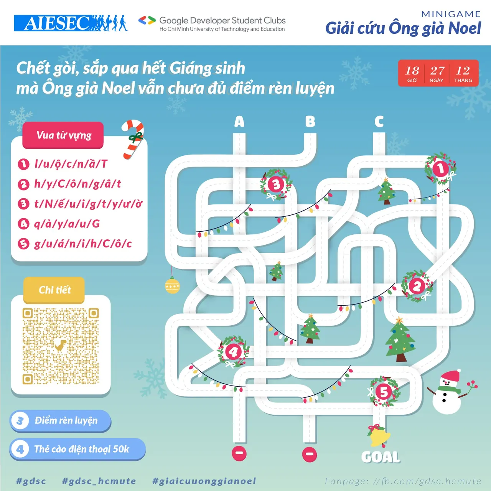

\[MINIGAME\] - GIẢI CỨU ÔNG GIÀ NOEL  
-----------------------------

<!--truncate-->

Chết gòi  
,... Sắp Giáng sinh mà ông già Noel vẫn chưa đủ điểm rèn luyện. Làm sao nhỉ?
  
Tèn tén ten
  
Đừng lo đã có chúng mình rồi đây.
  
 Minigame tổ chức với mục đích tạo ra sân chơi gắn kết, lành mạnh, bổ ích cho các bạn sinh viên cũng như tạo không khí Giáng sinh vui tươi, giải trí sau những giờ học căng thẳng mệt mỏi.
  
 Song song với đó, Minigame “Giải cứu Ông già Noel” cũng chính là mở đầu cho workshop “E-COMMERCE: GAIN FROM GROWTH” - sự kiện do GDSC - HCMUTE và AIESEC in Việt Nam đồng tổ chức. Sự kiện sẽ chính thức diễn ra trong thời gian sắp tới, còn bây giờ cùng tham gia Minigame nóng hổi ngay thôi nàooo…!
  
 THỜI GIAN:
  
 Bắt đầu lúc: 20h00 ngày 25/12/2021
  
 Kết thúc lúc: 18h00 ngày 27/12/2021
  
 Thời gian công bố kết quả: 19h00 ngày 28/12/2021
  
 ĐỐI TƯỢNG THAM GIA: Sinh viên đang theo học tại trường Đại học Sư phạm Kỹ thuật Thành phố Hồ Chí Minh.
  
 QUYỀN LỢI KHI THAM GIA: Sinh viên phá đảo trò chơi sẽ nhận được
  
 3 điểm rèn luyện theo quy định của nhà trường.
  
 Đặc biệt, 4 bạn nhanh nhất và chính xác nhất sẽ nhận được 1 thẻ cào trị giá 50.000 VNĐ.
  
 YÊU CẦU:
  
 Bước 1: Like Fanpage “Google Developer Student Clubs - HCM UTE”
  
 Bước 2: Like và Chia sẻ bài viết ở chế độ công khai kèm hashtag #GDSC\_HCMUTE, #GDSC, #Giaicuuonggianoel
  
 Bước 3: Tag tên 3 bạn cùng chơi vào bài viết
  
 Bước 4: Truy cập link: [https://tinyurl.com/MinigameGiaicuuonggianoel](https://tinyurl.com/MinigameGiaicuuonggianoel), điền thông tin cá nhân và đáp án tìm được của Minigame
  
 LUẬT CHƠI:
  
 Trò chơi dựa trên thuật toán tìm đường đi ngắn nhất. Người chơi tham gia giải mã Minigame bằng cách tìm ra đường đi ngắn nhất trong một mê cung ống khói, để có thể giúp ông già Noel vào được nhà và trao quà Giáng sinh.
  
 Trên đường đi người chơi sẽ gặp các chướng ngại vật (Chướng ngại vật 1, 2, 3, 4 và 5), vượt qua chướng ngại vật bằng cách trả lời một câu hỏi “Vua từ vựng” tương ứng với mỗi chướng ngại vật.
  
 Người chơi phá đảo khi tìm ra được đường đi ngắn nhất đi qua tất cả các chướng ngại vật và vượt qua thành công các chướng ngại vật đó.
  
 CHÚ Ý:
  
 Không thể đi tiếp trên đường đi đã được đi qua.
  
 Đường đi chính xác phải là đường đi ngắn nhất và đi qua hết tất cả các chướng ngại vật, tuy nhiên không cần tuân theo thứ tự của chúng.
  
 Chỉ chấp nhận đáp án đầu tiên, không chấp nhận các đáp án chỉnh sửa.
  
 Merry Christmas! GDSC - HCMUTE xin chúc các bạn sinh viên có mùa Giáng sinh: Ấm áp - an lành - hạnh phúc.
  
 Bật mí, bật mí,...! Đừng quên Like và Follow Page để nhận thông báo sớm nhất cho workshop “E-COMMERCE: GAIN FROM GROWTH" sắp được lên sóng nha!!
  
\#GDSC\_HCMUTE, #GDSC, #Giaicuuonggianoel  
----------------------------------
  
 Mọi ý kiến đóng góp, các bạn có thể liên hệ trực tiếp thông qua fanpage Google Developer Student Clubs - HCM UTE: [https://www.facebook.com/gdsc.hcmute](https://www.facebook.com/gdsc.hcmute)

---

_Bài viết được lưu trữ từ [fanpage HCMUTE Developer Student Club](https://www.facebook.com/hcmute.dsc)._
