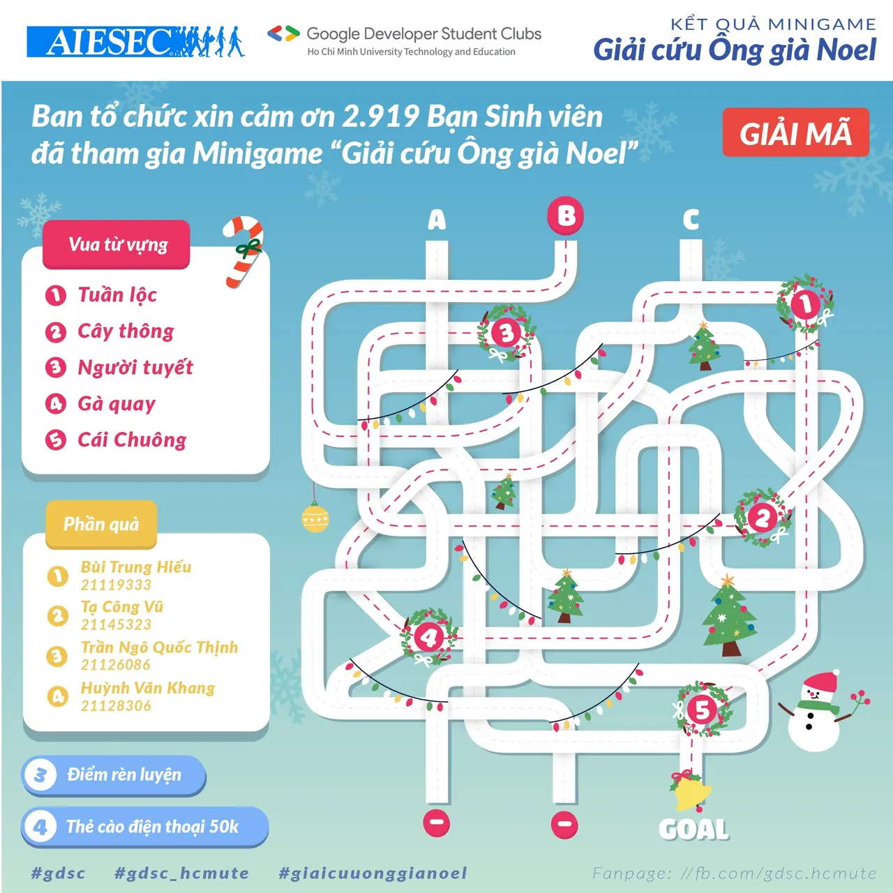

\[KẾT QUẢ MINIGAME\] - GIẢI CỨU ÔNG GIÀ NOEL  
-----------------------------

<!--truncate-->

Sau gần 2 ngày diễn ra Minigame với sự hưởng ứng tích cực và nhiệt tình của các bạn sinh viên toàn trường  
. Chúng mình xin công bố đáp án và chúc mừng 4 bạn nhanh nhất thành công phá đảo Minigame và nhận được phần quà đặc biệt (thẻ cào trị giá 50.000 VNĐ) của chương trình  
:
  
 Bùi Trung Hiếu
  
 Tạ Công Vũ
  
 Trần Ngô Quốc Thịnh
  
 Huỳnh Văn Khang
  
 Qua Minigame "Giải cứu ông già Noel" lần này, BTC mong rằng các bạn đã có thêm trải nghiệm với không khí vui tươi, giải trí sau những giờ học căng thẳng mệt mỏi  
. Đồng thời, đây cũng là mở đầu cho Workshop “E-COMMERCE: GAIN FROM GROWTH” - sự kiện do AIESEC in Vietnam và GDSC - HCMUTE đồng tổ chức. Sự kiện sẽ chính thức diễn ra trong thời gian sắp tới, hứa hẹn sẽ mang đến những trải nghiệm mới lạ, độc đáo về xu hướng hội nhập hiện nay trên khía cạnh thương mại điện tử  
.
  
 Đừng quên Like và Follow Page để nhận thông báo sớm nhất cho Workshop “E-COMMERCE: GAIN FROM GROWTH" sắp được lên sóng nhé!!
  
 BTC rất cảm ơn sự quan tâm và góp phần tạo nên sự lan tỏa cho Minigame lần này của gần 3000 bạn sinh viên!
  
4 bạn may mắn vui lòng liên hệ chúng mình trong khoảng thời gian từ nay đến hết ngày 04/01/2022 để nhận quà nhé!! Chậm trễ là mất quà đó nha!!!
  
\#GDSC\_HCMUTE, #GDSC, #Giaicuuonggianoel, #ecgainfromgrowth  
----------------------------------
  
 Mọi ý kiến đóng góp, các bạn có thể liên hệ trực tiếp thông qua fanpage Google Developer Student Clubs - HCM UTE: [https://www.facebook.com/gdsc.hcmute](https://www.facebook.com/gdsc.hcmute)

---

_Bài viết được lưu trữ từ [fanpage HCMUTE Developer Student Club](https://www.facebook.com/hcmute.dsc)._
