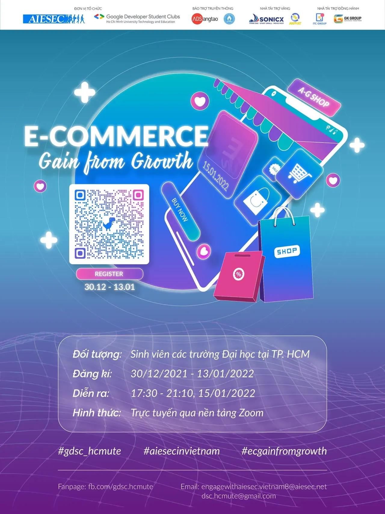

\[CHÍNH THỨC KHỞI ĐỘNG WORKSHOP “E-COMMERCE: GAIN FROM GROWTH”\]
  
➤ Đăng ký tại đây: [https://tinyurl.com/ECGFGFanpage](https://tinyurl.com/ECGFGFanpage)

<!--truncate-->

➤ Sổ tay thông tin: [https://tinyurl.com/ECSoTaySuKien](https://tinyurl.com/ECSoTaySuKien)  
➤ Tham gia Group sự kiện tại: [https://www.facebook.com/groups/ecgainfromgrowth](https://www.facebook.com/groups/ecgainfromgrowth)  
---------------------------------------------------  
Trước sự phát triển như vũ bão của công nghệ thông tin cùng cuộc cách mạng công nghiệp 4.0, ngành Thương mại điện tử (E-Commerce) đã và đang trở thành một xu hướng phát triển của thời đại. Thương mại điện tử cho phép việc kinh doanh thương mại vượt qua những rào cản địa lý và cho phép các doanh nghiệp, cá nhân có thể mua sản phẩm bất cứ lúc nào và từ bất cứ đâu. Thị trường trực tuyến cho phép người bán có thể mở những gian hàng trên mạng internet để mọi khách hàng có thể đến tham quan.
  
Với những sự tiện lợi đó, Thương mại điện tử ngày càng trở nên “Siêu Hot” cũng như phổ biến và phát triển trong thời đại công nghệ hiện nay. Chính vì thế mà cơ hội việc làm của ngành cũng được rất nhiều các bạn trẻ quan tâm và chú ý tới. Vậy:
  
➤ Cơ hội và thách thức trong ngành là gì ?  
➤ Những điều mà các Doanh nghiệp, nhà tuyển dụng yêu cầu ở một bạn trẻ “Chân ướt chân ráo” vào ngành là gì ?  
➤ Những kỹ năng quan trọng nào cần có để trở thành một nhân sự tốt trong ngành Thương mại điện tử ?
  
Thấu hiểu được những điều này, Workshop “E-Commerce: Gain from Growth” được tổ chức để kết nối các bạn trẻ với các Diễn giả có kinh nghiệm trong nghề, qua đó giúp các bạn trang bị thêm những kiến thức, kỹ năng cho mình và giải đáp thắc mắc của các bạn về những vấn đề mà các bạn quan tâm.  
---------------------------------------------------  
Workshop “E-Commerce: Gain from Growth” là sự kiện được đồng tổ chức bởi AIESEC in Vietnam và Google Developer Student Clubs - HCMUTE trực thuộc trường Đại học Sư phạm Kỹ thuật TPHCM nhằm mục đích tạo không gian chia sẻ để các bạn sinh viên có cơ hội hiểu hơn về ngành Thương mại điện tử, giúp các bạn tìm ra được mảng công việc phù hợp với năng lực của bản thân cũng như những cơ hội, thách thức và kỹ năng cần có để trang bị tốt cho ngành.  
---------------------------------------------------  
THÔNG TIN VỀ WORKSHOP:  
➤ Đối tượng: Sinh viên trường Đại học Sư phạm Kỹ thuật TPHCM và các trường Đại học khác trên địa bàn TPHCM  
➤ Quyền lợi: Sinh viên trường Đại học Sư phạm Kỹ thuật TPHCM tham gia sẽ được cộng điểm rèn luyện theo quy định  
➤ Hạn chót mở đơn đăng ký: 23h59 ngày 13/01/2022  
➤ Thời gian diễn ra sự kiện: 17h30 ngày 15/01/2022  
➤ Hình thức: Trực tuyến qua nền tảng Zoom  
➤ Phí tham gia: Miễn phí  
➤ Liên hệ:  
&gt; Trưởng ban tổ chức (Ms.Hoài Thương) hoặc (Mr.Minh Quân)  
&gt; Email: engagewithaiesec.vietnam8@aiesec.net  
\#gdsc\_hcmute, #aiesecinvietnam, #ecgainfromgrowth

---

_Bài viết được lưu trữ từ [fanpage HCMUTE Developer Student Club](https://www.facebook.com/hcmute.dsc)._
