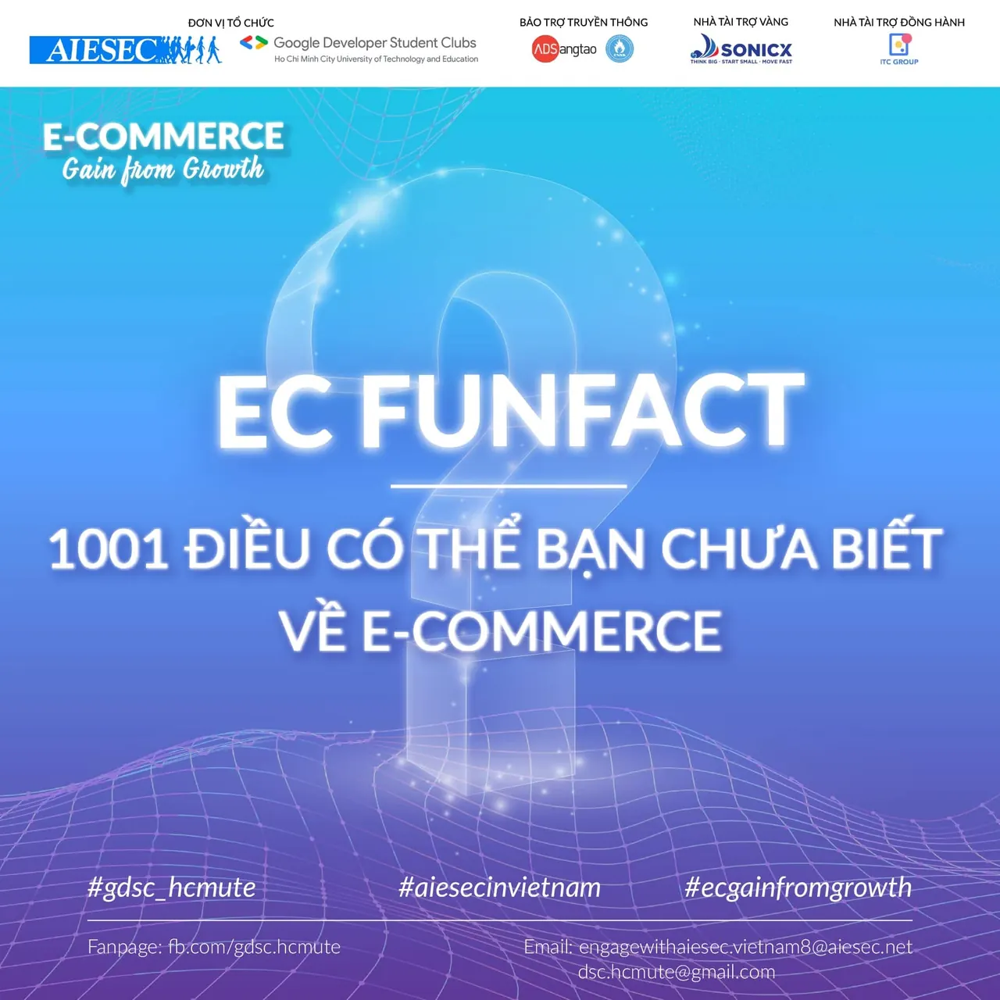

\[EC FUNFACT - 1001 ĐIỀU CÓ THỂ BẠN CHƯA BIẾT VỀ E-COMMERCE\]
  
 Xin chào các bạn, vậy là sau một khoảng thời gian “ấp ủ” thì Workshop: “E-Commerce: Gain from Growth” cũng đã chính thức được ra mắt với mong muốn đem lại cho mọi người những điều bổ ích nhất về Thương mại điện tử (E-Commerce). Trong lúc chờ Workshop lên sóng, hãy cùng chúng mình ngó xem thử 10 fun fact của Thương mại điện tử để thư giãn và lượm lặt những kiến thức thú vị nhé!!!

<!--truncate-->

\1. Thương mại điện tử là ngành kinh doanh phát triển nhanh nhất - ai cũng biết điều đó, vì nó giúp khách hàng tiết kiệm thời gian và công sức của họ.
  
\2. Theo nghiên cứu, người Việt có sở thích săn hàng giảm giá trong giờ hành chính, có lẽ là để giảm stress trong công việc.
  
\3. Shopee, Lazada và Tiki chính là 3 anh em khác cha khác mẹ đang làm mưa làm gió thị trường TMĐT hiện nay.
  
\4. Theo khảo sát, có đến 55% người tiêu dùng mua sắm online ở độ tuổi 18-29, trong đó 63% là phụ nữ, 65% là nhân viên văn phòng, 70% có thu nhập cao.
  
\5. Tiền thân là hệ thống bán sách, Amazon hiện nay đang là Tập đoàn bán lẻ lớn nhất thế giới.
  
\6. Tổng doanh thu thông qua LazLive tăng gấp 8 lần so với cùng kỳ năm 2020 và lập kỷ lục với doanh thu 700 triệu đồng, được ghi nhận chỉ trong 2 giờ livestream vào "Lễ hội mua sắm 9.9".
  
\7. Sàn TMĐT đa ngành Shopee Việt Nam đánh dấu quý thứ 12 dẫn đầu về lượt truy cập website với 73 triệu lượt truy cập trong quý II/2021, tăng 9,2 triệu lượt so với Quý I/2021.
  
\8. Việt Nam là quốc gia có chi phí mua các mặt hàng bách hóa rẻ thứ hai trong khu vực Đông Nam Á.
  
\9. Theo một báo cáo nghiên cứu cho biết Việt Nam được dự báo sẽ là thị trường thương mại điện tử phát triển nhanh nhất ở Đông Nam Á vào năm 2026, với tổng giá trị hàng hóa thương mại điện tử (GMV) đạt 56 tỷ USD, gấp 4,5 lần giá trị ước tính vào năm 2021.
  
\10. Nếu bạn muốn có thêm kiến thức và trải nghiệm về Thương mại điện tử cũng như các kỹ năng trong ngành, bạn nên tham gia Workshop: “E-Commerce: Gain from growth”.
  
---------------------------------------------------
  
 Workshop “E-Commerce: Gain from Growth” là sự kiện được đồng tổ chức bởi AIESEC in Vietnam và Google Developer Student Clubs - HCMUTE trực thuộc trường Đại học Sư phạm Kỹ thuật TPHCM nhằm mục đích tạo không gian chia sẻ để các bạn sinh viên có cơ hội hiểu hơn về ngành Thương mại điện tử, giúp các bạn tìm ra được mảng công việc phù hợp với năng lực của bản thân cũng như những cơ hội, thách thức và kỹ năng cần có để trang bị tốt cho ngành.  
---------------------------------------------------  
THÔNG TIN VỀ WORKSHOP:  
➤ Đối tượng: Sinh viên trường Đại học Sư phạm Kỹ thuật TPHCM và các trường Đại học khác trên địa bàn TPHCM  
➤ Hạn chót mở đơn đăng ký: 23h59 ngày 13/01/2022  
➤ Thời gian diễn ra sự kiện: 17h30 ngày 15/01/2022  
➤ Hình thức: Trực tuyến qua nền tảng Zoom  
➤ Phí tham gia: Miễn phí  
➤ Đơn đăng ký tham gia: [https://tinyurl.com/ECGFGFanpage](https://tinyurl.com/ECGFGFanpage)  
➤ Sổ tay thông tin: [https://tinyurl.com/ECSoTaySuKien](https://tinyurl.com/ECSoTaySuKien)  
➤ Tham gia Group sự kiện tại: [https://www.facebook.com/groups/ecgainfromgrowth](https://www.facebook.com/groups/ecgainfromgrowth)  
➤ Liên hệ:  
&gt; Trưởng ban tổ chức (Ms.Hoài Thương) hoặc (Mr.Minh Quân)  
&gt; Email: engagewithaiesec.vietnam8@aiesec.net  
\#gdsc\_hcmute, #aiesecinvietnam, #ecgainfromgrowth

---

_Bài viết được lưu trữ từ [fanpage HCMUTE Developer Student Club](https://www.facebook.com/hcmute.dsc)._
