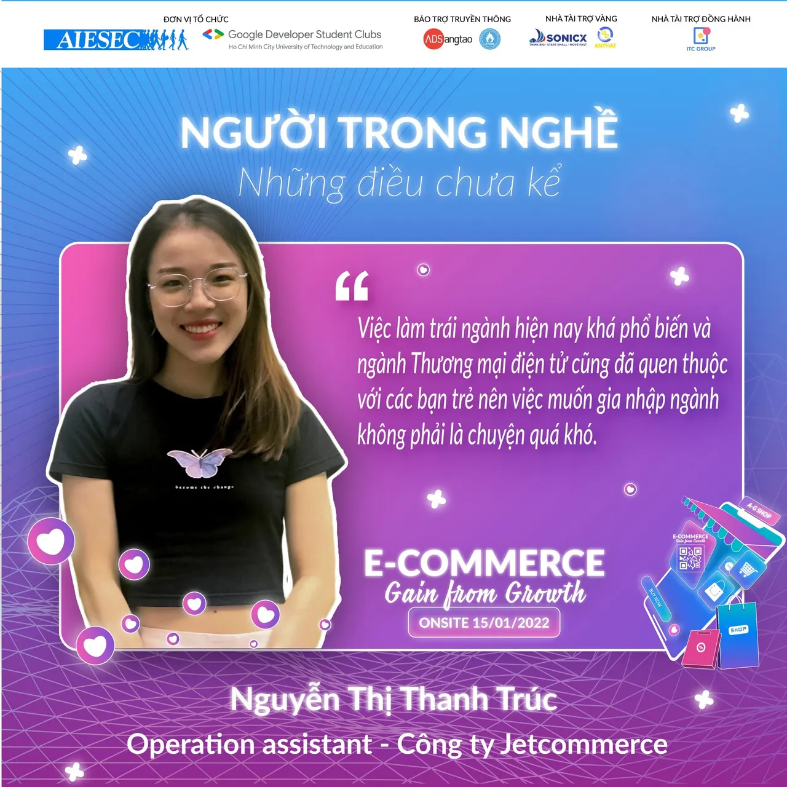

\[NGƯỜI TRONG NGHỀ - NHỮNG ĐIỀU CHƯA KỂ\]  
--------------------------------------------

<!--truncate-->

“Khi thiết tha yêu nghề, nghề sẽ không bao giờ phụ ta, hơn thế nữa, nghề còn vô tư đem niềm vui và vinh dự cho ta nữa. Khi không có lòng yêu nghề, xin đừng bao giờ đòi hỏi nghề mang lại cho ta bất cứ điều gì. Đó là lẽ công bằng của muôn thuở.”
  
Chắc chắn tất cả chúng ta đều đã từng 1 lần đi shopping trên mạng hay ít nhất đã từng nghe qua về cụm từ “Thương mại điện tử”. Vậy có thật Thương mại điện tử chỉ đơn giản là “Mua sắm qua mạng” hay “Mua hàng online” ? Hãy cùng chị Thanh Trúc - một người chị đã có kinh nghiệm trong nghề chia sẻ một chút cho chúng ta về nghề và ngành này nhé !!!
  
\[BTC\] Theo như chúng em được biết thì chị đã có kinh nghiệm khá lâu trong ngành Thương mại điện tử rồi, vậy chị nghĩ thế nào khi hiện nay, nhắc đến Thương mại điện tử mình chỉ đơn giản hiểu nó là “Mua sắm online” ?  
➤ Khái niệm này đúng nhưng chưa đủ, Thương mại điện tử là quá trình mua bán/hoạt động thương mại bằng các phương tiện điện tử. Như vậy, TMĐT bao gồm các hoạt động truyền thống, thương mại dịch vụ và đặc biệt là thương mại hàng hóa.
  
\[BTC\] Theo chị thì một bạn sinh viên học trái ngành Thương mại điện tử muốn gia nhập vào ngành thì bạn ấy sẽ cần những tố chất gì và cần những kỹ năng gì ?  
➤ Việc làm trái ngành hiện nay khá phổ biến và ngành Thương mại điện tử cũng đã quen thuộc với các bạn trẻ nên việc muốn gia nhập ngành không phải là chuyện quá khó. Chị nghĩ đầu tiên các bạn phải kiên trì học hỏi, linh hoạt theo sự phát triển nhanh chóng của thị trường, ngoài ra thì kỹ năng lập kế hoạch và xử lý tình huống cũng rất quan trọng trong ngành này.
  
\[BTC\] Chị cảm thấy thế nào khi lần này được đồng hành cùng với Workshop “E-Commerce: Gain from growth” với tư cách là diễn giả - một vai trò quan trọng trong sự kiện, người mang kiến thức đến cho các bạn sinh viên ?  
➤ Chị cảm thấy đây là 1 sự kiện rất hay và bổ ích để các bạn sinh viên bước đầu được tìm hiểu về ngành TMĐT. Với tư cách là diễn giả, chị sẽ cố gắng chọn lọc và gửi đến các bạn những kiến thức cô đọng, hữu ích nhất để giúp các bạn tự tin hơn trên con đường sắp tới của mình.  
---------------------------------------------------  
Workshop “E-Commerce: Gain from Growth” là sự kiện được đồng tổ chức bởi AIESEC in Vietnam và Google Developer Student Clubs - HCMUTE trực thuộc trường Đại học Sư phạm Kỹ thuật TPHCM nhằm mục đích tạo không gian chia sẻ để các bạn sinh viên có cơ hội hiểu hơn về ngành Thương mại điện tử, giúp các bạn tìm ra được mảng công việc phù hợp với năng lực của bản thân cũng như những cơ hội, thách thức và kỹ năng cần có để trang bị tốt cho ngành.  
---------------------------------------------------  
THÔNG TIN VỀ WORKSHOP:  
➤ Đối tượng: Sinh viên trường Đại học Sư phạm Kỹ thuật TPHCM và các trường Đại học khác trên địa bàn TPHCM  
➤ Hạn chót mở đơn đăng ký: 23h59 ngày 13/01/2022  
➤ Thời gian diễn ra sự kiện: 17h30 ngày 15/01/2022  
➤ Hình thức: Trực tuyến qua nền tảng Zoom  
➤ Phí tham gia: Miễn phí  
➤ Đơn đăng ký tham gia: [https://tinyurl.com/ECGFGFanpage](https://tinyurl.com/ECGFGFanpage)  
➤ Sổ tay thông tin: [https://tinyurl.com/ECSoTaySuKien](https://tinyurl.com/ECSoTaySuKien)  
➤ Tham gia Group sự kiện tại: [https://www.facebook.com/groups/ecgainfromgrowth](https://www.facebook.com/groups/ecgainfromgrowth)  
➤ Liên hệ:  
&gt; Trưởng ban tổ chức (Ms.Hoài Thương) hoặc (Mr.Minh Quân)  
&gt; Email: engagewithaiesec.vietnam8@aiesec.net  
\#gdsc\_hcmute, #aiesecinvietnam, #ecgainfromgrowth

---

_Bài viết được lưu trữ từ [fanpage HCMUTE Developer Student Club](https://www.facebook.com/hcmute.dsc)._
