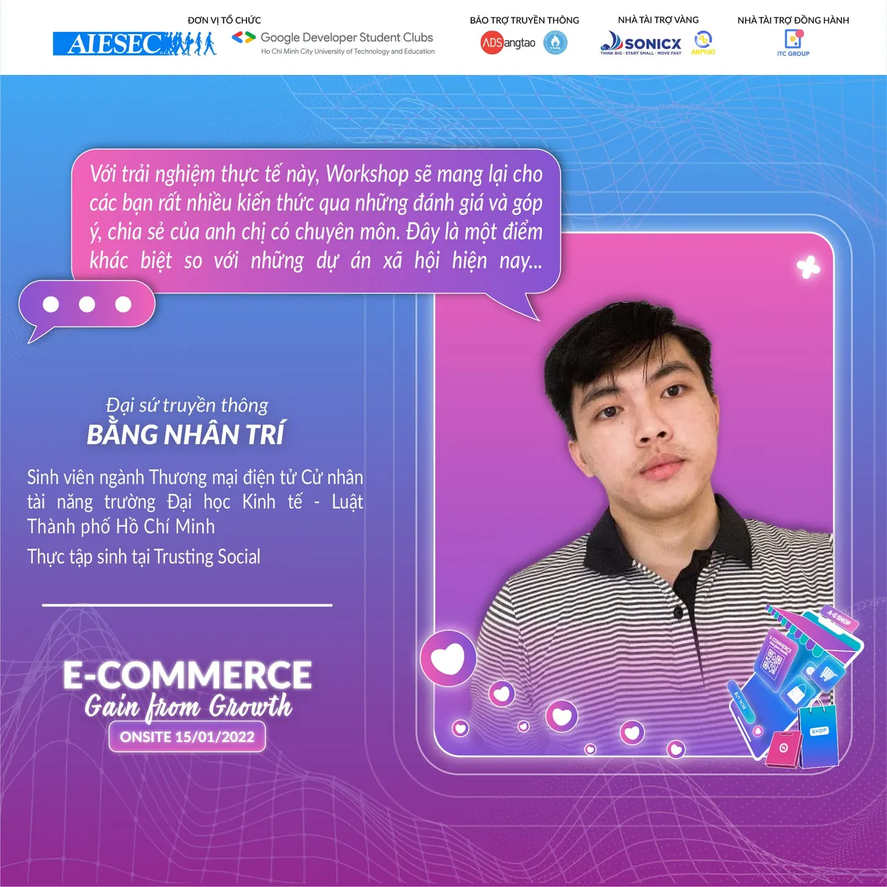
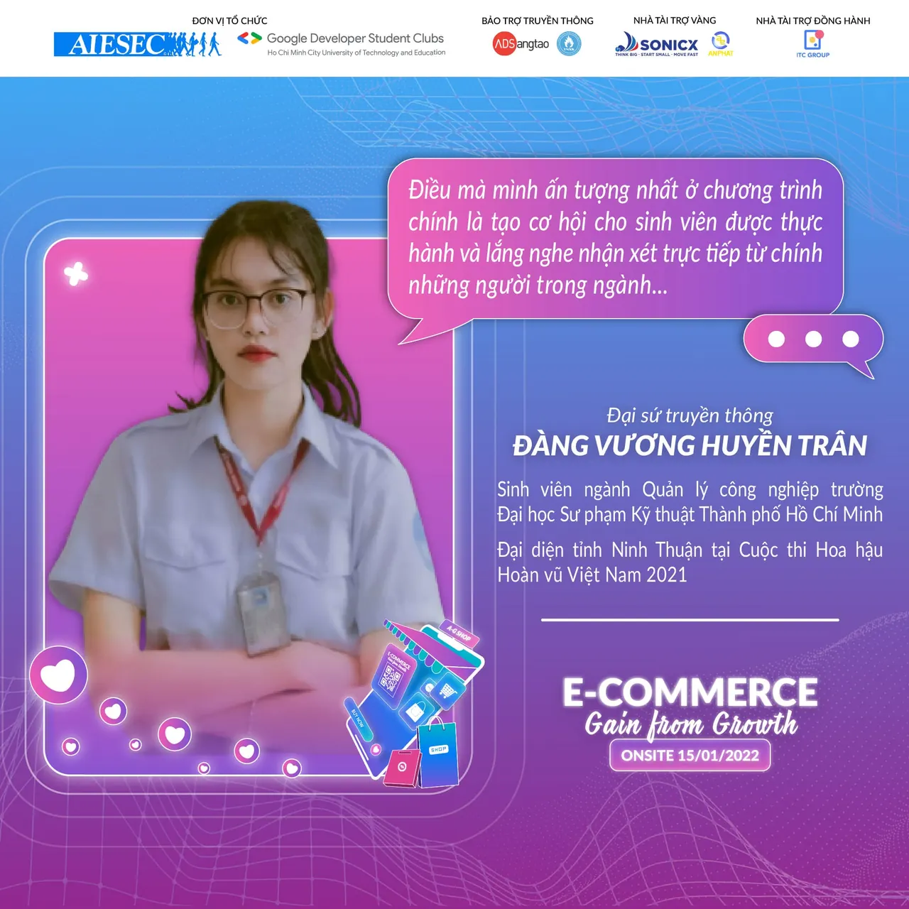
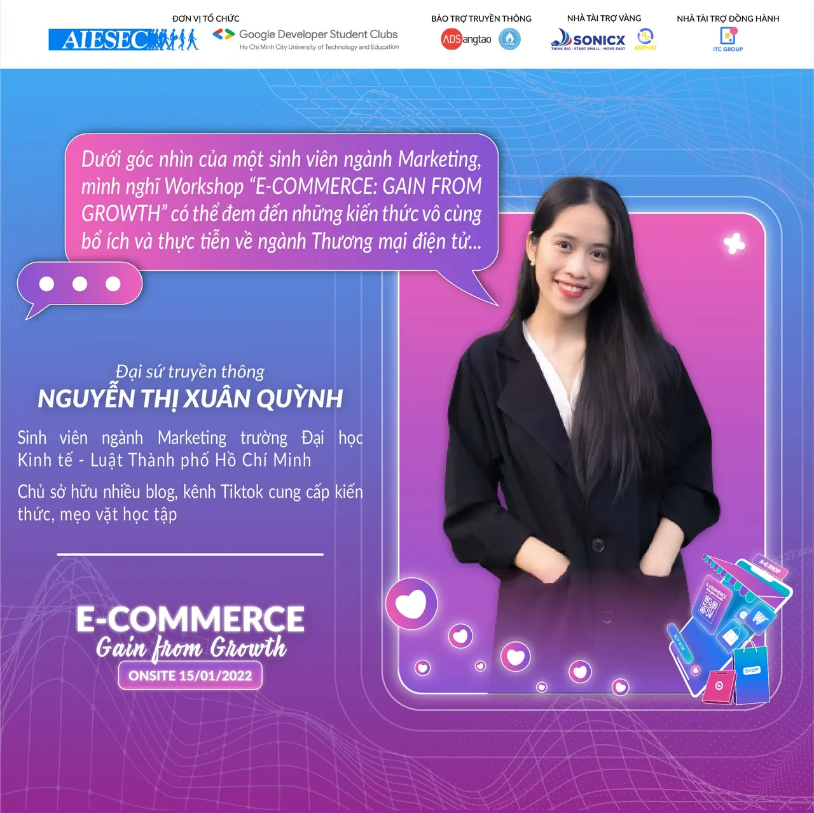
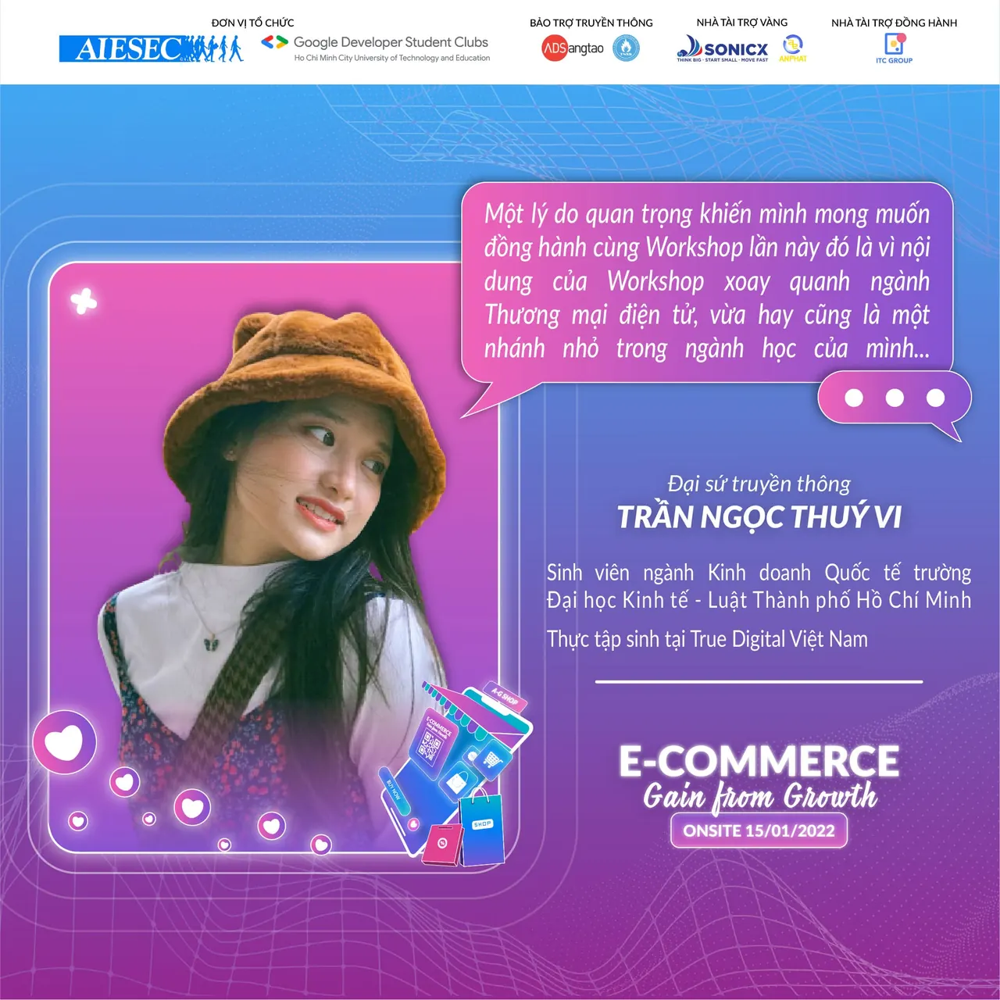

Bạn Đàng Vương Huyền Trân (Sinh viên năm 3 ngành Quản lý công nghiệp trường Đại học Sư phạm Kỹ thuật Tp. Hồ Chí Minh) - Đại diện tỉnh Ninh Thuận tại cuộc thi Hoa hậu Hoàn vũ Việt Nam năm 2021.
  
Q: Trước đây AIESEC đã từng có cơ hội hợp tác với chị trong một cuộc thi về Marketing. Không biết trong lời mời hợp tác lần này, với một chương trình về Thương mại điện tử, chị cảm thấy thế nào

<!--truncate-->

A: Đầu tiên, Trân rất vui khi được tiếp tục đồng hành cùng mọi người trong Workshop E-COMMERCE “GAIN FROM GROWTH”, chủ đề lần này đối với chị là một chủ đề rất thú vị và chị rất mong chờ nó.
  
Q: Vậy với sự hợp tác lần này, chị nghĩ Workshop “E-COMMERCE: GAIN FROM GROWTH” có thể đem lại những gì cho các bạn sinh viên Chị ấn tượng nhất với điều gì trong số đó
  
A: Với sự hợp tác lần này, chị nghĩ Workshop “E-COMMERCE: GAIN FROM GROWTH” sẽ đem lại rất nhiều điều bổ ích cho các bạn sinh viên năm 1,2,3 như chị vì chương trình tạo không gian chia sẻ để các bạn sinh viên có cơ hội hiểu hơn về ngành Thương mại điện tử, giúp các bạn tìm ra được mảng công việc phù hợp với năng lực của bản thân cũng như những cơ hội, thách thức và kỹ năng cần có để trang bị tốt cho ngành nói riêng và các ngành kinh tế khác nói chung. Thứ hai là đem đến cái nhìn rõ hơn về những cơ hội và thách thức trong ngành Thương mại điện tử thông qua phiên thảo luận giữa diễn giả, nhà tài trợ và sinh viên. Điều mà chị ấn tượng nhất ở chương trình chính là tạo cơ hội cho sinh viên được thực hành và lắng nghe nhận xét trực tiếp từ chính những người trong ngành, nhận biết và rút kinh nghiệm để rèn luyện những kỹ năng mềm cần thiết khi làm việc trong lĩnh vực Thương mại điện tử.
  
Q: Khi nhắc đến Thương mại điện tử, chị có nghĩ đó chỉ đơn giản là mua sắm online qua mạng không Nếu không, theo chị Thương mại điện tử sẽ còn bao gồm những gì
  
A: Khi nhắc đến Thương mại điện tử lần đầu, chị cũng nghĩ giống mọi người là chỉ đơn giản là mua sắm online qua mạng. Nhưng chị đã từng tìm hiểu khái quát về nó và phát hiện là ngành này rộng và thú vị hơn chị tưởng tượng. Thương mại điện tử, tên tiếng anh là Electronic Commerce (EC), là một thuật ngữ liên quan tới việc mua bán, trao đổi hàng hóa, dịch vụ thông qua mạng Internet và thanh toán bằng nhiều hình thức khác nhau như Internet Banking, giao dịch trực tiếp với người vận chuyển… Các giao dịch này thường được tiến hành giữa các nhóm đối tượng khác nhau, có thể là doanh nghiệp với doanh nghiệp, doanh nghiệp với người tiêu dùng, người tiêu dùng với người tiêu dùng hoặc người tiêu dùng với doanh nghiệp, có các hình thức thương mại điện tử phổ biến nhất hiện nay mà chị tìm hiểu được bao gồm B2B (doanh nghiệp tới doanh nghiệp), B2C (doanh nghiệp tới người tiêu dùng), C2B (người tiêu dùng tới doanh nghiệp) và C2C (người tiêu dùng với người tiêu dùng). Ngoài ra ở một số khu vực còn áp dụng các hình thức thương mại điện tử khác như G2C (chính phủ tới người tiêu dùng), C2G (người tiêu dùng tới chính phủ), B2E (doanh nghiệp tới nhà tuyển dụng)...

---

_Bài viết được lưu trữ từ [fanpage HCMUTE Developer Student Club](https://www.facebook.com/hcmute.dsc)._
