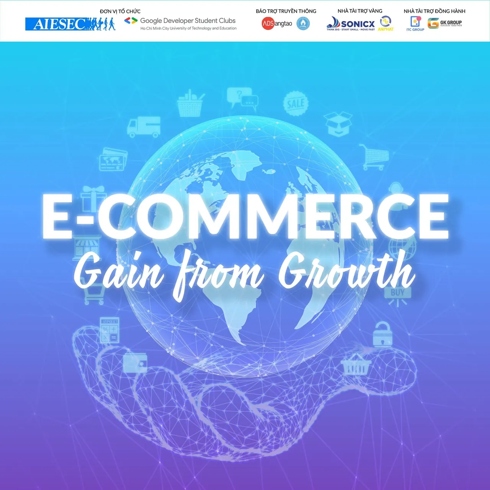
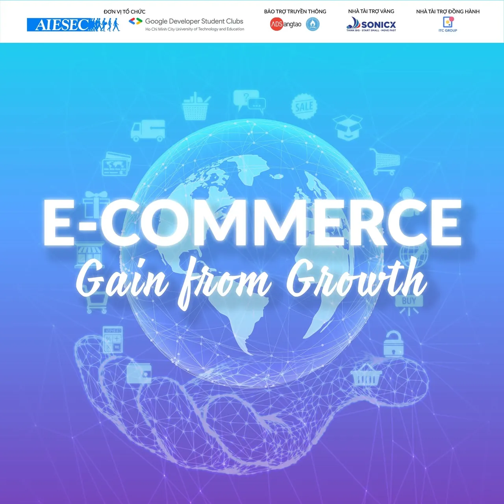

Shared with Public  
Workshop “E-Commerce: Gain from Growth” là sự kiện được đồng tổ chức bởi AIESEC in Vietnam và Google Developer Student Clubs - HCMUTE trực thuộc trường Đại học Sư phạm Kỹ thuật TPHCM nhằm mục đích tạo không gian chia sẻ để các bạn sinh viên có cơ hội hiểu hơn về ngành Thương mại điện tử, giúp các bạn tìm ra được mảng công việc phù hợp với năng lực của bản thân cũng như những cơ hội, thách thức và kỹ năng cần có để trang bị tốt cho ngành.

<!--truncate-->

---------------------------------------------------  
THÔNG TIN VỀ WORKSHOP:  
➤ Đối tượng: Sinh viên trường Đại học Sư phạm Kỹ thuật TPHCM và các trường Đại học khác trên địa bàn TPHCM  
➤ Quyền lợi: Sinh viên trường Đại học Sư phạm Kỹ thuật TPHCM tham gia sẽ được cộng điểm rèn luyện theo quy định  
➤ Hạn chót mở đơn đăng ký: 23h59 ngày 13/01/2022  
➤ Thời gian diễn ra sự kiện: 17h30 ngày 15/01/2022  
➤ Hình thức: Trực tuyến qua nền tảng Zoom  
➤ Phí tham gia: Miễn phí  
➤ Liên hệ:  
&gt; Trưởng ban tổ chức (Ms.Hoài Thương) hoặc (Mr.Minh Quân)  
&gt; Email: engagewithaiesec.vietnam8@aiesec.net  
\#gdsc\_hcmute, #aiesecinvietnam, #ecgainfromgrowth

---

_Bài viết được lưu trữ từ [fanpage HCMUTE Developer Student Club](https://www.facebook.com/hcmute.dsc)._
