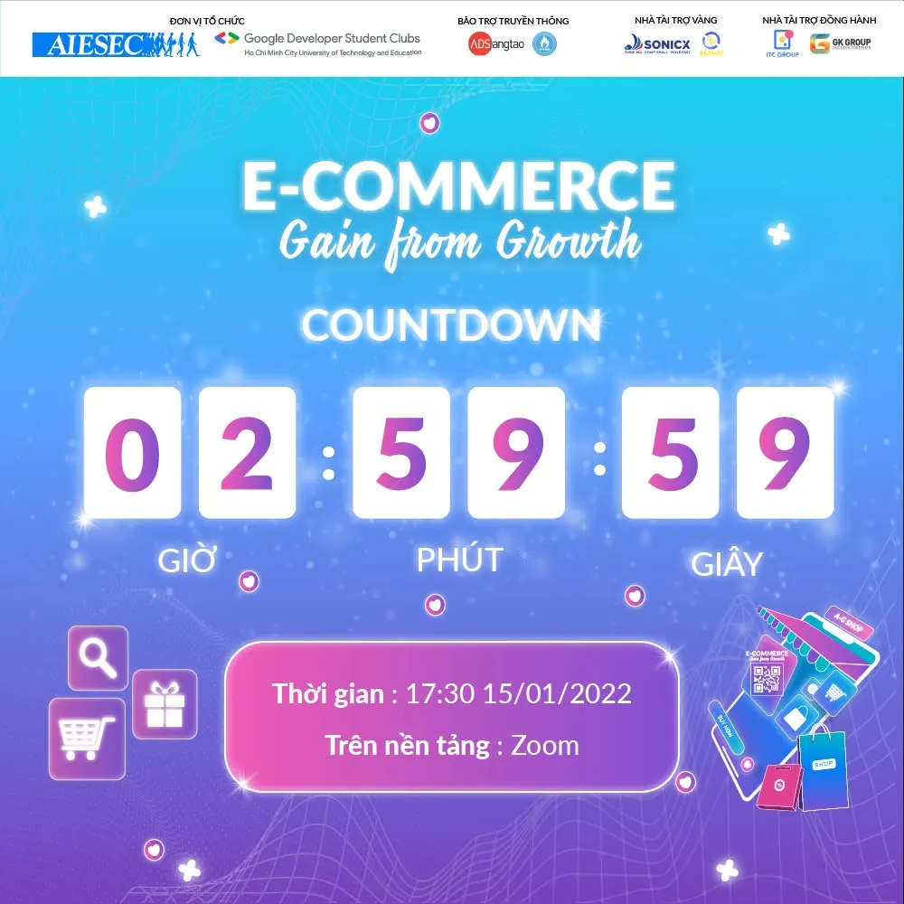

WORKSHOP “E-COMMERCE: GAIN FROM GROWTH” || 3 GIỜ TRƯỚC SỰ KIỆN
  
Chỉ còn đúng 3 tiếng nữa là workshop "E-Commerce: Gain from Growth" mà các bạn luôn mong chờ bấy lâu sẽ chính thức được bắt đầu. Theo dự tính chương trình sẽ diễn ra từ 17h30 đến 21h00 nên các bạn nhớ chuẩn bị đồ ăn nhẹ cùng với giấy bút để có thể tận hưởng buổi workshop được trọn vẹn hơn nhé. Các bạn đã chuẩn bị sẵn tinh thần và những thắc mắc cần được giải đáp để hỏi các diễn giả khi tham gia chưa nào?

<!--truncate-->

Các bạn đã đăng ký thành công đừng quên kiểm tra Email để nắm được những thông tin về buổi workshop chiều nay nhé. Thông tin chi tiết và cách thức tham dự workshop đã được ban tổ chức gửi đến các bạn thông qua Email đăng ký sự kiện (bạn có thể tìm trong mục thư spam nếu không thấy ở hộp thư đến), nếu vẫn chưa nhận được thư mời tham dự các bạn vui lòng liên hệ ngay Fanpage để được hỗ trợ kịp thời nhé.
  
Thêm một lưu ý nhỏ, khi tham gia workshop các bạn sẽ cần bật cam để tương tác nên các bạn nhớ chuẩn bị visual thật xinh xẻo, tải về sử dụng background chương trình và biết đâu dự workshop mà vừa có kiến thức và trải nghiệm lại vừa có bồ thì sao.
  
 Bật mí với các bạn là sự kiện sẽ có những hoạt động rất vui cùng với rất nhiều quà tặng hấp dẫn đến từ nhà tài trợ đang chờ bạn đấy!
  
Tham dự đúng giờ và hy vọng các bạn sẽ có những trải nghiệm thú vị nhé!  
---------------------------------------------------  
Workshop “E-Commerce: Gain from Growth” là sự kiện được đồng tổ chức bởi AIESEC in Vietnam và Google Developer Student Clubs - HCMUTE trực thuộc trường Đại học Sư phạm Kỹ thuật TPHCM nhằm mục đích tạo không gian chia sẻ để các bạn sinh viên có cơ hội hiểu hơn về ngành Thương mại điện tử, giúp các bạn tìm ra được mảng công việc phù hợp với năng lực của bản thân cũng như những cơ hội, thách thức và kỹ năng cần có để trang bị tốt cho ngành.  
---------------------------------------------------  
THÔNG TIN VỀ WORKSHOP:  
➤ Đối tượng: Sinh viên trường Đại học Sư phạm Kỹ thuật TPHCM và các trường Đại học khác trên địa bàn TPHCM  
➤ Thời gian diễn ra sự kiện: 17h30 ngày 15/01/2022  
➤ Hình thức: Trực tuyến qua nền tảng Zoom  
➤ Phí tham gia: Miễn phí  
➤ Sổ tay thông tin: [https://tinyurl.com/ECSoTaySuKien](https://tinyurl.com/ECSoTaySuKien)  
➤ Tham gia Group sự kiện tại: [https://www.facebook.com/groups/ecgainfromgrowth](https://www.facebook.com/groups/ecgainfromgrowth)  
➤ Liên hệ:  
&gt; Trưởng ban tổ chức (Ms.Hoài Thương) hoặc (Mr.Minh Quân)  
&gt; Email: engagewithaiesec.vietnam8@aiesec.net  
\#gdsc\_hcmute, #aiesecinvietnam, #ecgainfromgrowth

---

_Bài viết được lưu trữ từ [fanpage HCMUTE Developer Student Club](https://www.facebook.com/hcmute.dsc)._
