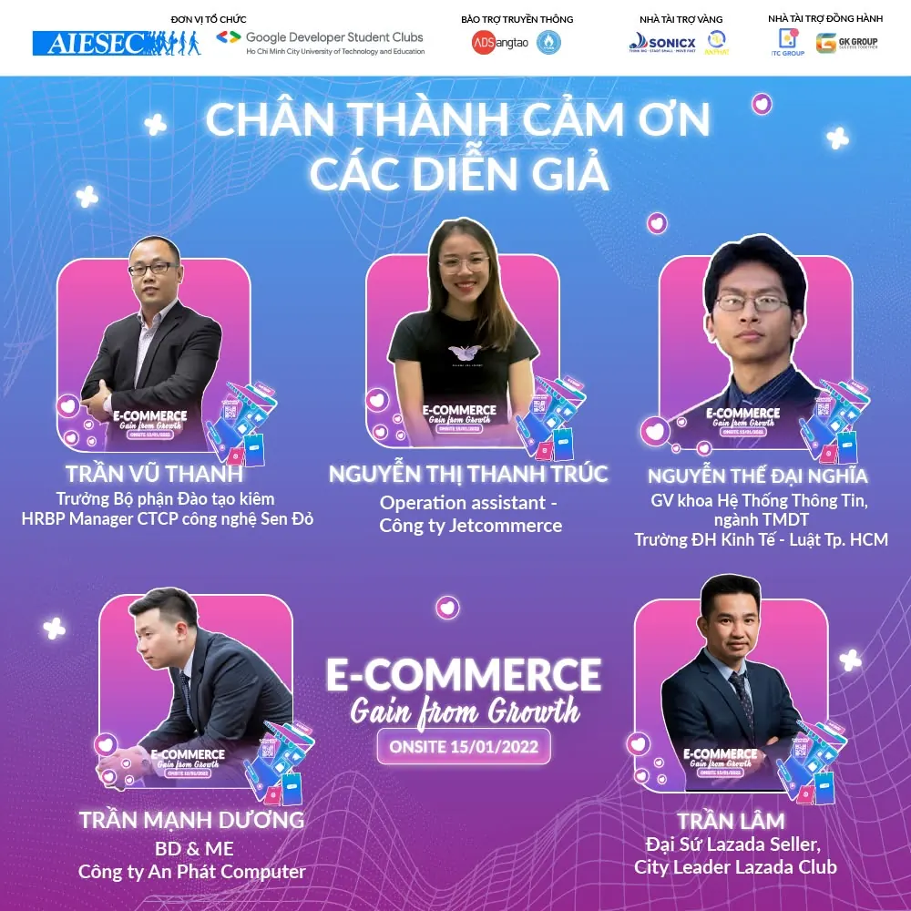

E-COMMERCE: GAIN FROM GROWTH | TRI ÂN DIỄN GIẢ
  
 Workshop “E-Commerce: Gain from growth” được đồng tổ chức bởi AIESEC in Vietnam và GDSC - HCMUTE đã được diễn ra thành công, tốt đẹp với sự tham dự của hơn 400 Sinh viên đến từ nhiều ngành học của các trường đại học khác nhau trên địa bàn thành phố.

<!--truncate-->

 Thông qua Workshop chúng ta đã có cái nhìn toàn cảnh và chính xác hơn về khối ngành Thương mại điện tử cũng như các vấn đề xung quanh. Các diễn giả tài năng đã đem đến nhiều kiến thức thiết thực, những bài học, những chia sẻ và trải nghiệm đắt giá chắc chắn sẽ là hành trang bổ ích cho chúng ta trong tương lai.
  
 Đại diện Ban tổ chức Workshop “E-Commerce: Gain from growth” xin gửi lời cảm ơn chân thành đến với các diễn giả:  
\- Anh Trần Lâm  
\- Anh Trần Vũ Thanh  
\- Chị Nguyễn Thị Thanh Trúc  
\- Anh Trần Mạnh Dương  
\- Anh Nguyễn Thế Đại Nghĩa
  
 Sự hiện diện của quý diễn giả mang đến nhiều giá trị kiến thức quý báu, đóng góp quan trọng vào sự thành công của Workshop.
  
 Một lần nữa, Ban tổ chức xin gửi lời tri ân chân thành và sâu sắc nhất đến với quý diễn giả đã ủng hộ và đồng hành cùng Workshop “E-Commerce: Gain from growth” trong thời gian vừa qua. Kính chúc quý diễn giả thật nhiều sức khỏe và ngày càng thành công hơn nữa.
  
---------------------------------------  
➤ Mọi thắc mắc xin liên hệ:  
Mail: engagewithaiesec.vietnam8@aiesec.net  
Hotline (Hoài Thương) | (Minh Quân)  
\#ecgainfromgrowth #aiesecinvietnam #gdsc\_hcmute

---

_Bài viết được lưu trữ từ [fanpage HCMUTE Developer Student Club](https://www.facebook.com/hcmute.dsc)._
