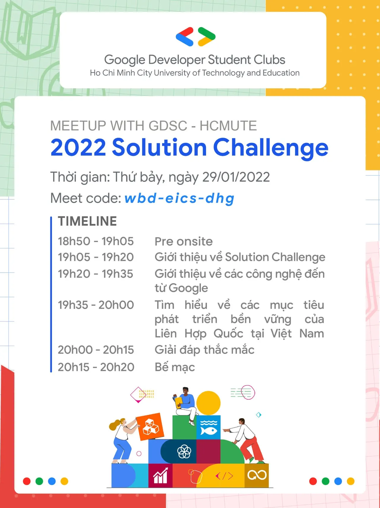

\[Meetup with GDSC - HCMUTE: 2022 Solution Challenge\]

<!--truncate-->

  
 Xin chào, xin chào!

  
Trước khi kết thúc năm cũ và chào đón năm mới, GDSC - HCMUTE gửi đến cho các bạn một buổi meetup về cuộc thi với quy mô toàn cầu kèm theo nhiều phần quà vô cùng hấp dẫn, cuộc thi mang tên "2022 Solution Challenge".

  
Solution Challenge là một cuộc thi thường niên do Google tổ chức với mong muốn cùng các bạn sinh viên phát triển, tìm ra giải pháp giải quyết các vấn đề của cộng đồng bằng cách sử dụng những công nghệ của Google. Cuộc thi không chỉ tìm kiếm những đề tài công nghệ tiên tiến nhất, mà còn nhấn mạnh vào sức ảnh hưởng đến xã hội cũng như khả năng mở rộng phạm vi trong tương lai. Cuộc thi đã thu hút hơn 800 trường Đại học đến từ 60 quốc gia và vùng lãnh thổ. Đây là môi trường hoàn hảo dành cho các bạn sinh viên gia tăng trải nghiệm, thỏa sức thể hiện sự phong phú trong sáng tạo và trau dồi thêm nhiều kiến thức cũng như kỹ năng bổ ích.  
️️  
Bên cạnh đó giải thưởng của cuộc thi cũng không kém phần hấp dẫn, cụ thể:  
️  
50 đội hàng đầu sẽ giành được áo phông, giấy chứng nhận, sự cố vấn từ những Googler và các chuyên gia khác để cải thiện ứng dụng.
  
10 đội lọt vào chung kết sẽ giành giải thưởng tiền mặt 1.000 USD cho mỗi thành viên trong đội, quà, giấy chứng nhận, sự cố vấn từ những Googler, cũng như được tham gia vào buổi Demo Day phát sóng trực tiếp trên Youtube.
  
 3 đội có thành tích tốt nhất sẽ giành giải thưởng tiền mặt 3.000 USD cho mỗi thành viên trong đội, quà, giấy chứng nhận, sự cố vấn từ những Googler, cũng như được tham gia vào buổi Demo Day phát sóng trực tiếp trên Youtube.

  
Tham gia vào buổi sinh hoạt mở rộng, các bạn sẽ có cơ hội:
  
 Tìm hiểu thêm thông tin chi tiết về 2022 Solution Challenge.
  
 Có kiến thức tổng quan về Firebase và Material Design, từ đó các bạn có thể tìm hiểu thêm để xây dựng ứng dụng.
  
Có cái nhìn tổng quan về 17 Mục tiêu Phát triển Bền vững của Liên hợp quốc, là chủ đề của cuộc thi năm nay.
  
 Giao lưu, học hỏi với những người bạn mới, tạo điều kiện để các bạn lập nhóm tham gia vào cuộc thi.
  
 Đặc biệt, buổi sinh hoạt mở rộng lần này còn có một minigame với những phần thưởng vô cùng hấp dẫn đang chờ đợi các bạn.

  
Thời gian buổi sinh hoạt: 18h50 thứ 7 ngày 29/01/2022
  
Đối tượng tham gia: Sinh viên có niềm đam mê với các công nghệ của Google
  
Đơn đăng ký: tinyurl.com/meetupSolutionChallenge
  
Hạn chót mở đơn đăng ký: 19h00 thứ 7 ngày 29/01/2022
  
Link tham gia: meet.google.com/wbd-eics-dhg
  
Slide buổi sinh hoạt: tinyurl.com/slideSolutionChallenge

  
Đơn đăng ký của chúng mình có thể sẽ đóng sớm nếu đủ số lượng tham gia. Còn chần chừ gì nữa mà không đăng ký tham gia ngay buổi sinh hoạt mở rộng lần này để có thể bắt kịp những thông tin mới nhất về cuộc thi 2022 Solution Challenge nào!  
------------------------------------------  
Mọi ý kiến đóng góp, các bạn có thể liên hệ trực tiếp thông qua fanpage Google Developer Student Clubs - HCM UTE: [https://www.facebook.com/gdsc.hcmute](https://www.facebook.com/gdsc.hcmute)
  
\#GDSC #GoogleDeveloperStudentClubs #GDSC\_HCMUTE

---

_Bài viết được lưu trữ từ [fanpage HCMUTE Developer Student Club](https://www.facebook.com/hcmute.dsc)._
