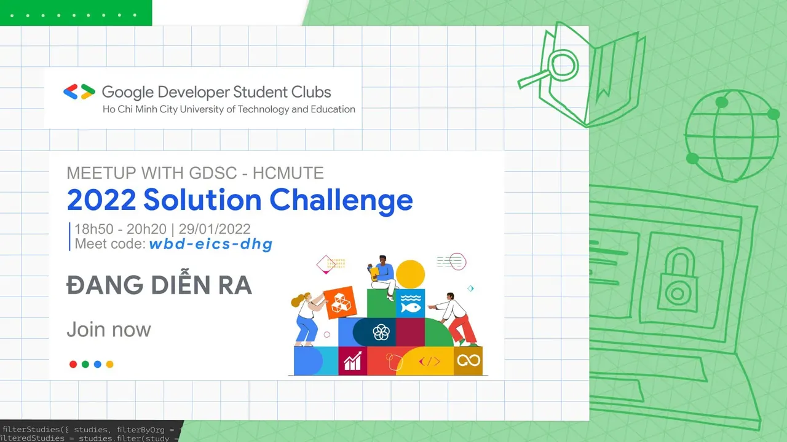

\[MEETING UP WITH GDSC - HCMUTE: 2022 SOLUTION CHALLENGE\]

<!--truncate-->

  
 Loa…Loa…Loa…  
 Kim giây đã điểm, “Meetup with GDSC - HCMUTE: 2022 Solution Challenge” đã chính thức lên sóng. Các bạn còn chần chừ gì nữa Hãy truy cập đường link bên dưới để tham gia cùng chúng mình nhé! Hứa hẹn sẽ có nhiều điều thú vị lắm à nhen!!!

  
 Đối tượng tham gia meetup: toàn bộ sinh viên có niềm đam mê với các công nghệ của Google.

  
 Link tham gia: meet.google.com/wbd-eics-dhg

  
Tham gia vào buổi sinh hoạt mở rộng, các bạn sẽ có cơ hội:
  
 Tìm hiểu thêm thông tin chi tiết về 2022 Solution Challenge.
  
 Có kiến thức tổng quan về Firebase và Material Design, từ đó các bạn có thể tìm hiểu thêm để xây dựng ứng dụng.
  
 Có cái nhìn tổng quan về 17 Mục tiêu Phát triển Bền vững của Liên hợp quốc, là chủ đề của cuộc thi năm nay.
  
 Giao lưu, học hỏi với những người bạn mới, tạo điều kiện để các bạn lập nhóm tham gia vào cuộc thi.
  
 Đặc biệt, buổi sinh hoạt mở rộng lần này còn có một minigame với những phần thưởng vô cùng hấp dẫn đang chờ đợi các bạn.  
------------------------------------------  
Solution Challenge là một cuộc thi thường niên do Google tổ chức với mong muốn cùng các bạn sinh viên phát triển, tìm ra giải pháp giải quyết các vấn đề của cộng đồng bằng cách sử dụng những công nghệ của Google. Cuộc thi không chỉ tìm kiếm những đề tài công nghệ tiên tiến nhất, mà còn nhấn mạnh vào sức ảnh hưởng đến xã hội cũng như khả năng mở rộng phạm vi trong tương lai. Cuộc thi đã thu hút hơn 800 trường Đại học đến từ 60 quốc gia và vùng lãnh thổ.

  
 Nhiệm vụ của 2022 Solution Challenge là xây dựng ứng dụng giải quyết một hoặc nhiều mục tiêu trong số 17 Mục tiêu Phát triển Bền vững của Liên hợp quốc.

  
 Hạn chót nộp sản phẩm: ngày 31/03/2022.  
------------------------------------------  
Mọi ý kiến đóng góp, các bạn có thể liên hệ trực tiếp thông qua fanpage Google Developer Student Clubs - HCM UTE: [https://www.facebook.com/gdsc.hcmute](https://www.facebook.com/gdsc.hcmute)
  
\#GDSC #GoogleDeveloperStudentClubs #GDSC\_HCMUTE

---

_Bài viết được lưu trữ từ [fanpage HCMUTE Developer Student Club](https://www.facebook.com/hcmute.dsc)._
