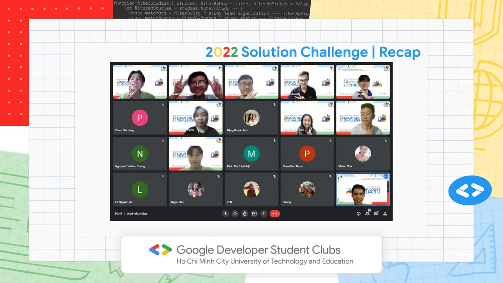

\[MEETING UP WITH GDSC - HCMUTE: 2022 SOLUTION CHALLENGE | RECAP\]
  
Chào mọi người Chào mọi ngườiiii

<!--truncate-->

Vậy là buổi “Meetup with GDSC - HCMUTE: 2022 Solution Challenge” đã chính thức được khép lại với sự tham gia nhiệt tình của các bạn Sinh viên
  
Mong rằng, với những giây phút quây quần cuối năm với chúng mình, các bạn đã có thêm hành trang bổ ích về:
  
Các thông tin chi tiết của cuộc thi 2022 Solution Challenge.
  
Kiến thức tổng quan về Firebase và Material Design để xây dựng các ứng dụng trong tương lai.
  
Có cái nhìn tổng quan về 17 Mục tiêu Phát triển Bền vững của Liên hợp quốc, là chủ đề của cuộc thi năm nay.
  
Ngoài ra, chúng mình cũng mong các bạn đã có những giây phút tuyệt vời khi giao lưu, học hỏi với những người bạn mới và tham gia vào minigame vô cùng sôi động cùng chúng mình.
  
GDSC - HCMUTE xin gửi lời cảm ơn chân thành đến các bạn sinh viên đã dành thời gian quan tâm, ủng hộ và tham gia buổi trò chuyện cuối năm này. Hẹn gặp lại các bạn ở các chương trình thú vị tiếp theo nhá!  
------------------------------------------
  
Solution Challenge là một cuộc thi thường niên do Google tổ chức với mong muốn cùng các bạn sinh viên phát triển, tìm ra giải pháp giải quyết các vấn đề của cộng đồng bằng cách sử dụng những công nghệ của Google. Cuộc thi không chỉ tìm kiếm những đề tài công nghệ tiên tiến nhất, mà còn nhấn mạnh vào sức ảnh hưởng đến xã hội cũng như khả năng mở rộng phạm vi trong tương lai. Cuộc thi đã thu hút hơn 800 trường Đại học đến từ 60 quốc gia và vùng lãnh thổ.
  
Nhiệm vụ của 2022 Solution Challenge là xây dựng ứng dụng giải quyết một hoặc nhiều mục tiêu trong số 17 Mục tiêu Phát triển Bền vững của Liên hợp quốc.
  
Hạn chót nộp sản phẩm: ngày 31/03/2022.  
------------------------------------------  
Mọi ý kiến đóng góp, các bạn có thể liên hệ trực tiếp thông qua fanpage Google Developer Student Clubs - HCM UTE: [https://www.facebook.com/gdsc.hcmute](https://www.facebook.com/gdsc.hcmute)  
\#GDSC #GoogleDeveloperStudentClubs #GDSC\_HCMUTE

---

_Bài viết được lưu trữ từ [fanpage HCMUTE Developer Student Club](https://www.facebook.com/hcmute.dsc)._
