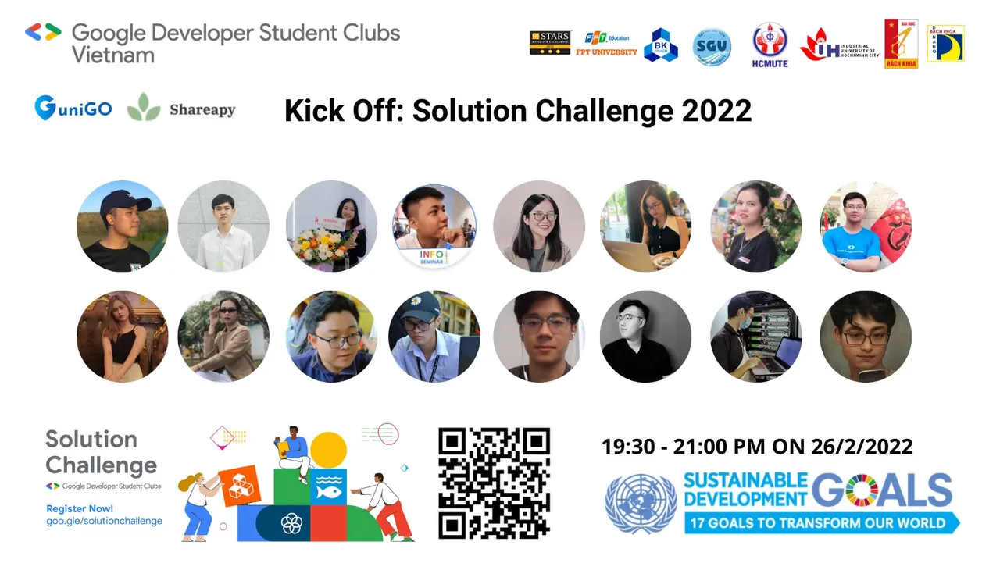

Chào mấy friends, GDSC đứng đây từ chiều!
  
 𝐒𝐎𝐋𝐔𝐓𝐈𝐎𝐍 𝐂𝐇𝐀𝐋𝐋𝐄𝐍𝐆𝐄 𝐊𝐈𝐂𝐊𝐎𝐅𝐅 𝟐𝟎𝟐𝟐

<!--truncate-->

-----------------------
  
Các bạn có biết gì chưa, Solution Challenge - một cuộc thi quy mô toàn Trái Đất đang đổ bộ về Việt Nam chúng ta với rất nhiều các bạn sinh viên trẻ đang muốn thử sức với các đội thi thế giới đấy. Là một cuộc thi mang tính cộng đồng vô cùng cao, giải quyết 17 vấn đề của Liên Hợp Quốc với 𝐆𝐈𝐀̉𝐈 𝐓𝐇𝐔̛𝐎̛̉𝐍𝐆 lên đến $𝟑,𝟎𝟎𝟎, chắc cũng khiến rất nhiều bạn e dè và không biết phải bắt đầu từ đâu.
  
Vì lý do đó, các GDSC toàn quốc đã tập hợp lại để tổ chức buổi 𝐊𝐢𝐜𝐤𝐨𝐟𝐟 dành riêng cho cuộc thi 𝐒𝐨𝐥𝐮𝐭𝐢𝐨𝐧 𝐂𝐡𝐚𝐥𝐥𝐞𝐧𝐠𝐞 𝟐𝟎𝟐𝟐 nhằm giúp các bạn có nhiều thông tin hơn và nhiều động lực hơn để chúng ta có thể chinh chiến và mang về những thành tích tốt đẹp trong mắt bạn bè nước ngoài đó.
  
Vậy thì các bạn đã sẵn sàng để cùng chúng mình, ghi danh vào bảng vàng của cuộc thi 𝐒𝐨𝐥𝐮𝐭𝐢𝐨𝐧 𝐂𝐡𝐚𝐥𝐥𝐞𝐧𝐠𝐞 𝟐𝟎𝟐𝟐 quy mô toàn Trái Đất chưa. Các bạn đã sẵn sàng xắn tay áo lên để khẳng định dòng máu đỏ Lạc Việt chúng ta chưa. Vậy thì hãy mau mau tham gia buổi Kickoff của chúng mình ngay thôi nào!
  
Thời gian: lúc 𝟕𝐡𝟑𝟎 tối Thứ bảy ngày 𝟐𝟔/𝟎𝟐/𝟐𝟎𝟐𝟐.
  
Địa điểm: Google Meet
  
Link tham gia: [https://meet.google.com/vbd-isqs-bhf](https://meet.google.com/vbd-isqs-bhf)
  
NỘI DUNG KICKOFF:
  
Giới thiệu về cuộc thi, các công nghệ của Google
  
Giới thiệu về các mục tiêu phát triển bền vững của LHQ
  
Panel discussion với team Shareapy - ĐH Bách Khoa HCM và uniGO - ĐH Bách Khoa ĐN
  
Thông tin cuộc thi Solution Challenge: [https://tinyurl.com/mypcjbsc](https://tinyurl.com/mypcjbsc)  
-----------------------  
Mọi ý kiến đóng góp, các bạn có thể liên hệ trực tiếp thông qua fanpage Google Developer Student Clubs - HCM UTE: [https://www.facebook.com/gdsc.hcmute](https://www.facebook.com/gdsc.hcmute)  
\#GDSC #GoogleDeveloperStudentClubs #GDSC\_HCMUTE

---

_Bài viết được lưu trữ từ [fanpage HCMUTE Developer Student Club](https://www.facebook.com/hcmute.dsc)._
