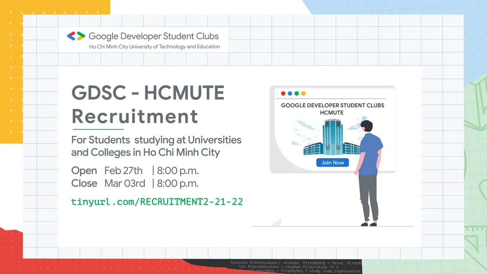

\[TUYỂN THÀNH VIÊN GIAI ĐOẠN 2 NĂM HỌC 2021 - 2022 | GDSC - HCMUTE\]
  
\- Bạn cảm thấy việc học căng thẳng, mệt mỏi  
\- Bạn muốn giao lưu, kết nối và gặp gỡ nhiều bạn bè hơn  
\- Bạn có niềm đam mê, yêu thích các công nghệ của Google nói riêng và Công nghệ Thông tin nói chung  
\- Bạn khao khát có môi trường thể hiện sở trường và năng khiếu của chính mình  
...  
Vậy còn chần chừ gì nữa mà không nhanh tay đăng ký để có cơ hội trở thành Thành viên chính thức của CLB GDSC - HCMUTE ngay thôi nào

<!--truncate-->

  
 Form đăng ký thành viên: [https://tinyurl.com/RECRUITMENT2-21-22](https://tinyurl.com/RECRUITMENT2-21-22)

  
 Thời gian đăng ký: 20h ngày 27/02/2022 đến 20h00 ngày 03/03/2022  
(BTC sẽ tiến hành đóng link đăng ký trước thời hạn nếu số lượng đủ 30)

  
 Đối tượng đăng ký: Sinh viên tại các trường Đại học và Cao đẳng trong địa bàn TP.HCM có đam mê với các công nghệ của Google nói riêng và Công nghệ Thông tin nói chung.

  
 Sau khi đăng ký thành công, các bạn sẽ trải qua vòng Phỏng vấn với Ban chủ nhiệm CLB để chính thức bước chân vào GDSC - HCMUTE, nhưng đừng lo lắng quá nhá  
 Thông tin chi tiết sẽ được chúng mình đăng tải sớm trên Fanpage!  
\_\_\_\_\_\_\_\_\_\_\_\_\_\_\_\_\_\_\_\_\_\_\_\_\_\_\_\_\_\_\_\_\_\_\_\_\_\_\_\_\_\_\_\_\_\_\_\_\_\_  
Được hỗ trợ bởi Google Developers, Google Developer Student Clubs (GDSC) là các nhóm cộng đồng cho sinh viên có niềm đam mê với các công nghệ của Google. Khi tham gia vào GDSC, các bạn sinh viên có cơ hội cùng nhau học hỏi trong một môi trường mở và năng động, cùng nhau xây dựng các giải pháp cho các vấn đề thực tế trong cộng đồng.
  
 Google Developer Student Clubs - HCMUTE (GDSC - HCMUTE) vô cùng vinh dự khi trở thành một thành viên mới của GDSC toàn cầu. Với khao khát kết nối các bạn sinh viên yêu thích công nghệ thông tin nói chung và các công nghệ của Google nói riêng, GDSC - HCMUTE sẽ xây dựng một cộng đồng thân thiện để mọi người cùng chia sẻ kiến thức và tạo ra nhiều sản phẩm giúp ích cho xã hội.
  
 Tham gia vào GDSC - HCMUTE, các bạn sẽ được:  
\- Hòa mình vào một môi trường "đa văn hóa" với các thành viên đến từ các ngành học và các khóa học khác nhau.  
\- Truy cập vào các tài nguyên dành cho nhà phát triển của Google.  
\- Chia sẻ và học hỏi những kiến thức công nghệ mới.  
\- Learning By Making, áp dụng những kiến thức đã được học để xây dựng các sản phẩm công nghệ giải quyết những bài toán thực tiễn trong cộng đồng.
  
 Muốn biết thêm thông tin về GDSC toàn cầu, các bạn hãy vào trang web:  
[https://developers.google.com/community/gdsc](https://developers.google.com/community/gdsc)  
\_\_\_\_\_\_\_\_\_\_\_\_\_\_\_\_\_\_\_\_\_\_\_\_\_\_\_\_\_\_\_\_\_\_\_\_\_\_\_\_\_\_\_\_\_\_\_\_\_\_  
Mọi thắc mắc, xin vui lòng liên hệ:
  
 Fanpage Google Developer Student Clubs - HCM UTE: [https://www.facebook.com/gdsc.hcmute](https://www.facebook.com/gdsc.hcmute)
  
 Số điện thoại - Bùi Quốc Tĩnh - Thành viên Ban truyền thông  
[https://www.facebook.com/tinhbuiquoc1010](https://www.facebook.com/tinhbuiquoc1010)
  
\#GDSC #GoogleDeveloperStudentClubs #GDSC\_HCMUTE #TuyenTVDot2

---

_Bài viết được lưu trữ từ [fanpage HCMUTE Developer Student Club](https://www.facebook.com/hcmute.dsc)._
