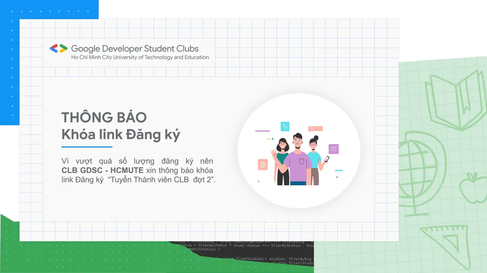

\[TUYỂN THÀNH VIÊN GIAI ĐOẠN 2 NĂM HỌC 2021 - 2022 | GDSC - HCMUTE\] - THÔNG BÁO
  
Lời đầu tiên, CLB Google Developer Student Clubs - HCMUTE xin gửi lời cảm ơn chân thành nhất đến toàn thể các bạn sinh viên gần xa đã quan tâm đến CLB!

<!--truncate-->

 Sau gần 1 ngày mở link đăng ký thành viên, số lượng đơn đăng ký chúng mình nhận được đã hơn con số 30, vượt xa kỳ vọng của tụi mình. Do đó chúng mình đã đóng link đăng ký vào lúc 9h30 ngày 28/02/2022.
  
Tuy nhiên, các bạn chưa đăng ký kịp cũng đừng buồn nhé, vì chúng mình sẽ còn tuyển thành viên vào năm học mới 2022 - 2023, các bạn hãy chờ nhé!
  
 Kết quả đăng ký và thời gian phỏng vấn chúng mình sẽ cập nhật sớm nhất trên Fanpage, nhớ theo dõi Fanpage của tụi mình để không bỏ lỡ nhé!
  
 Một lần nữa xin cảm ơn tình cảm của mọi người dành cho CLB Google Developer Student Clubs - HCMUTE.  
\_\_\_\_\_\_\_\_\_\_\_\_\_\_\_\_\_\_\_\_\_\_\_\_\_\_\_\_\_\_\_\_\_\_\_\_\_\_\_\_\_\_\_\_\_\_\_\_\_\_
  
 Được hỗ trợ bởi Google Developers, Google Developer Student Clubs (GDSC) là các nhóm cộng đồng cho sinh viên có niềm đam mê với các công nghệ của Google. Khi tham gia vào GDSC, các bạn sinh viên có cơ hội cùng nhau học hỏi trong một môi trường mở và năng động, cùng nhau xây dựng các giải pháp cho các vấn đề thực tế trong cộng đồng.
  
 Google Developer Student Clubs - HCMUTE (GDSC - HCMUTE) vô cùng vinh dự khi trở thành một thành viên mới của GDSC toàn cầu. Với khao khát kết nối các bạn sinh viên yêu thích công nghệ thông tin nói chung và các công nghệ của Google nói riêng, GDSC - HCMUTE sẽ xây dựng một cộng đồng thân thiện để mọi người cùng chia sẻ kiến thức và tạo ra nhiều sản phẩm giúp ích cho xã hội.
  
 Tham gia vào GDSC - HCMUTE, các bạn sẽ được:  
\- Hòa mình vào một môi trường "đa văn hóa" với các thành viên đến từ các ngành học và các khóa học khác nhau.  
\- Truy cập vào các tài nguyên dành cho nhà phát triển của Google.  
\- Chia sẻ và học hỏi những kiến thức công nghệ mới.  
\- Learning By Making, áp dụng những kiến thức đã được học để xây dựng các sản phẩm công nghệ giải quyết những bài toán thực tiễn trong cộng đồng.
  
 Muốn biết thêm thông tin về GDSC toàn cầu, các bạn hãy vào trang web:  
[https://developers.google.com/community/gdsc](https://developers.google.com/community/gdsc)  
\_\_\_\_\_\_\_\_\_\_\_\_\_\_\_\_\_\_\_\_\_\_\_\_\_\_\_\_\_\_\_\_\_\_\_\_\_\_\_\_\_\_\_\_\_\_\_\_\_\_
  
 Mọi thắc mắc, xin vui lòng liên hệ:
  
 Fanpage Google Developer Student Clubs - HCM UTE: [https://www.facebook.com/gdsc.hcmute](https://www.facebook.com/gdsc.hcmute)
  
 Số điện thoại - Bùi Quốc Tĩnh - Thành viên Ban truyền thông  
[https://www.facebook.com/tinhbuiquoc1010](https://www.facebook.com/tinhbuiquoc1010)
  
\#GDSC #GoogleDeveloperStudentClubs #GDSC\_HCMUTE #TuyenTVDot2

---

_Bài viết được lưu trữ từ [fanpage HCMUTE Developer Student Club](https://www.facebook.com/hcmute.dsc)._
