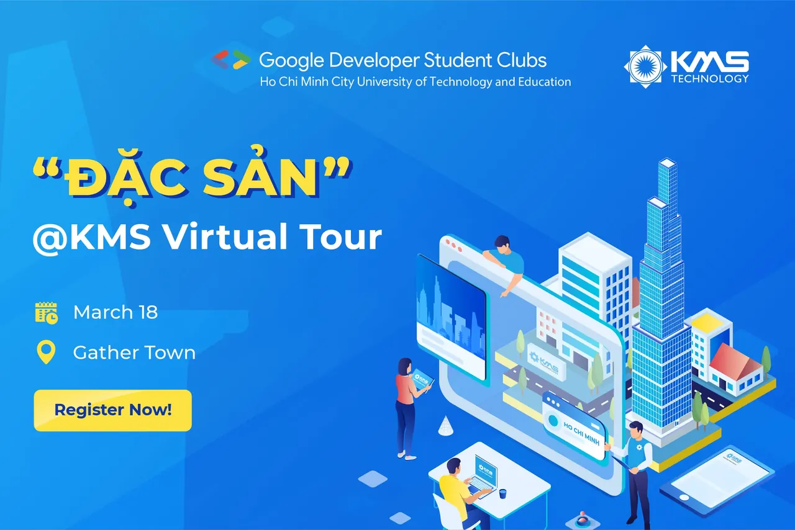
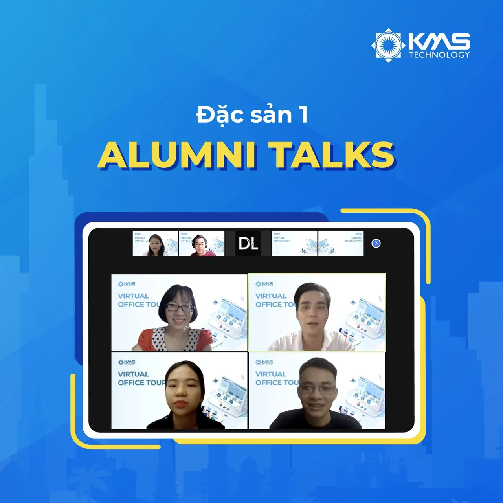
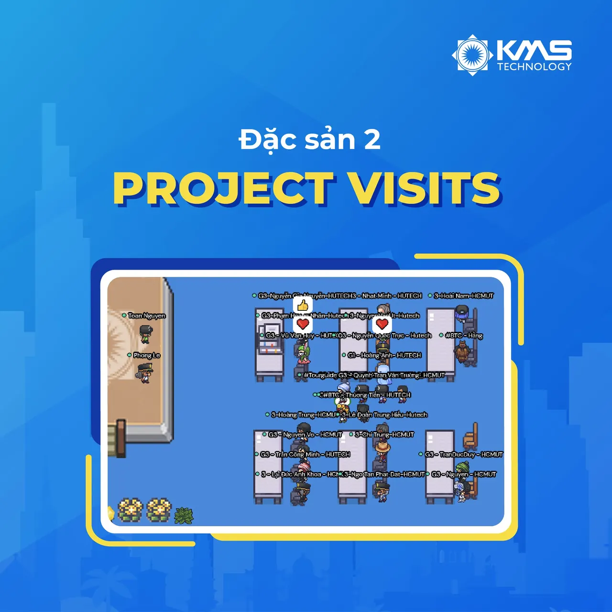
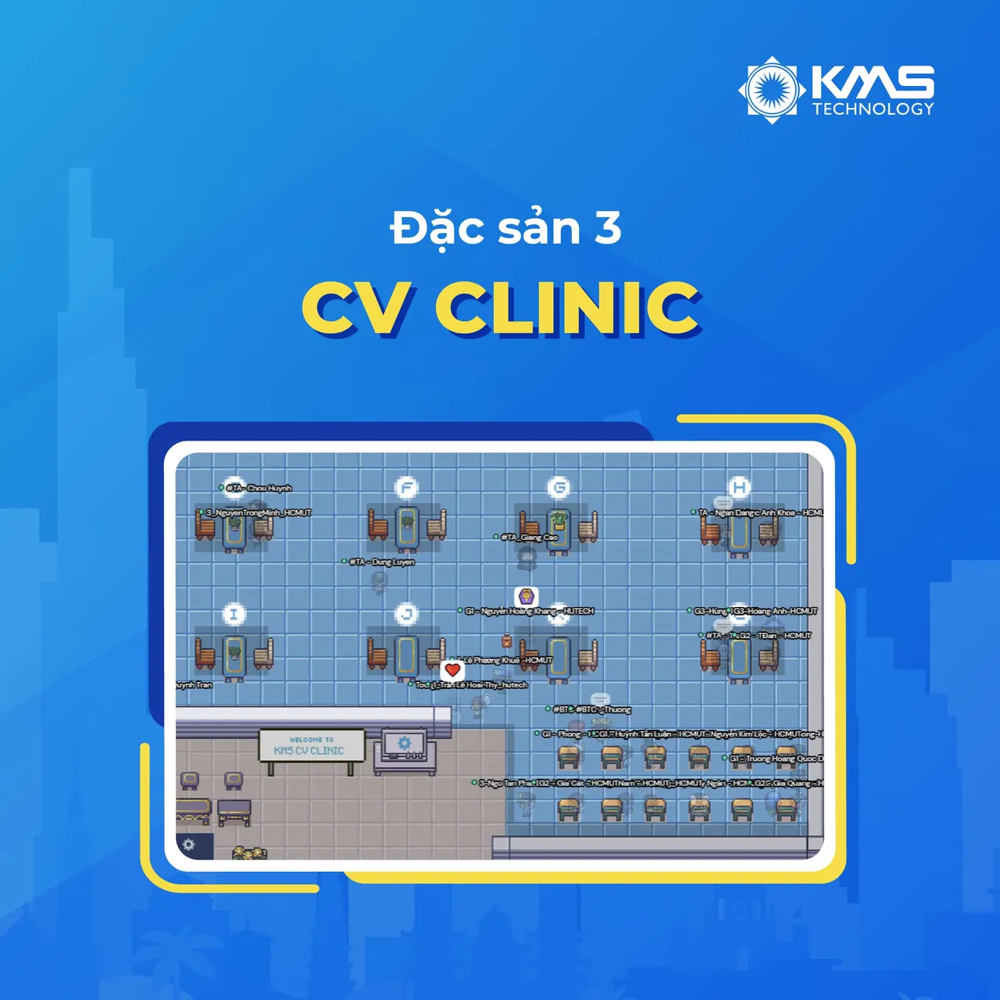

KMS TOUR - Chương trình tham quan văn phòng và gặp gỡ con người KMS, một trong những nơi làm việc tốt nhất Việt Nam và Châu Á - luôn là cơ hội đáng mong chờ của rất nhiều bạn sinh viên CNTT. KMS VIRTUAL TOUR phiên bản online đậm chất bình thường mới, vẫn giữ vững tinh thần hào hứng và bất ngờ của KMS TOUR cùng những "đặc sản" độc quyền không thể bỏ lỡ.
  
 Thời gian: 8h30 - 12h00, Thứ 6, ngày 18/03/2022

<!--truncate-->

 Vẫn còn rất nhiều slots đang chờ tại: [https://careers.kms-technology.com/office-tour/](https://careers.kms-technology.com/office-tour/)
  
 Cổng đăng ký được mở đến: 23h59, ngày 15/03/2022
  
 Hình thức diễn ra: Online qua nền tảng Gather.Town
  
 Đối tượng đăng ký: dành riêng cho Sinh viên năm 3, 4 ngành CNTT tại HCMUTE See less

---

_Bài viết được lưu trữ từ [fanpage HCMUTE Developer Student Club](https://www.facebook.com/hcmute.dsc)._
