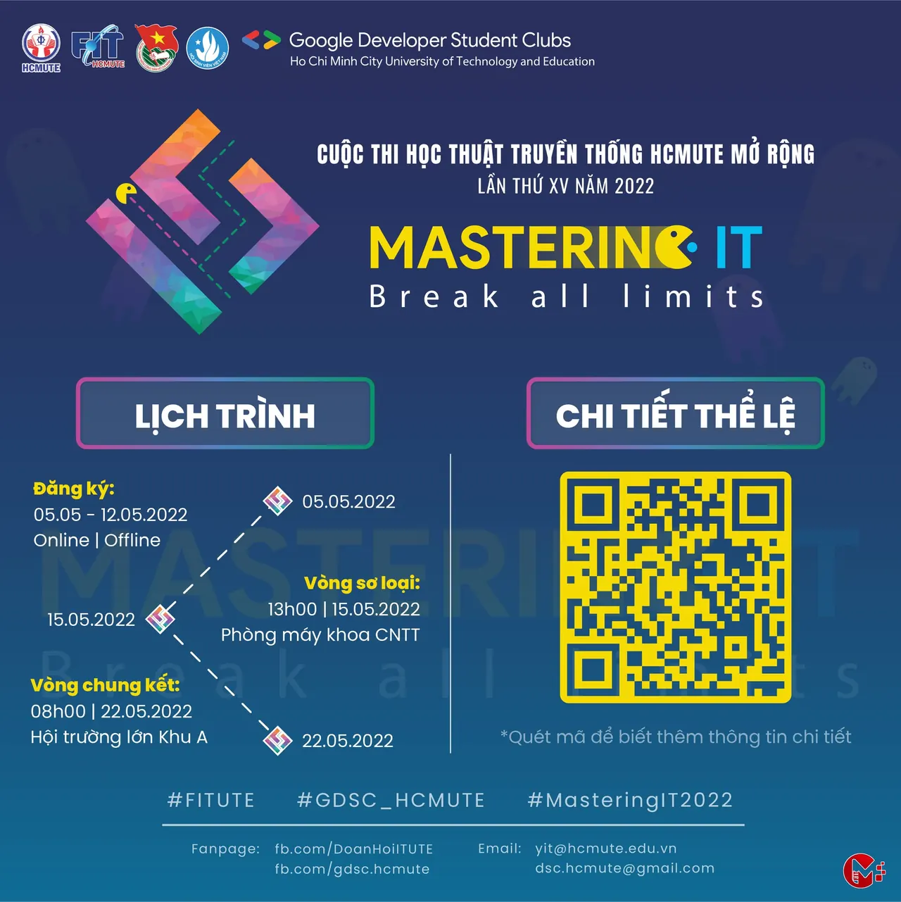
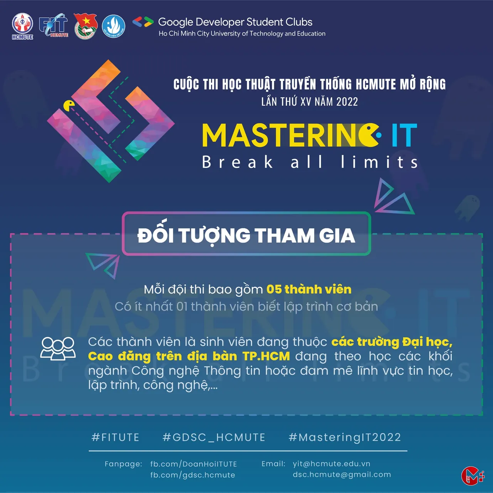
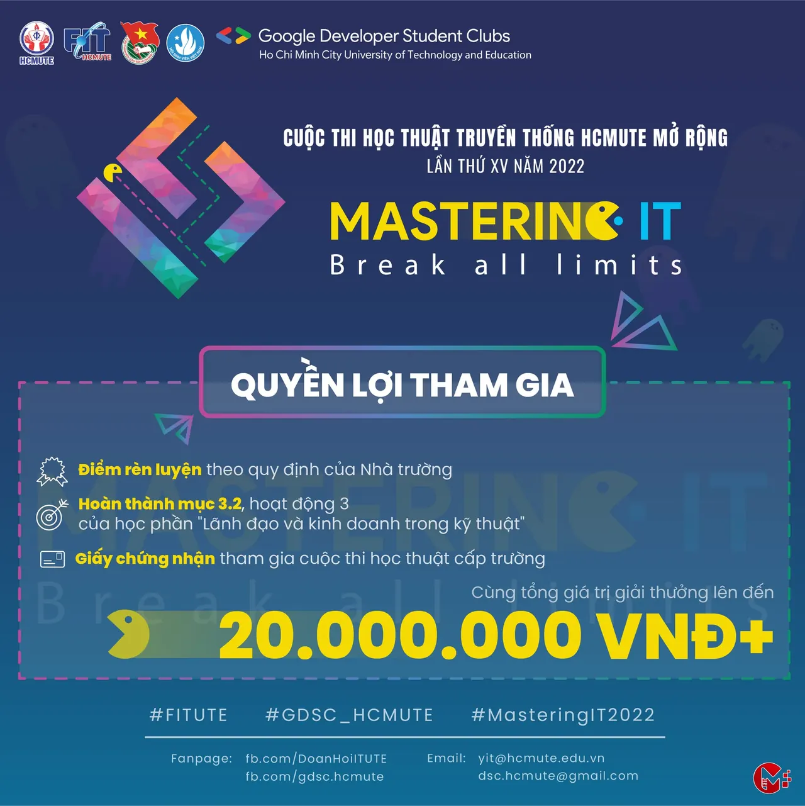
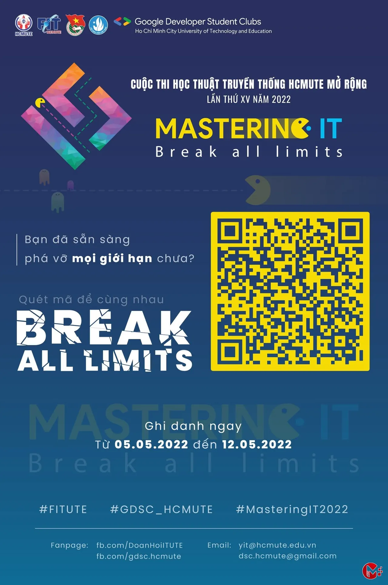
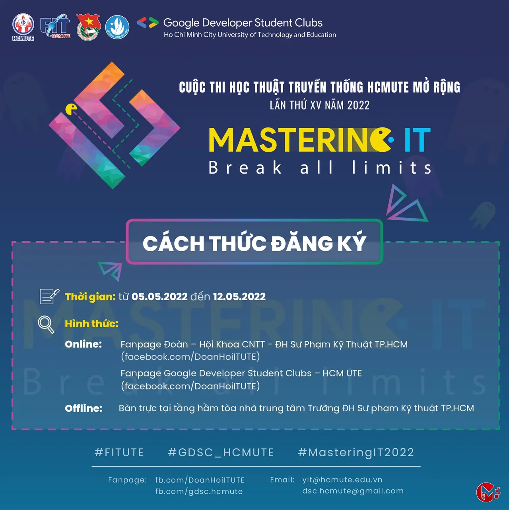

HÌNH THỨC THI:
  
 Vòng sơ loại: 13h00, ngày 15/5/2022 (Chủ nhật), Phòng máy khoa CNTT. Ở vòng này, các đội thi sẽ trả lời các câu hỏi trắc nghiệm với 4 phương án A, B, C và D.

<!--truncate-->

Top 05 đội thi có số điểm cao nhất sẽ được tham gia vòng chung kết.
  
 Vòng chung kết: 08h00, 22/5/2022 (Chủ nhật), Hội trường lớn Khu A - Trường ĐH Sư phạm Kỹ thuật TP. HCM.  
Các đội chơi sẽ tiếp tục tranh tài với 5 phần thi lần lượt là Khởi động, Kết nối, Tăng tốc, Lập trình tiếp sức và Về đích.  
Top… See more

---

_Bài viết được lưu trữ từ [fanpage HCMUTE Developer Student Club](https://www.facebook.com/hcmute.dsc)._
