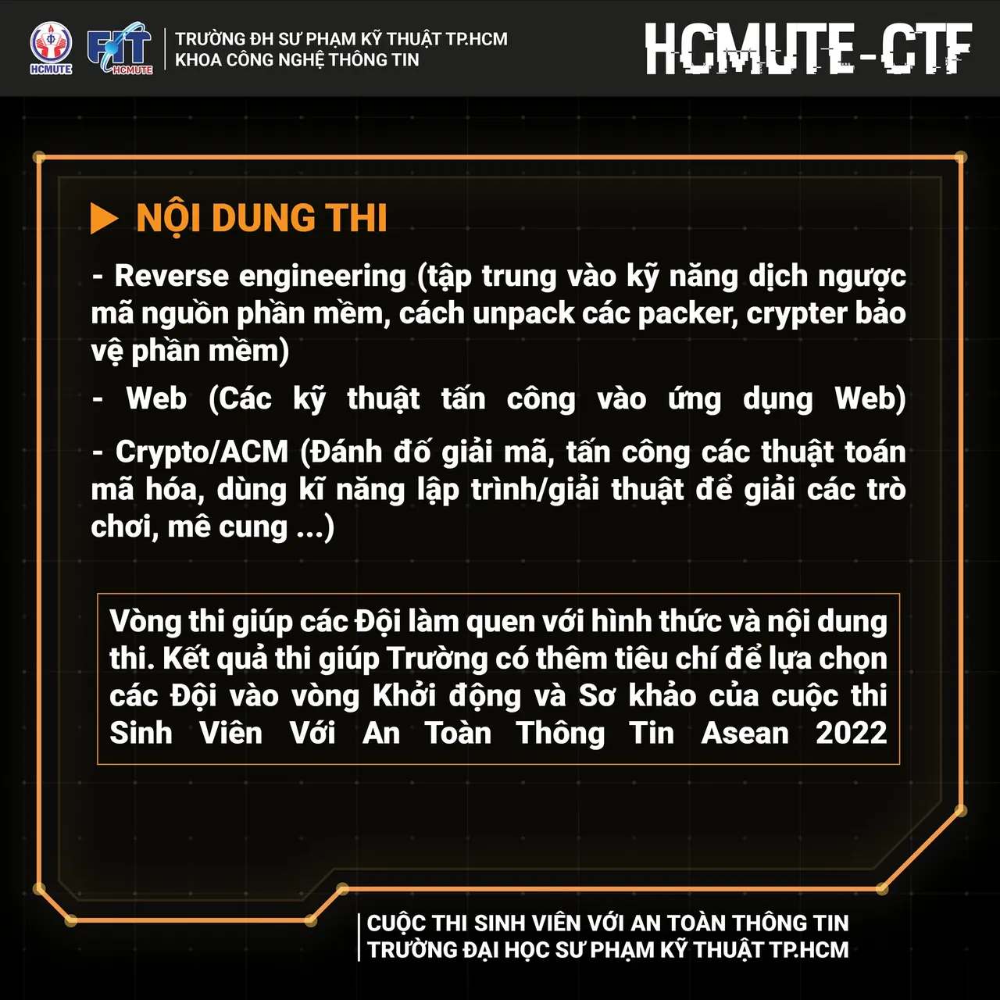
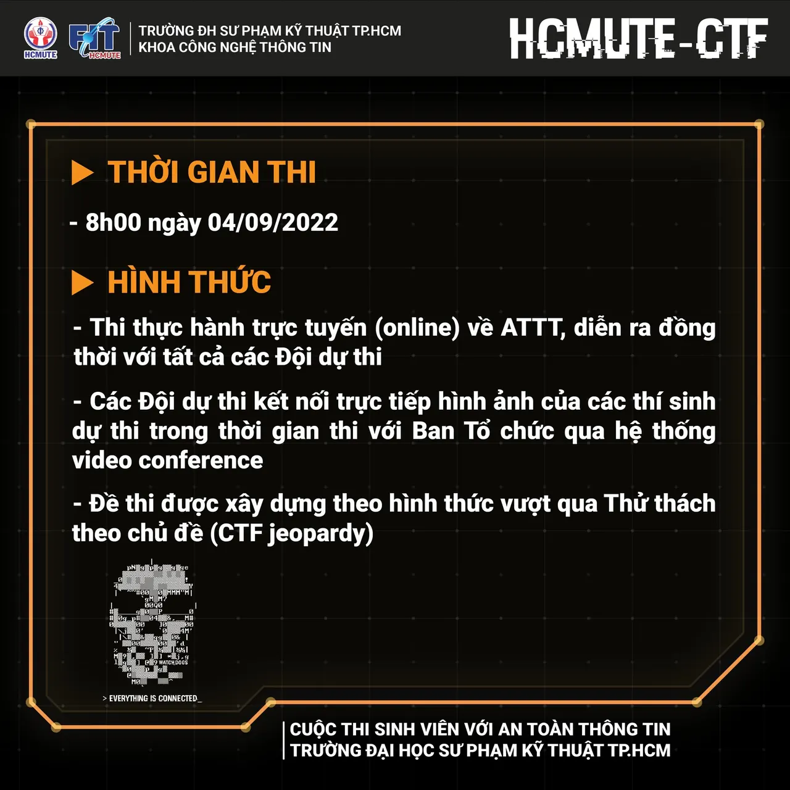
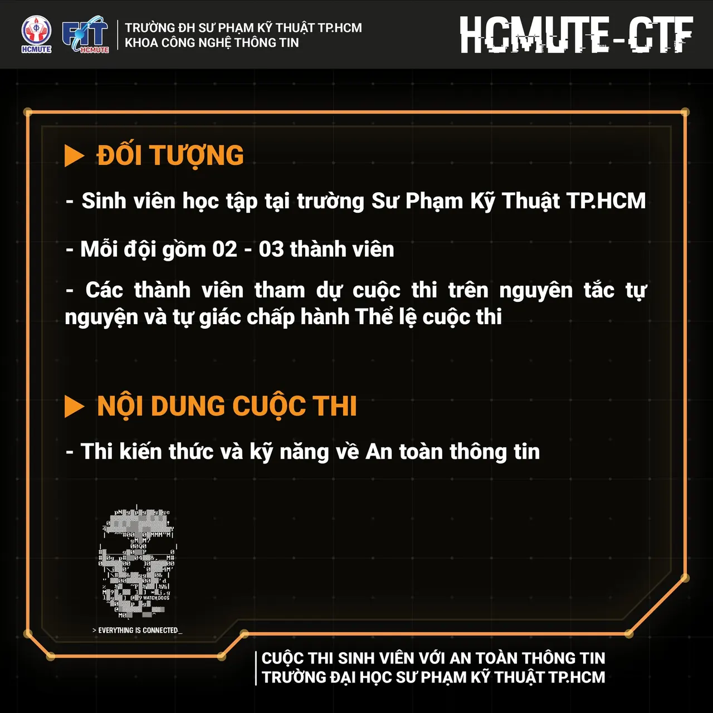
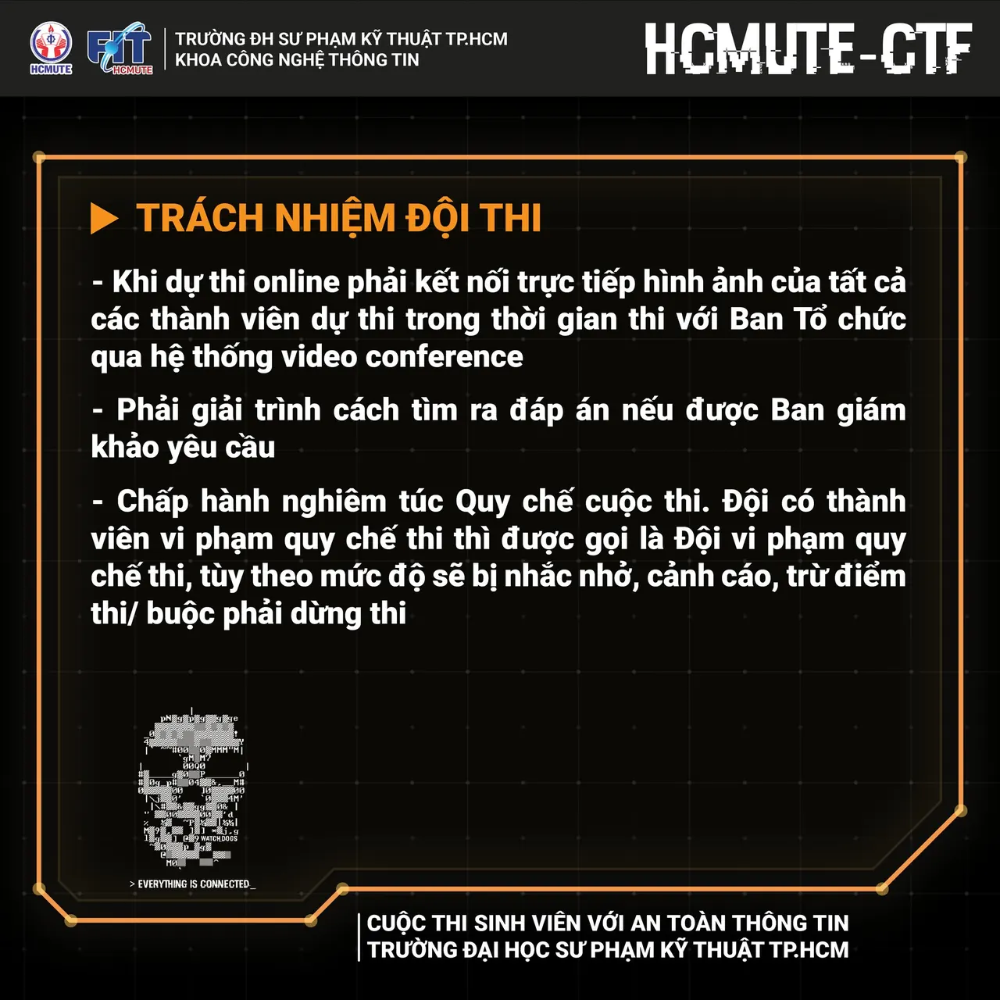
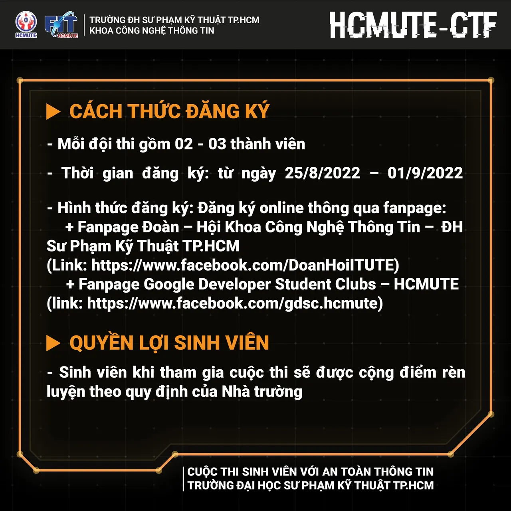
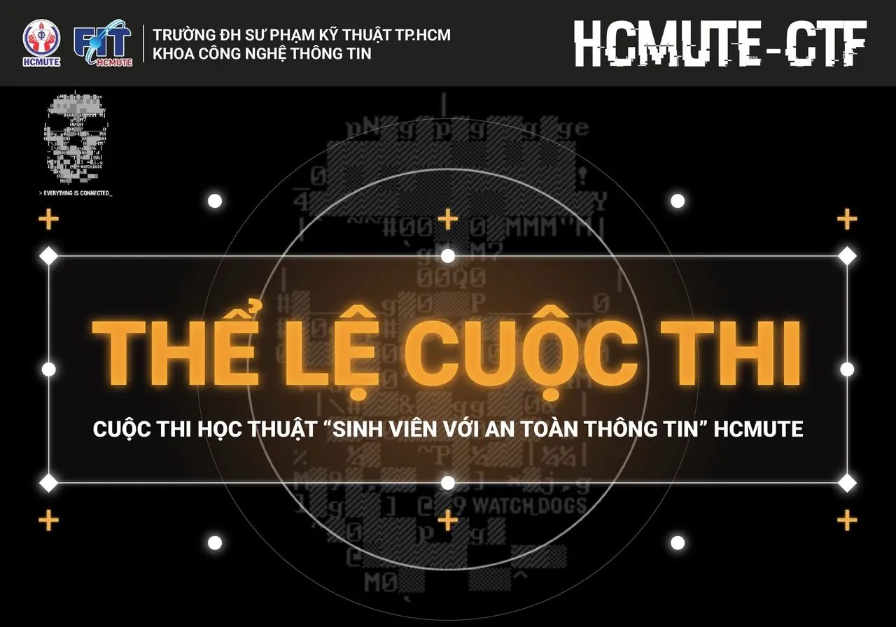
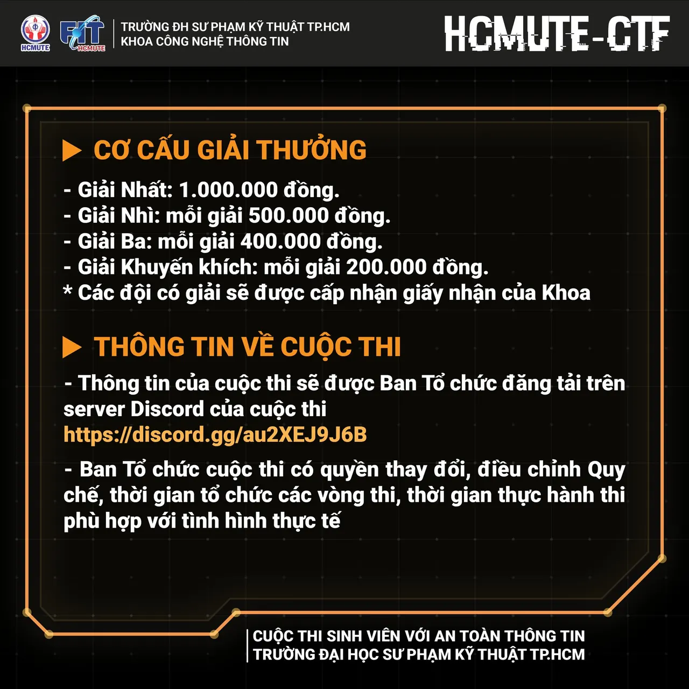

\[ĐĂNG KÝ DỰ THI CUỘC THI HỌC THUẬT “SINH VIÊN VỚI AN TOÀN THÔNG TIN” HCMUTE LẦN THỨ 1, NĂM 2022\] “Ngọc kia chẳng dũa chẳng mài Cũng thành vô dụng cũng hoài ngọc đi.” Bạn đang chán chường, muốn bức phá bản thân Bạn muốn có môi trường để vận dụng kiến thức và kỹ năng  
❗ Đừng lo lắng…!

<!--truncate-->

💥 Cuộc thi học thuật “Sinh viên và An toàn Thông tin” đã cập bến trường ĐH Sư phạm Kỹ thuật TP.HCM 💥 💖 Còn chần chừ gì nữa mà không đăng ký tham gia ngay thôi nào!  
\_\_\_\_\_\_\_\_\_\_\_\_\_\_\_\_\_\_\_\_\_\_\_\_\_\_\_\_\_\_\_\_\_\_\_\_\_\_\_\_\_\_\_\_  
🙆‍♂️🙆‍♂️ ĐỐI TƯỢNG THAM GIA: Sinh viên học tập tại trường ĐH Sư Phạm Kỹ Thuật Thành phố Hồ Chí Minh.  
📌📌 CÁCH THỨC ĐĂNG KÝ:  
👭 Sinh viên đăng ký tham gia cuộc thi theo đội, mỗi đội gồm 02 - 03 thành viên.  
❗ Lưu ý: Những thành viên trong Ban tổ chức và các bạn làm công tác liên quan đến đề thi không được tham gia cuộc thi.  
🕐 Thời gian đăng ký: đến hết ngày 01/9/2022.  
📌 Link đăng ký: [https://itute.tiny.us/ATTT-DK](https://itute.tiny.us/ATTT-DK) 💻💻 HÌNH THỨC THI:  
🕐 Thời gian: 8h00 ngày 04/9/2022. (Các đội thi phải có mặt đầy đủ thành viên trước 30 phút theo thời gian quy định của BTC để ổn định và làm thủ tục dự thi)  
✨ Thi thực hành trực tuyến (online) về ATTT, diễn ra đồng thời với tất cả các Đội dự thi. Các Đội dự thi kết nối trực tiếp hình ảnh của các thí sinh dự thi trong thời gian thi với BTC qua hệ thống video conference. Đề thi được xây dựng theo hình thức vượt qua Thử thách theo chủ đề (CTF jeopardy).  
🏆🏆 CƠ CẤU GIẢI THƯỞNG:  
🥇 Giải Nhất: 1.000.000 đồng/giải và giấy chứng nhận của Khoa.  
🥈 Giải Nhì: 500.000 đồng/giải và giấy chứng nhận của Khoa.  
🥉 Giải Ba: 400.000 đồng/giải và giấy chứng nhận của Khoa.  
🏅 Giải Khuyến khích: 200.000 đồng/giải và giấy chứng nhận của Khoa.  
💥💥QUYỀN LỢI SINH VIÊN: Được cộng điểm rèn luyện theo quy định của nhà trường.  
📝📝 ĐIỀU KHOẢN THI HÀNH:  
👉 Trong quá trình tổ chức cuộc thi, nếu có những vấn đề phát sinh trước, trong và sau mỗi vòng thi diễn ra cần thay đổi phù hợp với tình hình thực tế, BTC sẽ có quyết định và thông báo cụ thể đến từng đội thi.  
🏷 Thông tin của cuộc thi sẽ được Ban Tổ chức đăng tải trên server Discord của cuộc thi [https://discord.gg/au2XEJ9J6B](https://discord.gg/au2XEJ9J6B) 📣 Lưu ý: Trong suốt quá trình diễn ra cuộc thi mọi hành vi gian lận, thi hộ, trao đổi với các đội thi khác thì đội thi sẽ bị loại.  
\_\_\_\_\_\_\_\_\_\_\_\_\_\_\_\_\_\_\_\_\_\_\_\_\_\_\_\_\_\_\_\_\_\_\_\_\_\_\_\_\_\_\_\_  
🤩🤩 Thật hoành tráng đúng không nào, còn chần chừ gì mà không tham gia ngay thôi các bạn ơi !!  
📍📍 THỂ LỆ CHI TIẾT: [https://itute.tiny.us/ATTT-TheLe](https://itute.tiny.us/ATTT-TheLe) 🥰🥰 Đừng quên Like và Follow fanpage để cập nhật những thông tin mới nhất nhé!  
\_\_\_\_\_\_\_\_\_\_\_\_\_\_\_\_\_\_\_\_\_\_\_\_\_\_\_\_\_\_\_\_\_\_\_\_\_\_\_\_\_\_\_\_  
📬📬 Mọi thắc mắc, xin vui lòng liên hệ:  
📞📞 Liên hệ trực tiếp:  
👦 Đ/c Lã Minh Phúc – Thành viên BTC [https://www.facebook.com/pk9r327/](https://www.facebook.com/pk9r327/)
  
\#FITUTE #HCMUTECTF

---

_Bài viết được lưu trữ từ [fanpage HCMUTE Developer Student Club](https://www.facebook.com/hcmute.dsc)._
