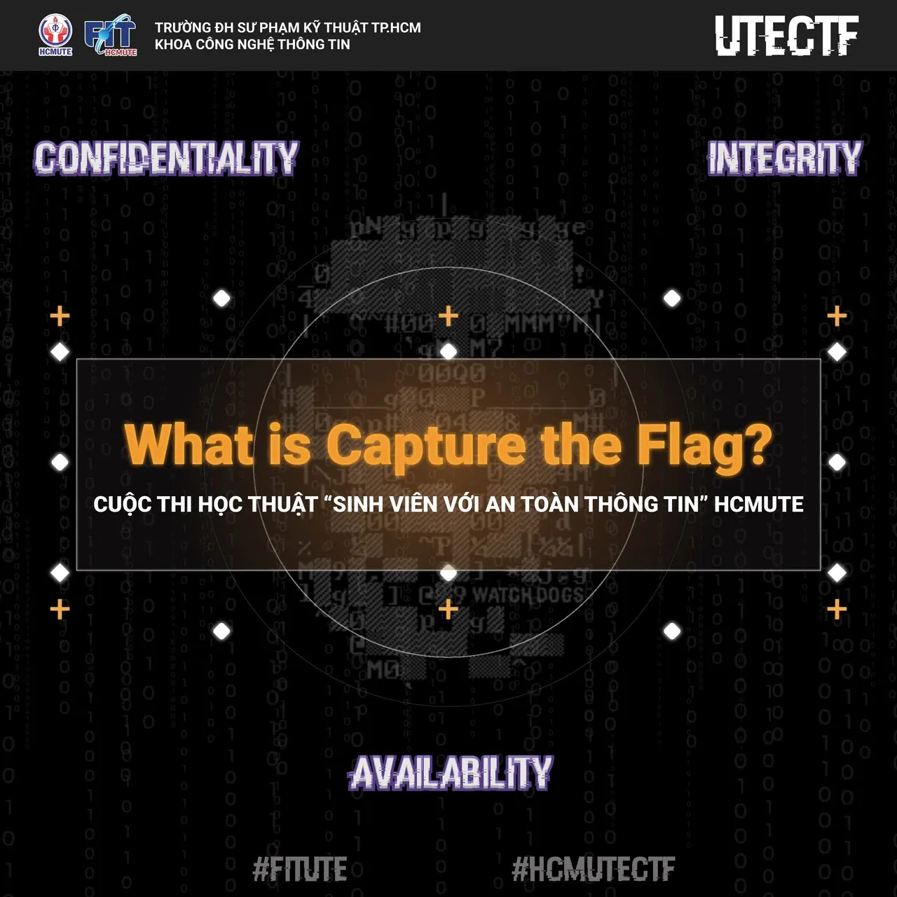

\[HCMUTE-CTF\] - GIỚI THIỆU VỀ CAPTURE THE FLAG (CTF)  
💥💥 CTF LÀ GÌ

<!--truncate-->

👉 CTF (viết tắt của Capture The Flag) là một dạng cuộc thi kiến thức về bảo mật thông tin, thử thách các đội chơi tìm ra lời giải cho một vấn đề bất kỳ trong an ninh mạng.  
👉 Thông thường trong một cuộc thi CTF, các đội chơi sẽ ganh đua nhau để tìm ra một Mật mã đặc biệt được giấu bên trong server, hoặc phía sau một trang web. Mật mã này chính là Flag. Đội nào hack vào hệ thống của đối thủ và tìm ra Flag nhanh hơn sẽ giành chiến thắng vòng thi. Đó là lí do cái tên Capture The Flag ra đời!  
💥💥 CÁC HÌNH THỨC THI CTF PHỔ BIẾN 📌 Trả lời thử thách theo từng chủ đề (Jeopardy-style): trả lời nhiều chủ đề như: Web, Forensic, Crypto, Binary, Stegano… được sắp theo độ khó tăng dần cùng với điểm số cũng tăng dần. Đây cũng là hình thức thi của cuộc thi HCMUTE-CTF lần thứ nhất, các bạn có thể thử tham gia bằng cách đăng ký tại [https://ctf.hcmute.edu.vn/](https://ctf.hcmute.edu.vn/) (thời gian thử đến hết ngày 01/9, ngày 02/9 trang sẽ chuyển qua chế độ thi).  
📌 Tấn công và phòng thủ (attack  defence): Hình thức thi này theo đúng luật thi CTF cổ điển ban đầu và khó hơn so với các hình thức khác do yêu cầu cao hơn. Ngoài các kỹ năng tìm kiếm lỗ hổng bảo mật và khai thác các lỗ hổng đó thì người chơi cần có khả năng khắc phục các điểm yếu, lỗ hổng, bảo vệ hệ thống của mình trước các tấn công từ các đội khác. Điểm khác biệt nữa là cách thức tính điểm cho các đội thi. Điểm thi trong hình thức này được thực hiện theo các tiêu chí khác nhau như: Điểm tấn công, điểm phòng thủ, điểm thưởng,…  
📌 Hình thức thi kết hợp: Là sự phối hợp của 2 hình thức trên, chẳng hạn như kết hợp giữa hình thức chỉ có tấn công (attack only) với các dạng thử thách khác nhau.  
💥💥 CTF CẦN HỌC GÌ ĐỂ THI CTF 🎈 Cuộc thi CTF dành cho mọi người đều nhưng để có thể tham gia người chơi ít nhất phải nắm rõ kiến thức cơ bản về an toàn thông tin mạng và một số công cụ hỗ trợ thích hợp.  
🎈 Các kiến thức về CTF, an toàn thông tin và một số công cụ sẽ được chia sẻ và cập nhập tại server discord [https://discord.gg/au2XEJ9J6B](https://discord.gg/au2XEJ9J6B)  
\_\_\_\_\_\_\_\_\_\_\_\_\_\_\_\_\_\_\_\_\_\_\_\_\_\_\_\_\_\_\_\_\_\_\_\_\_\_\_\_\_\_\_\_  
🤩🤩 Thật hoành tráng đúng không nào, còn chần chừ gì mà không tham gia ngay thôi các bạn ơi !!  
🕐 Thời gian đăng ký: đến hết ngày 01/9/2022.  
📌 Link đăng ký: [https://itute.tiny.us/ATTT-DK](https://itute.tiny.us/ATTT-DK) 📍📍 THỂ LỆ CHI TIẾT: [https://itute.tiny.us/ATTT-TheLe](https://itute.tiny.us/ATTT-TheLe) 🥰🥰 Đừng quên Like và Follow fanpage để cập nhật những thông tin mới nhất nhé!  
\_\_\_\_\_\_\_\_\_\_\_\_\_\_\_\_\_\_\_\_\_\_\_\_\_\_\_\_\_\_\_\_\_\_\_\_\_\_\_\_\_\_\_\_  
📬📬 Mọi thắc mắc, xin vui lòng liên hệ:  
📞📞 Liên hệ trực tiếp:  
👦 Đ/c Lã Minh Phúc – Thành viên BTC [https://www.facebook.com/pk9r327/](https://www.facebook.com/pk9r327/)
  
\#FITUTE #HCMUTECTF

---

_Bài viết được lưu trữ từ [fanpage HCMUTE Developer Student Club](https://www.facebook.com/hcmute.dsc)._
