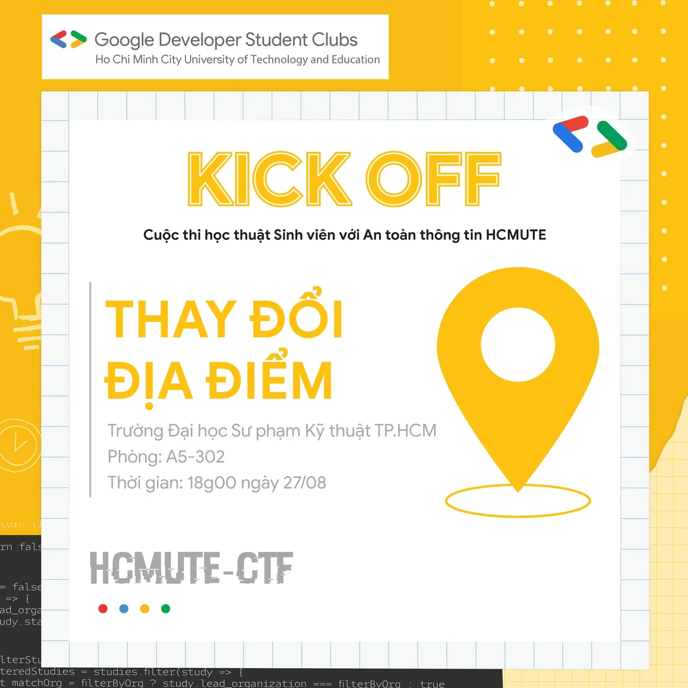

\[KICK OF\] - ĐỊA ĐIỂM THAM GIA CUỘC THI HỌC THUẬT "SINH VIÊN VỚI AN TOÀN THÔNG TIN" HCMUTE (HCMUTE\_CTF)
  
Xin chào các bạn,

<!--truncate-->

Lời đầu tiên, BTC chúng mình xin cảm ơn các bạn đã dành thời gian quan tâm và đăng ký tham gia buổi Sinh hoạt mở rộng của CLB GDSC - HCMUTE.
  
⏰⏰ Thời gian tham gia buổi sinh hoạt: 18h00 ngày 27/8/2022.
  
🚞🚞 Địa điểm tham gia: phòng A5-302.
  
💖💖 Tuy nhiên, các bạn chưa kịp đăng ký thì vẫn được tham gia nhé! Chúng mình sẽ điểm danh bổ xung vào cuối buổi sinh hoạt.
  
💥💥 Khi tham gia buổi sinh hoạt mở rộng, các bạn sẽ có cơ hội:  
🍀 Tìm hiểu kiến thức và kỹ năng về An toàn Thông tin.  
🍀 Giao lưu, học hỏi với những người bạn mới, tạo điều kiện để các bạn lập nhóm tham gia vào cuộc thi.  
🍀 Được cộng điểm rèn luyện theo quy định của nhà trường.  
🍀 Đặc biệt, các bạn sẽ có cơ hội trao đổi và lắng nghe chia sẻ từ cô ThS. Nguyễn Thị Thanh Vân - Chủ nhiệm bộ môn Mạng và An ninh mạng.
  
Các bạn nhớ đến đúng giờ nhé!
  
Cảm ơn các bạn nhiều!  
-----------------------  
Mọi ý kiến đóng góp, các bạn có thể liên hệ trực tiếp thông qua fanpage Google Developer Student Clubs - HCM UTE: [https://www.facebook.com/gdsc.hcmute](https://www.facebook.com/gdsc.hcmute)  
\#GDSC #GoogleDeveloperStudentClubs #GDSC\_HCMUTE

---

_Bài viết được lưu trữ từ [fanpage HCMUTE Developer Student Club](https://www.facebook.com/hcmute.dsc)._
