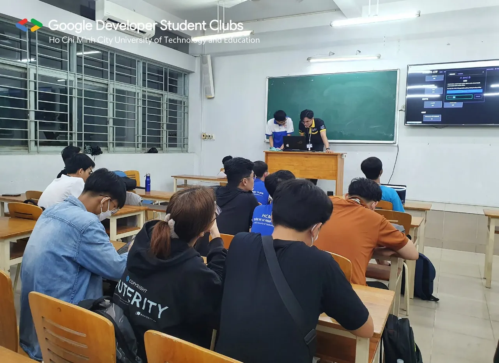
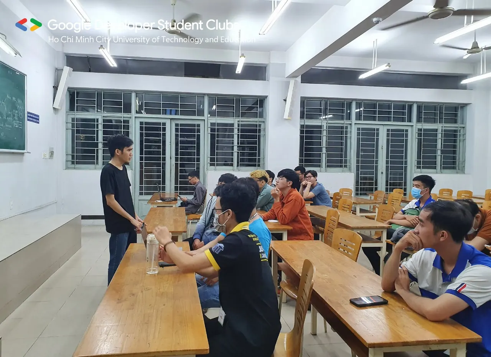
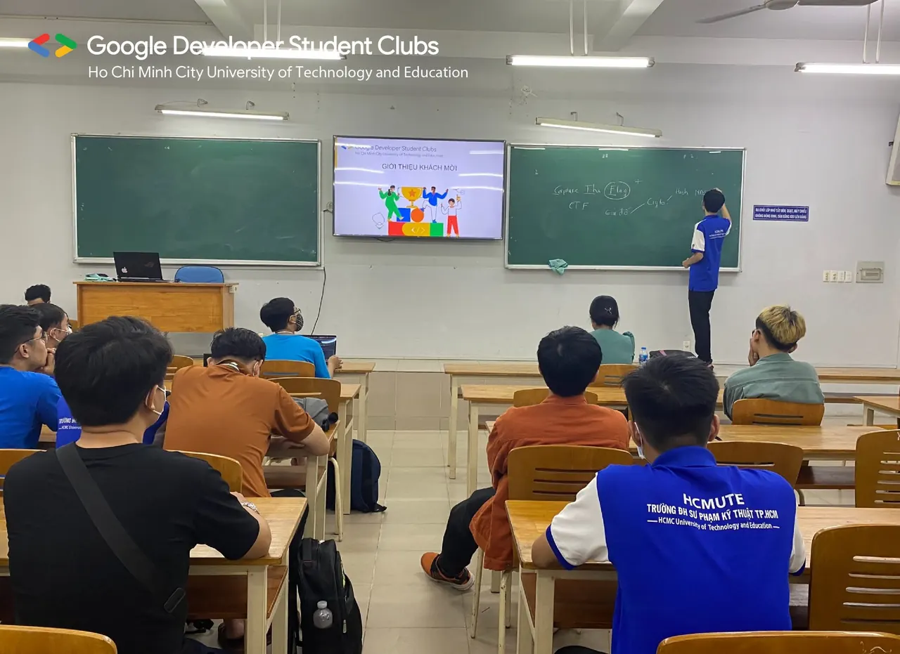
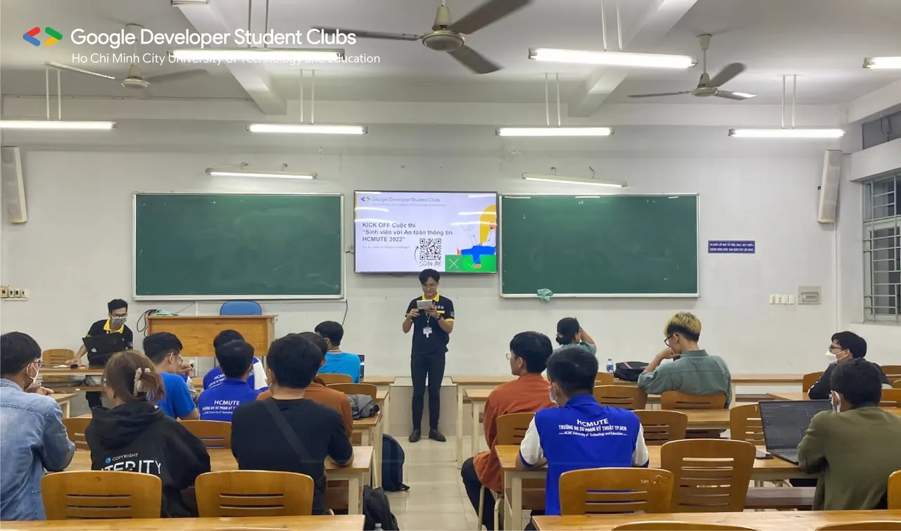
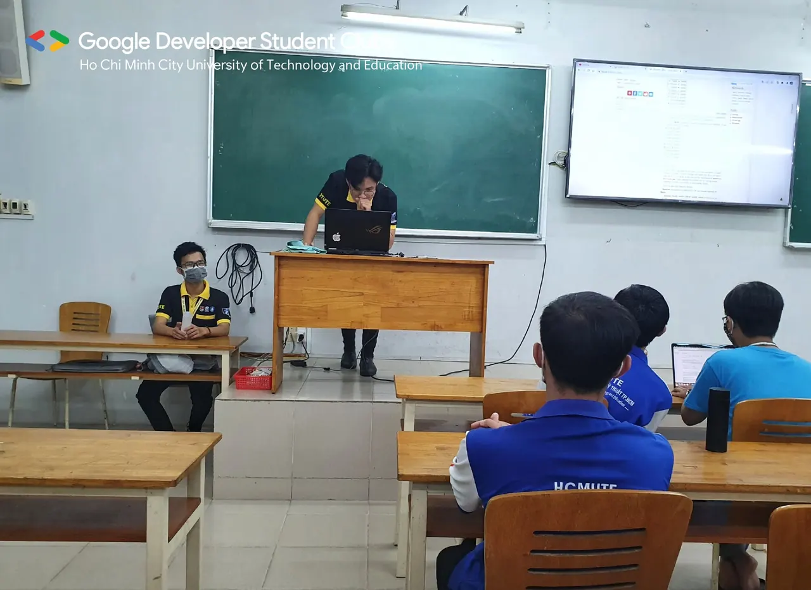
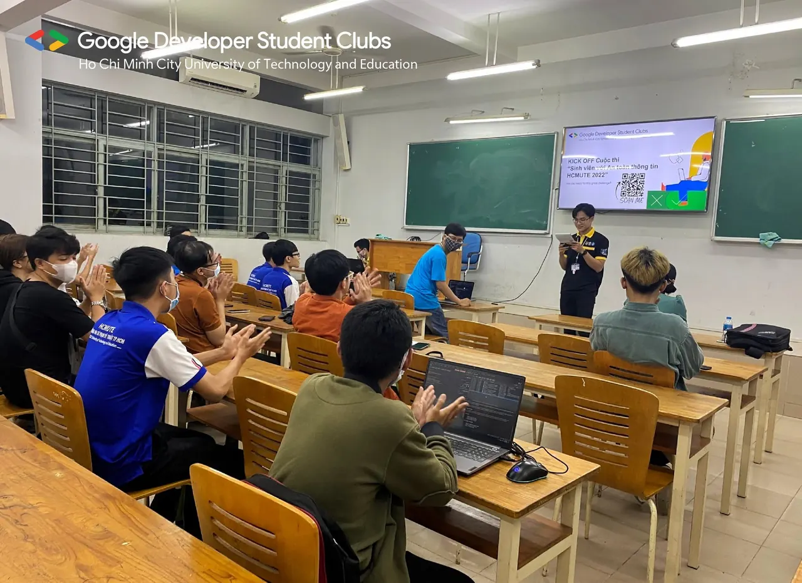
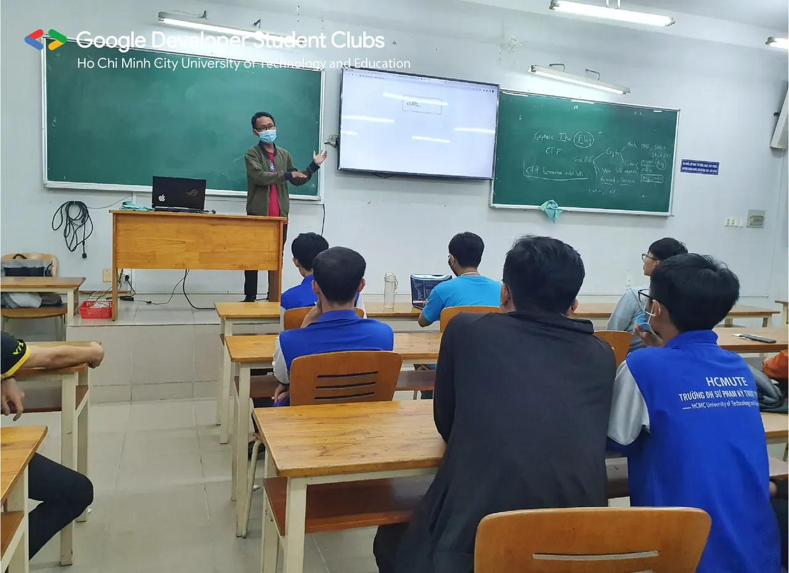
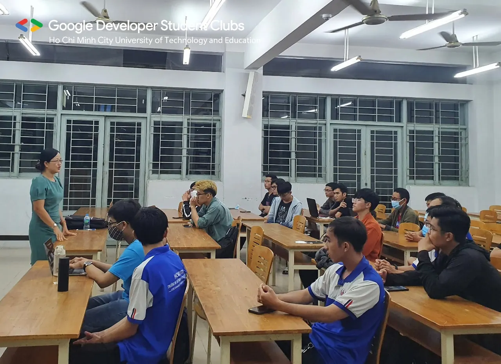
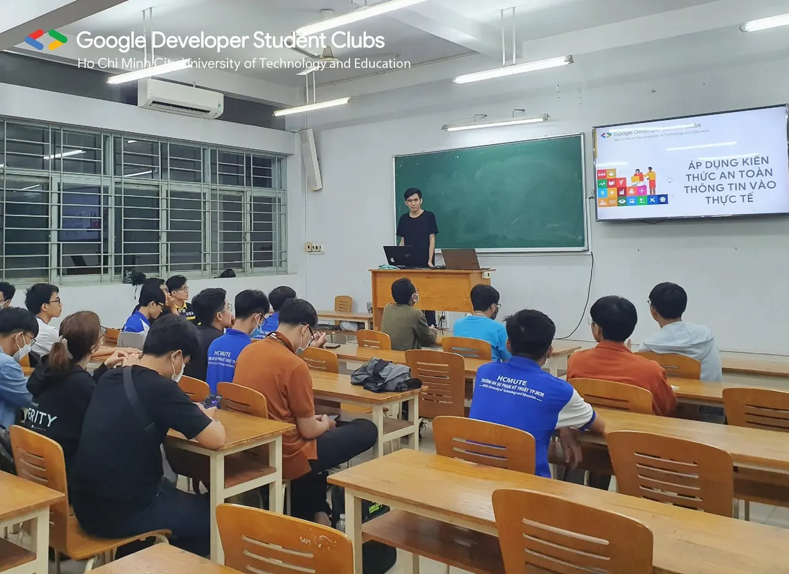
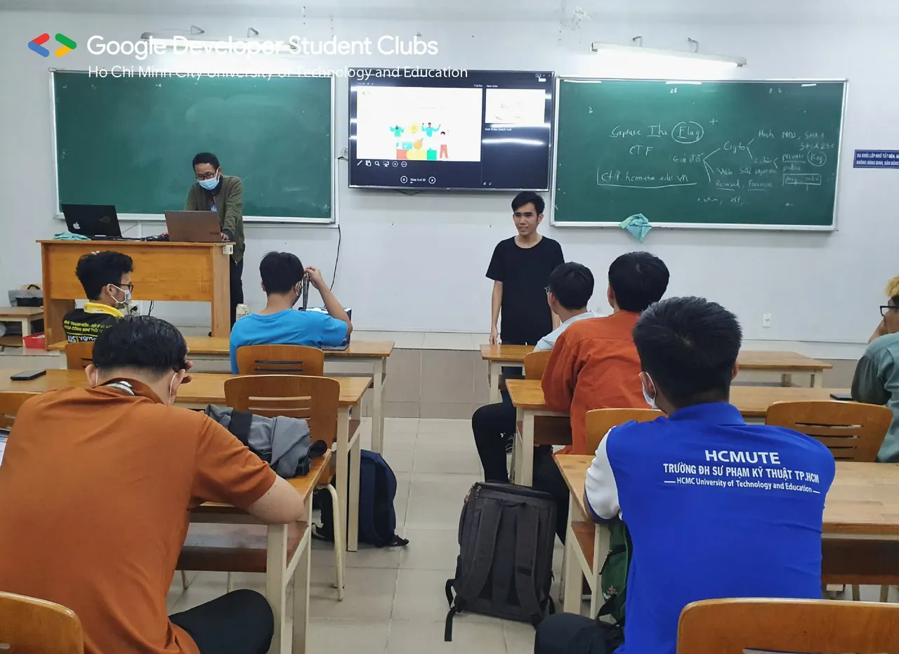

\[RECAP | KICK OFF\] - CUỘC THI HỌC THUẬT "SINH VIÊN VỚI AN TOÀN THÔNG TIN" HCMUTE (HCMUTE\_CTF)  
🖐️Chào các bạn🖐️ 🔥Vậy là buổi sinh hoạt mở rộng của chúng ta đã khép lại tốt đẹp, dựa trên tinh thần giao lưu, học hỏi, chia sẻ kiến thức và kỹ năng về An toàn thông tin chắc hẳn mọi người tham dự đều đã được trang bị thêm cho mình nhiều kiến thức bổ ích phải không nào.

<!--truncate-->

🔥Với sự đồng hành của Thạc sĩ Nguyễn Thị Thanh Vân, cùng những bậc tiền bối đi trước, chúng ta lại một lần nữa hiểu thêm về cuộc thi CTF, những kiến thức về an toàn thông tin và ứng dụng của An toàn thông tin trong thực tế….  
❤️Một lần nữa xin chân thành cảm ơn quý thầy cô cùng các anh chị rất nhiều❤️ 🔥Trong khoảng thời gian tiếp theo sẽ là giai đoạn nước rút tiến gần với cuộc thi học thuật HCMUTE\_CTF mong các bạn thí sinh sẽ luôn giữ vững lửa nhiệt và cháy hết mình trong suốt chặng thi nha &gt;&lt;  
-----------------------  
👉Nhắc bạn: thời hạn đăng ký vẫn còn hãy nhanh tay lên nhé!!!  
⏱ Thời gian đăng ký: đến hết ngày 01/9/2022 📌 Link đăng ký: [https://itute.tiny.us/ATTT-DK](https://itute.tiny.us/ATTT-DK) 📍 Thể lệ chi tiết: [https://itute.tiny.us/ATTT-TheLe](https://itute.tiny.us/ATTT-TheLe) ️️ 📒 Các kiến thức về CTF, an toàn thông tin và một số công cụ sẽ được chia sẻ và cập nhập tại server discord [https://discord.gg/au2XEJ9J6B](https://discord.gg/au2XEJ9J6B) 😍😍 Đừng quên Like và Follow fanpage để cập nhật những thông tin mới nhất nhé!  
-----------------------  
Mọi ý kiến đóng góp, các bạn có thể liên hệ trực tiếp thông qua fanpage Google Developer Student Clubs - HCM UTE: [https://www.facebook.com/gdsc.hcmute](https://www.facebook.com/gdsc.hcmute)
  
\#GDSC #GoogleDeveloperStudentClubs #GDSC\_HCMUTE

---

_Bài viết được lưu trữ từ [fanpage HCMUTE Developer Student Club](https://www.facebook.com/hcmute.dsc)._
