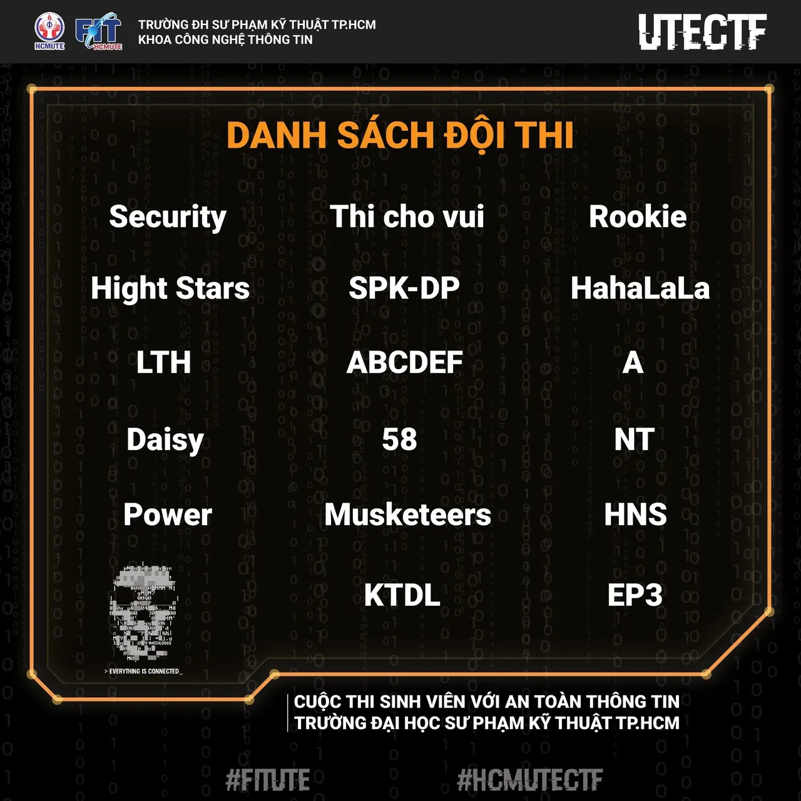

🔔 CÔNG BỐ DANH SÁCH ĐỘI THI - CUỘC THI HỌC THUẬT "SINH VIÊN VỚI AN TOÀN THÔNG TIN"  HCMUTE 🔔
  
🥰 Lời đầu tiên,  Ban Tổ chức cảm ơn các bạn đã dành thật nhiều sự quan tâm và đăng ký tham gia cuộc thi!!!

<!--truncate-->

🌟 Sau thời gian chờ đợi, 17 cái tên của chúng ta cũng đã lộ diện. Hãy cùng chào đón những đội thi tài năng của chúng ta đi nào !!!😍😍😍  
     🔹Security  
     🔸Hight Stars  
     🔹Thi cho vui  
     🔸Rookie  
     🔹HahaLaLa  
     🔸LTH  
     🔹ABCDEF  
     🔸SPK-DP  
     🔹A  
     🔸Daisy  
     🔹58  
     🔸NT  
     🔹HNS  
     🔸Musketeers  
     🔹KTDL  
     🔸EP3  
     🔹Power
  
🔥🔥🔥 Với tinh thần nhiệt huyết tuổi trẻ, sự say mê tìm tòi, học hỏi, hứa hẹn sẽ là 1 ngày thi rực cháy 🔥🔥🔥  
\_\_\_\_\_\_\_\_\_\_\_\_\_\_\_\_\_\_\_\_\_\_\_\_\_\_\_\_\_\_\_\_\_\_\_\_\_\_\_\_\_\_\_\_\_  
🚨CHECK MAIL, CHECK MAIL, CHECK MAIL🚨
  
💥 Công tác chuẩn bị cho cuộc thi học thuật “Sinh viên với An toàn thông tin” HCMUTE lần 1 năm 2022 đã chính thức được hoàn tất. Các đội thi hãy thường xuyên check mail để nhận được các thông tin từ BTC sớm nhất.  
(Hãy kiểm tra Mail sinh viên mình nhé!!!)
  
💖 Toàn thể Ban Tổ chức xin chân thành gửi lời cảm ơn đến những tình cảm, sự quan tâm và ủng hộ nhiệt tình của các bạn dành cho cuộc thi!
  
💞 Cuối cùng, chúc các bạn khoảnh khắc đặt tay vào bàn phím giống như 1 vị “tiên kiếm”, kiếm khí tung hoành tam vạn lý - nhất kiếm quang hàn thập cửu châu.  
-------------------------------------------------  
 💻💻 HÌNH THỨC THI:  
🕐 Thời gian: 8h00 ngày 04/9/2022.  
(Các đội thi phải có mặt đầy đủ thành viên trước 30 phút theo thời gian quy định của BTC để ổn định và làm thủ tục dự thi)  
✨ Thi thực hành trực tuyến (online) về ATTT, diễn ra đồng thời với tất cả các Đội dự thi. Các Đội dự thi kết nối trực tiếp hình ảnh của các thí sinh dự thi trong thời gian thi với BTC qua hệ thống video conference. Đề thi được xây dựng theo hình thức vượt qua Thử thách theo chủ đề (CTF jeopardy).
  
🏆🏆 CƠ CẤU GIẢI THƯỞNG:  
🥇 Giải Nhất: 1.000.000 đồng/giải và giấy chứng nhận của Khoa.  
🥈 Giải Nhì: 500.000 đồng/giải và giấy chứng nhận của Khoa.  
🥉 Giải Ba: 400.000 đồng/giải và giấy chứng nhận của Khoa.  
🏅 Giải Khuyến khích: 200.000 đồng/giải và giấy chứng nhận của Khoa.
  
💥💥QUYỀN LỢI SINH VIÊN: Được cộng điểm rèn luyện theo quy định của nhà trường.
  
📝📝 ĐIỀU KHOẢN THI HÀNH:  
👉 Trong quá trình tổ chức cuộc thi, nếu có những vấn đề phát sinh trước, trong và sau mỗi vòng thi diễn ra cần thay đổi phù hợp với tình hình thực tế, BTC sẽ có quyết định và thông báo cụ thể đến từng đội thi.  
🏷 Thông tin của cuộc thi sẽ được Ban Tổ chức đăng tải trên server Discord của cuộc thi [https://discord.gg/au2XEJ9J6B](https://discord.gg/au2XEJ9J6B)  
📣 Lưu ý: Trong suốt quá trình diễn ra cuộc thi mọi hành vi gian lận, thi hộ, trao đổi với các đội thi khác thì đội thi sẽ bị loại.  
\_\_\_\_\_\_\_\_\_\_\_\_\_\_\_\_\_\_\_\_\_\_\_\_\_\_\_\_\_\_\_\_\_\_\_\_\_\_\_\_\_\_\_\_  
📍📍 THỂ LỆ CHI TIẾT: [https://itute.tiny.us/ATTT-TheLe](https://itute.tiny.us/ATTT-TheLe)
  
🥰🥰 Đừng quên Like và Follow fanpage để cập nhật những thông tin mới nhất nhé!  
\_\_\_\_\_\_\_\_\_\_\_\_\_\_\_\_\_\_\_\_\_\_\_\_\_\_\_\_\_\_\_\_\_\_\_\_\_\_\_\_\_\_\_  
📬📬 Mọi thắc mắc, xin vui lòng liên hệ:  
📞📞 Liên hệ trực tiếp:  
 👦 Đ/c Lã Minh Phúc – Thành viên BTC  
[https://www.facebook.com/pk9r327/](https://www.facebook.com/pk9r327/)
  
\#FITUTE  
\#HCMUTECTF

---

_Bài viết được lưu trữ từ [fanpage HCMUTE Developer Student Club](https://www.facebook.com/hcmute.dsc)._
