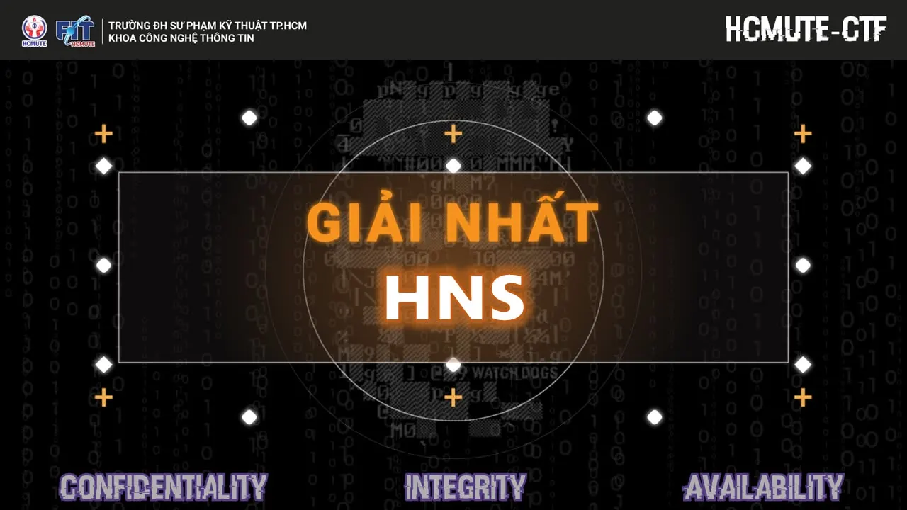
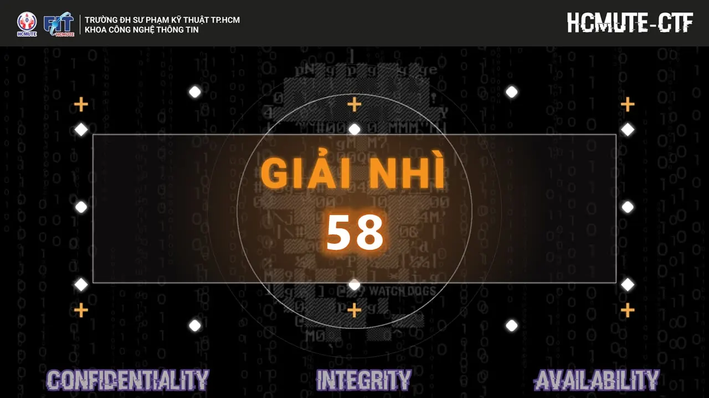
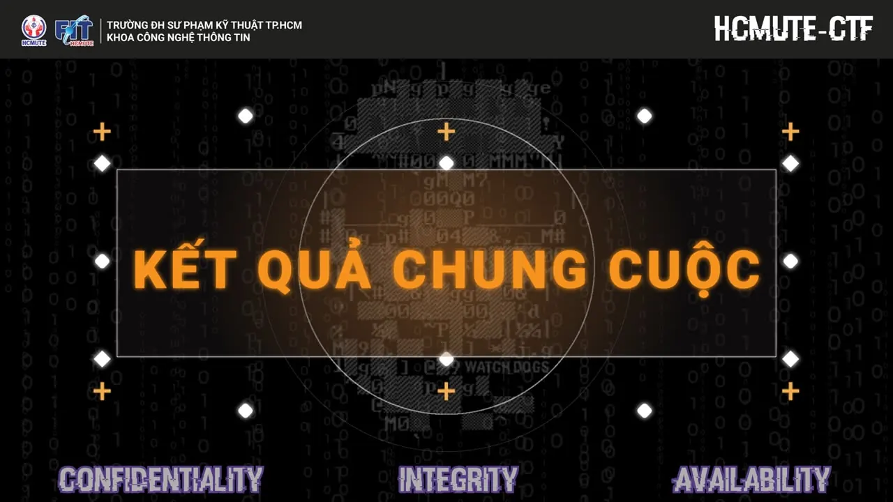
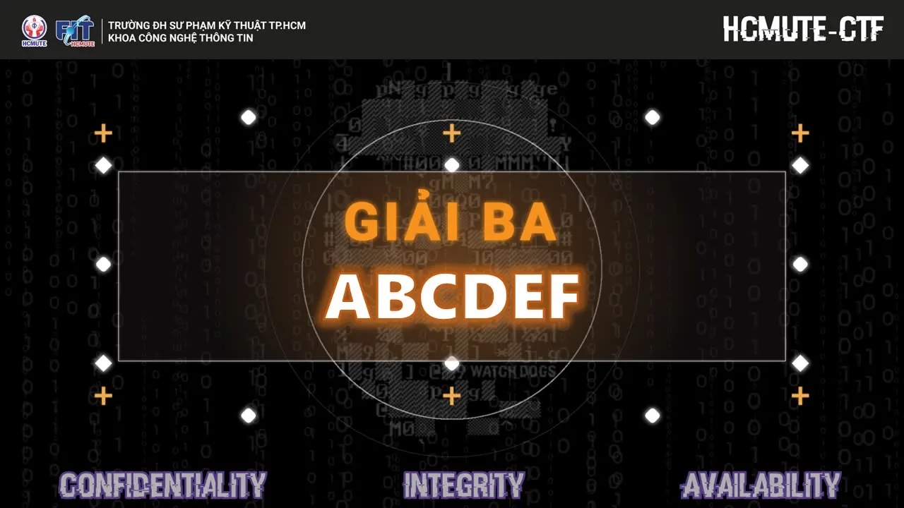
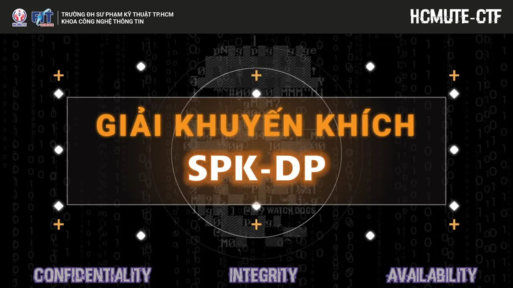
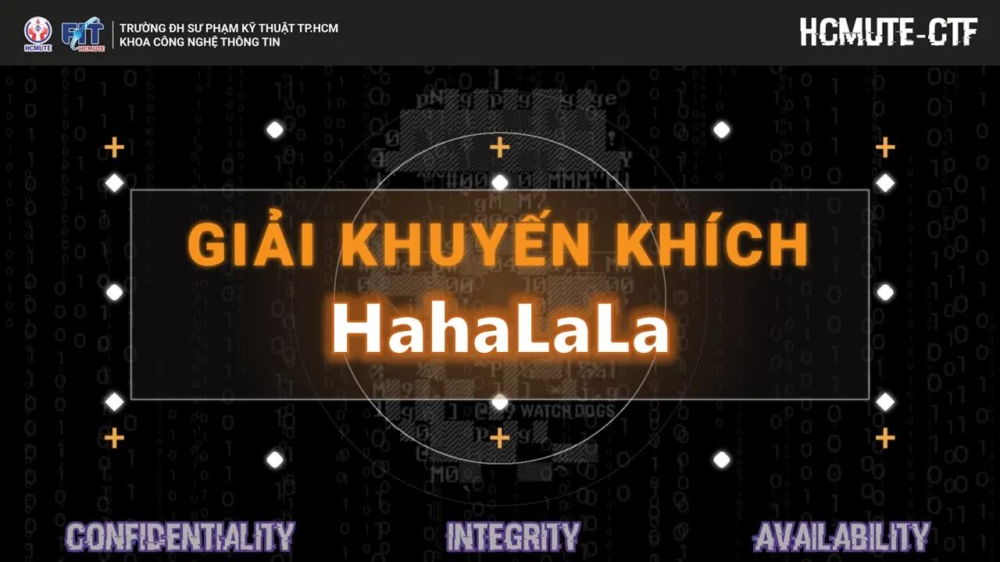
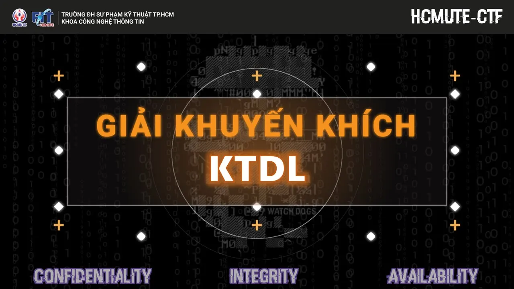
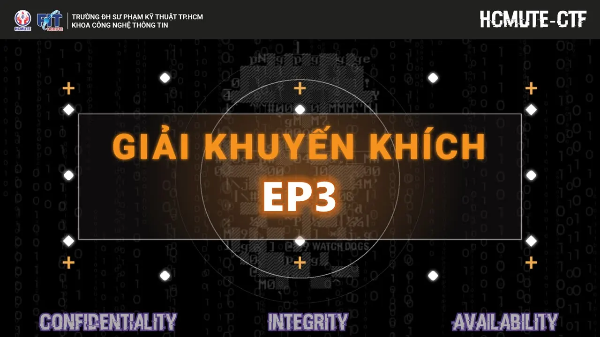

\[KẾT QUẢ CHUNG CUỘC CUỘC THI HỌC THUẬT "SINH VIÊN VỚI AN TOÀN THÔNG TIN" HCMUTE, LẦN 1 NĂM 2022\]
  
👋 Xin chào mọi người 👋

<!--truncate-->

🙆🙆 Như vậy “Sinh viên với An toàn thông tin” HCMUTE đã chính thức khép lại với sự nhiệt huyết nhất, bùng nổ nhất từ các đội thi đến từ trường Đại học Sư phạm Kỹ thuật Tp. Hồ Chí Minh. 🥰🥰 Cảm ơn sự quan tâm, tham gia tích cực đã góp phần tạo nên sự thành công rực rỡ cho cuộc thi lần này của các bạn sinh viên. Còn chần chừ gì nữa, chúng ta hãy cùng vinh danh những đội thi xuất sắc nhất đã làm bùng nổ “Sinh viên với An toàn thông tin” HCMUTE thôi nào!!!
  
🎉🎉🎉🎉 Chúc mừng các đội thi:️ 🎉🎉🎉🎉  
🏆🏆🏆 01 Giải Nhất  
💖💖 Xin chúc mừng đội: HNS đã giành giải Nhất, với các thành viên:  
🔥 Thí sinh Võ Huỳnh Anh Nhật  
🔥 Thí sinh Trần Quốc Siêu  
🔥 Thí sinh Lê Văn Hiền
  
🥈🥈🥈 01 Giải Nhì  
💖💖 Xin chúc mừng đội: 58 đã giành giải Nhì, với các thành viên:  
🔥 Thí sinh Hoàng Nguyễn Kim Duy
  
🥉🥉🥉 01 Giải Ba  
💖💖 Xin chúc mừng đội: ABCDEF đã giành giải Ba, với các thành viên:  
🔥 Thí sinh  Nguyễn Thành Văn  
🔥 Thí sinh Trần Thị Bảo Ngọc
  
🏅🏅🏅 04 Giải Khuyến Khích  
💖💖 Xin chúc mừng đội:  SPK-DP đã giành giải Khuyến khích, với các thành viên:  
🔥 Thí sinh Nguyễn Cảnh Dũng  
🔥 Thí sinh Lê Trịnh Hoàng Phú
  
💖💖 Xin chúc mừng đội: HahaLaLa đã giành giải Khuyến khích, với các thành viên:  
🔥 Thí sinh Trần Đăng Khoa  
🔥 Thí sinh Phan Ngọc Bảo Tuyền  
🔥 Thí sinh Phạm Quang Danh
  
💖💖 Xin chúc mừng đội: KTDL đã giành giải Khuyến khích, với các thành viên:  
🔥 Thí sinh Bùi Lê Hải Triều  
🔥 Thí sinh Lê Minh Trí  
🔥 Thí sinh Võ Như Ý
  
💖💖 Xin chúc mừng đội: EP3 đã giành giải Khuyến khích, với các thành viên:  
🔥 Thí sinh Nguyễn Ngọc Phát  
🔥 Thí sinh Nguyễn Thị Bích Liên
  
💥💥 Bên cạnh đó, các đội không có tên cũng đừng buồn nhé, chúng ta còn có nhiều cơ hội để chinh phục giải thưởng của các cuộc thi do khoa Công nghệ Thông tin tổ chức nữa nè!!! 💪💪
  
💟💟 Một lần nữa chúng mình xin chân thành cảm ơn sự quan tâm và yêu mến của tất cả mọi người, chúc tất cả các bạn thật nhiều sức khỏe và luôn gặt hát được thành công trong cuộc sống nhé!
  
🤔 Đừng quên Like và Follow fanpage để cập nhật những thông tin mới nhất nhé!  
\_\_\_\_\_\_\_\_\_\_\_\_\_\_\_\_\_\_\_\_\_\_\_\_\_\_\_\_\_\_\_\_\_\_\_\_\_\_\_\_\_\_\_  
📬📬 Mọi thắc mắc, xin vui lòng liên hệ:  
📞📞 Liên hệ trực tiếp:  
 👦 Đ/c Lã Minh Phúc – Thành viên BTC  
[https://www.facebook.com/pk9r327/](https://www.facebook.com/pk9r327/)
  
\#FITUTE  
\#HCMUTECTF

---

_Bài viết được lưu trữ từ [fanpage HCMUTE Developer Student Club](https://www.facebook.com/hcmute.dsc)._
