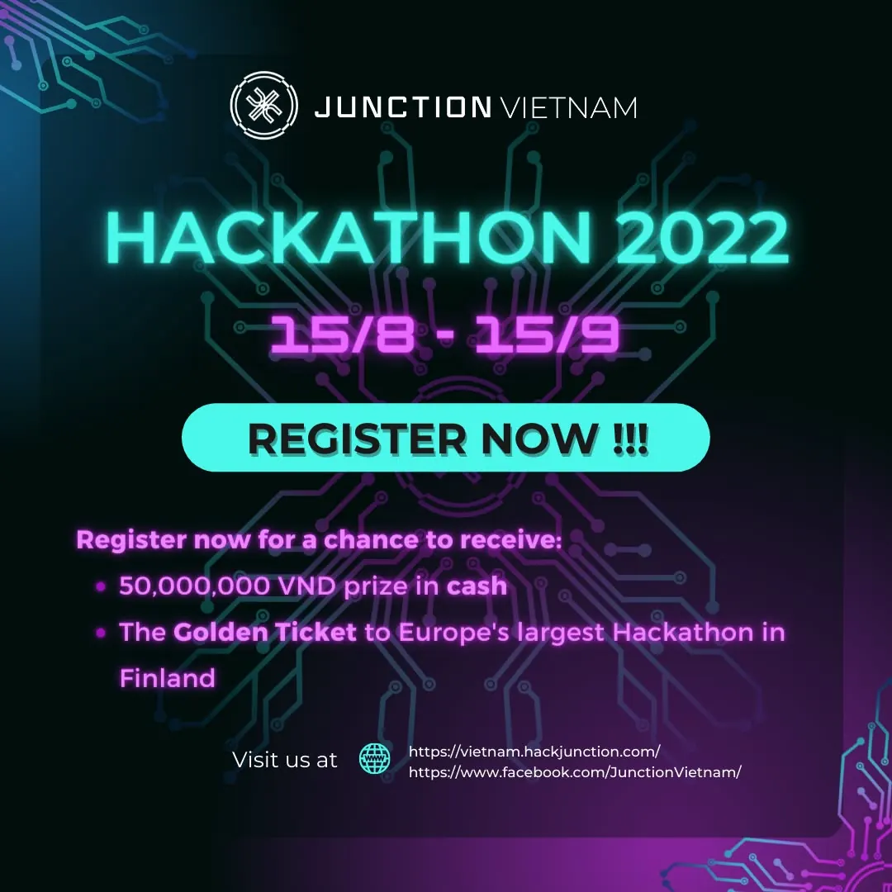

🔥 JUNCTION VIETNAM HACKATHON 2022 - WE HAVE OFFICIALLY OPENED FOR REGISTRATION 🔥 📌𝐑𝐞𝐠𝐢𝐬𝐭𝐫𝐚𝐭𝐢𝐨𝐧 𝐋𝐢𝐧𝐤: [https://bit.ly/3pj7EYf](https://bit.ly/3pj7EYf) 🔥 The hottest Hackathon is back and more exciting than ever!  
📢 Hackathon Junction Vietnam 2022 is a playground where technology lovers unleash their creativity and express themselves, actualizing their own technology fantasy. The contestants will spend 48 thrilling hours with special challenges, promising to have the most wonderful experience!

<!--truncate-->

📢This year's Hackathon is a special milestone for Junction Vietnam, as the event will be held both online and offline (in Hanoi). Each team (2-5 members) will compete in a contest with the hottest technology topics. More specifically, this year, we welcome contestants from all over the country! Come to Junction Vietnam Hackathon 2022, the champion will receive:  
✨The "Golden ticket" represents Vietnam to attend Europe's largest hackathon in Finland for the champion.  
✨50,000,000 VND prize in CASH !!!  
🔥 Are you ready for an explosive weekend  
📌𝐉𝐎𝐈𝐍 𝐓𝐇𝐄 𝐇𝐀𝐂𝐊 𝐍𝐎𝐖: [https://bit.ly/3pj7EYf](https://bit.ly/3pj7EYf) 📌𝐑𝐞𝐠𝐢𝐬𝐭𝐫𝐚𝐭𝐢𝐨𝐧 𝐩𝐞𝐫𝐢𝐨𝐝: 𝟏𝟓.𝟎𝟖 - 𝟏𝟓.𝟎𝟗.𝟐𝟎𝟐𝟐 📌More information at: [https://vietnam.hackjunction.com/](https://vietnam.hackjunction.com/) 📌Hackathon: 14.10 - 16.10.2022  
\_\_\_\_\_\_\_\_\_\_\_\_\_\_\_  
🔥MỞ ĐƠN ĐĂNG KÝ - CUỘC THI CÔNG NGHỆ JUNCTION VIETNAM HACKATHON 2022 🔥 📌𝐋𝐢𝐧𝐤 Đ𝐚̆𝐧𝐠 𝐊𝐲́: [https://bit.ly/3pj7EYf](https://bit.ly/3pj7EYf) 🔥Cuộc thi Hackathon “nóng” nhất đã trở lại và sôi động hơn bao giờ hết!  
📢Hackathon Junction Vietnam 2022 là một sân chơi, nơi các tín đồ công nghệ thỏa sức sáng tạo và thể hiện bản thân, hiện thực hóa giấc mơ công nghệ của chính mình. Các thí sinh sẽ trải qua 48 giờ gay cấn, chiến đấu với những thử thách đặc biệt, hứa hẹn đem lại những trải nghiệm bất ngờ nhất.  
📢Cuộc thi Hackathon năm nay là một dấu mốc đặc biệt với Junction Vietnam, khi mà sự kiện sẽ được tổ chức theo hình thức kết hợp cả online và offline (tại Hà Nội). Mỗi đội có số lượng từ 2-5 thành viên sẽ phải hoàn thành phần thi về các chủ đề công nghệ hot nhất hiện nay. Đặc biệt hơn, năm nay, chúng mình chào đón thí sinh trên toàn quốc! Trở thành nhà vô địch, bạn sẽ nhận được:  
✨Giải thưởng 50.000.000 VNĐ tiền mặt ✨Tấm “vé vàng” đại diện Việt Nam đến với đấu trường Hackathon lớn nhất Châu u ở Phần Lan.  
🔥Bạn đã sẵn sàng trải qua một cuối tuần bùng nổ chưa  
📌ĐĂNG KÝ THAM GIA NGAY TẠI: [https://bit.ly/3pj7EYf](https://bit.ly/3pj7EYf) 📌𝐓𝐡𝐨̛̀𝐢 𝐠𝐢𝐚𝐧 đ𝐚̆𝐧𝐠 𝐤𝐲́: 𝟏𝟓.𝟎𝟖 - 𝟏𝟓.𝟎𝟗.𝟐𝟎𝟐𝟐 📌Thông tin chi tiết: [https://vietnam.hackjunction.com/](https://vietnam.hackjunction.com/) 📌Hackathon: 14.10 - 16.10.2022
  
\#hackathon #hackathon2022 #junction #junctionvietnam #hackyourfuture

---

_Bài viết được lưu trữ từ [fanpage HCMUTE Developer Student Club](https://www.facebook.com/hcmute.dsc)._
