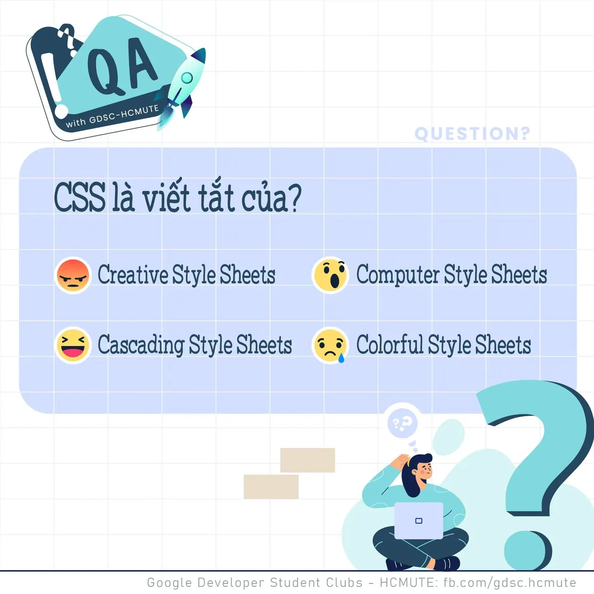

\[QA GDSC - Question\]
  
👉 Tadaa 👈

<!--truncate-->

😚 Chào tất cả mọi người, sau một thời gian khá lâu thì chuyên mục Q&A của chúng mình đã chính thức trở lại với nhiều nội dung phong phú hơn dành cho mọi người đây. Các bạn hãy cùng chúng mình nạp lại năng lượng với một câu hỏi về CSS nhá.😚😚
  
CSS là viết tắt của?🤔🤔
  
💚 Bình tĩnh tự tin và để lại React cũng như Comment để GDSC - HCMUTE chúng mình xem có bao nhiêu bạn vượt qua thử thách lần này nào.  
🍀 Đừng quên Like và Follow Page để đón chờ phần Answer được lên sóng vào ngày mai nha.  
------------------------------------------------------------------------------------------------------------------------  
👉QA with GDSC HCMUTE là chuyên mục do GDSC - HCMUTE thực hiện với mong muốn cung cấp các kiến thức và thông tin hữu ích, giúp các bạn có thêm các tips thú vị trong lĩnh vực Công nghệ Thông tin thông qua Question và Answer được lên sóng hàng tuần!  
👉Mọi ý kiến đóng góp, các bạn có thể liên hệ trực tiếp thông qua fanpage Google Developer Student Clubs - HCM UTE: [https://www.facebook.com/gdsc.hcmute](https://www.facebook.com/gdsc.hcmute)  
\#GDSC #GoogleDeveloperStudentClubs #GDSC\_HCMUTE #GDSC\_QA See less

---

_Bài viết được lưu trữ từ [fanpage HCMUTE Developer Student Club](https://www.facebook.com/hcmute.dsc)._
