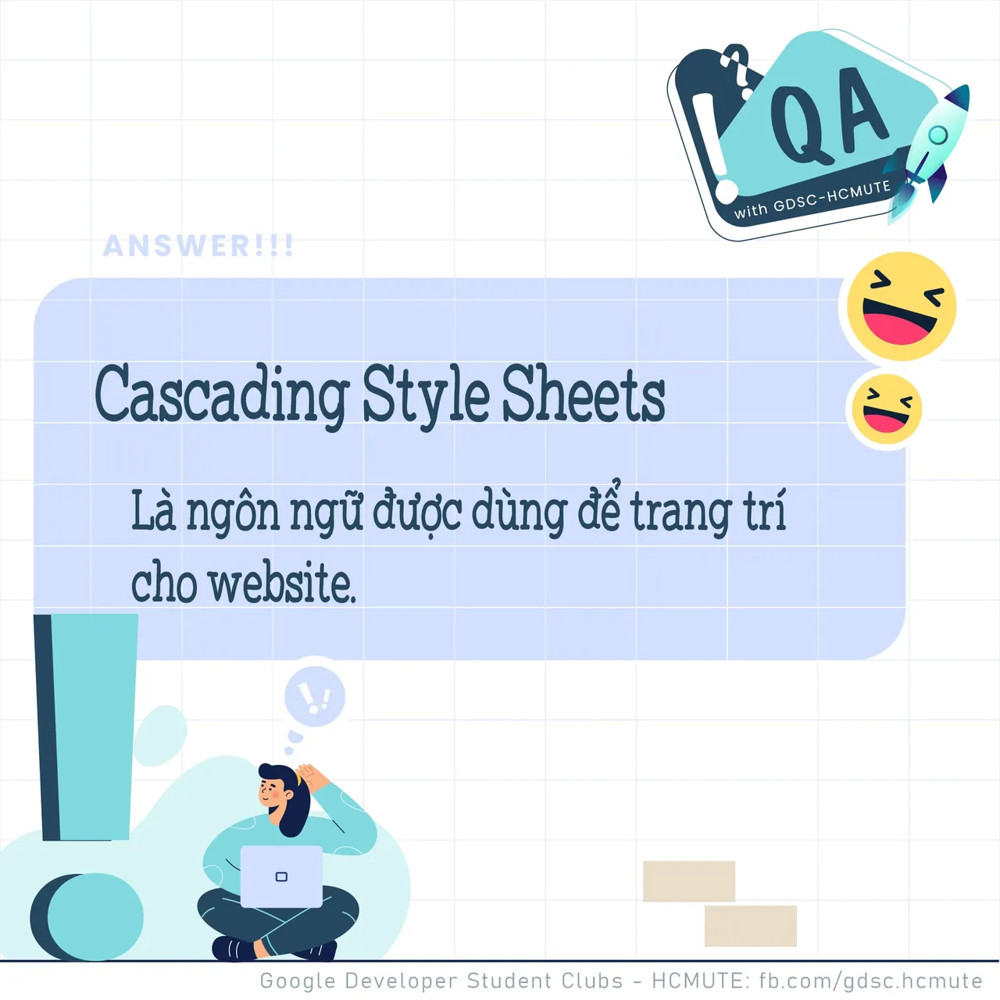

\[QA GDSC - Answer\]  
😚 Sau câu hỏi QA hôm qua, chúng mình đã quay trở lại rồi đây😚 👉 Chắc câu hỏi về định nghĩa cơ bản sẽ không làm khó các coder đâu nhỉ. Đáp án chính xác của tui mình là Cascading Style Sheets.

<!--truncate-->

🤗 Thông tin thêm với các bạn CSS( Cascading Style Sheets) là ngôn ngữ được dùng để trang trí cho website.  
🤔 Các bạn có suy nghĩ thế nào với đáp án lần này Để lại bình luận bên dưới để Ad cũng như các bạn có thể tham khảo nha ^^  
---------------------------  
👉 QA with GDSC - HCMUTE là chuyên mục do GDSC - HCMUTE thực hiện với mong muốn cung cấp các kiến thức và thông tin hữu ích, giúp các bạn có thêm các tips thú vị trong lĩnh vực Công nghệ Thông tin thông qua Question và Answer được lên sóng hàng tuần!  
👉Mọi ý kiến đóng góp, các bạn có thể liên hệ trực tiếp thông qua fanpage Google Developer Student Clubs - HCM UTE: [https://www.facebook.com/gdsc.hcmute](https://www.facebook.com/gdsc.hcmute) #GDSC #GoogleDeveloperStudentClubs #GDSC\_HCMUTE #GDSC\_QA See less

---

_Bài viết được lưu trữ từ [fanpage HCMUTE Developer Student Club](https://www.facebook.com/hcmute.dsc)._
