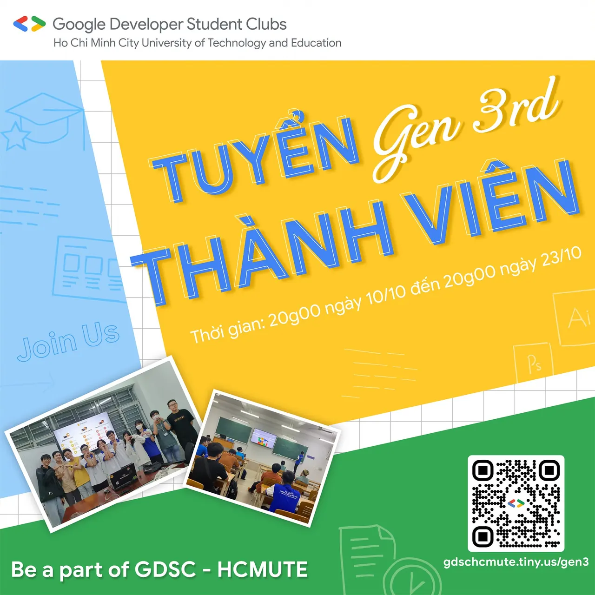

\[GDSC - HCMUTE | TUYỂN THÀNH VIÊN GEN3rd\]
  
🤘 LET’S BECOME A PART OF GDSC - HCMUTE 🤘

<!--truncate-->

🧐 Bạn là sinh viên có niềm đam mê, yêu thích đối với công nghệ thông tin?
  
🧐 Bạn đang tìm kiếm một môi trường để phát triển bản thân trên con đường Đại học?  
…  
🤗🤗 Còn chần chừ gì nữa mà không đăng ký để có cơ hội trở thành thành viên chính thức của GDSC - HCMUTE thôi nào!!!!
  
🗒🗒🗒 Tham gia vào GDSC - HCMUTE, các bạn sẽ được:  
👉 Hòa mình vào một môi trường "đa văn hóa" với các thành viên đến từ các ngành học và các khóa học khác nhau.  
👉 Truy cập vào các tài nguyên dành cho nhà phát triển của Google.  
👉 Chia sẻ và học hỏi những kiến thức công nghệ mới.  
👉 Learning By Making, áp dụng những kiến thức đã được học để xây dựng các sản phẩm công nghệ giải quyết những bài toán thực tiễn trong cộng đồng.
  
❤️❤️ Với mong muốn tìm kiếm và kết nối các bạn Sinh viên có niềm đam mê, yêu thích các công nghệ của Google nói riêng và Công nghệ Thông tin nói chung, GDSC - HCMUTE chúng mình chính thức mở form đăng ký thành viên cụ thể như sau:
  
⌛ Thời gian đăng ký: 20g00 ngày 10/10 đến 20g00 ngày 23/10
  
📝 Link đăng ký: gdschcmute.tiny.us/gen3
  
✅ Đối tượng đăng ký: Sinh viên tại các trường Đại học và Cao đẳng trong địa bàn TP.HCM có hiểu biết hoặc đam mê với Công nghệ Thông tin.
  
⚡ Sau khi đăng ký thành công, các bạn sẽ trải qua vòng lọc hồ sơ và vòng phỏng vấn online với ban chủ nhiệm CLB để trở thành thành viên chính thức của GDSC - HCMUTE, nhưng đừng lo lắng quá nhá ❤️ Thông tin chi tiết sẽ được chúng mình đăng tải sớm trên Fanpage!
  
✨ Sự tham gia, đồng hành và hỗ trợ từ các bạn Sinh viên sẽ là động lực để GDSC - HCMUTE ngày càng phát triển, góp phần mang lại kiến thức và kỹ năng bổ ích cho cộng đồng các bạn Sinh viên ❤️.
  
👉 Đừng quên Like và Follow Page để cùng đón chờ các hoạt động thú vị tiếp theo của GDSC - HCMUTE nha😉  
\_\_\_\_\_\_\_\_\_\_\_\_\_\_\_\_\_\_\_\_\_\_\_\_\_\_\_\_\_\_\_\_\_\_\_\_\_\_\_\_\_\_\_\_\_\_\_\_\_\_\_\_\_\_\_\_\_\_
  
✨✨✨ Được hỗ trợ bởi Google Developers, Google Developer Student Clubs (GDSC) là các nhóm cộng đồng cho sinh viên có niềm đam mê với các công nghệ của Google. Khi tham gia vào GDSC, các bạn sinh viên có cơ hội cùng nhau học hỏi trong một môi trường mở và năng động, cùng nhau xây dựng các giải pháp cho các vấn đề thực tế trong cộng đồng.
  
👉👉👉 Google Developer Student Clubs - HCMUTE (GDSC - HCMUTE) vô cùng vinh dự khi trở thành một thành viên mới của GDSC toàn cầu. Với khao khát kết nối các bạn sinh viên yêu thích công nghệ thông tin nói chung và các công nghệ của Google nói riêng, GDSC - HCMUTE sẽ xây dựng một cộng đồng thân thiện để mọi người cùng chia sẻ kiến thức và tạo ra nhiều sản phẩm giúp ích cho xã hội.
  
📌📌📌 Muốn biết thêm thông tin về GDSC toàn cầu, các bạn hãy vào trang web: developers.google.com/community/gdsc
  
\_\_\_\_\_\_\_\_\_\_\_\_\_\_\_\_\_\_\_\_\_\_\_\_\_\_\_\_\_\_\_\_\_\_\_\_\_\_\_\_\_\_\_\_\_\_\_\_\_\_
  
📎 Mọi thắc mắc, xin vui lòng liên hệ:
  
💾 Fanpage Google Developer Student Clubs - HCM UTE: [https://www.facebook.com/gdsc.hcmute](https://www.facebook.com/gdsc.hcmute)
  
\#GDSC #GoogleDeveloperStudentClubs #GDSC\_HCMUTE #TuyenTVDot3

---

_Bài viết được lưu trữ từ [fanpage HCMUTE Developer Student Club](https://www.facebook.com/hcmute.dsc)._
