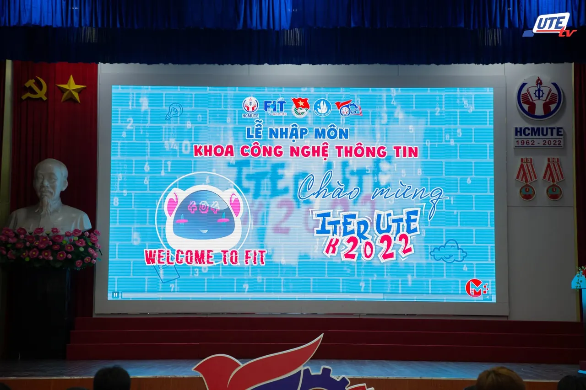
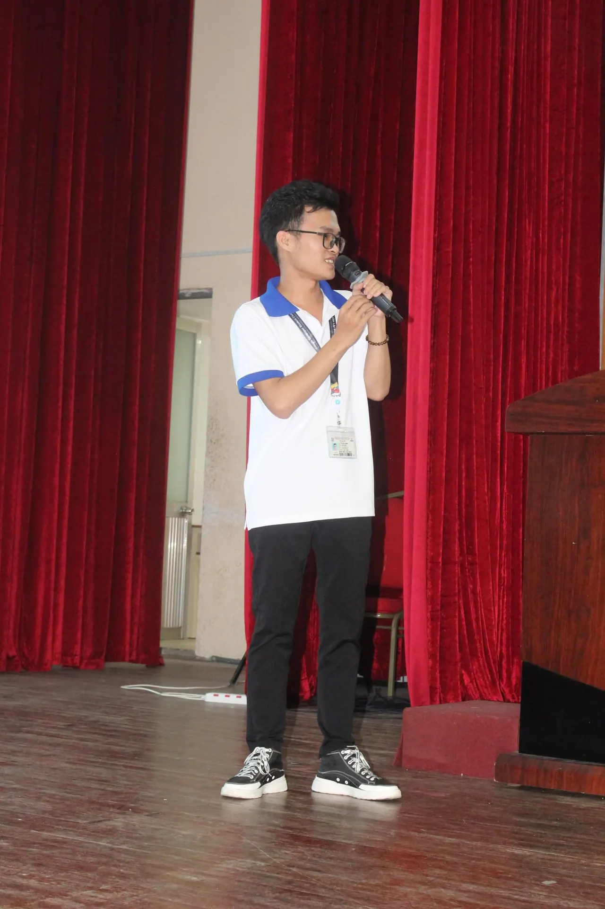
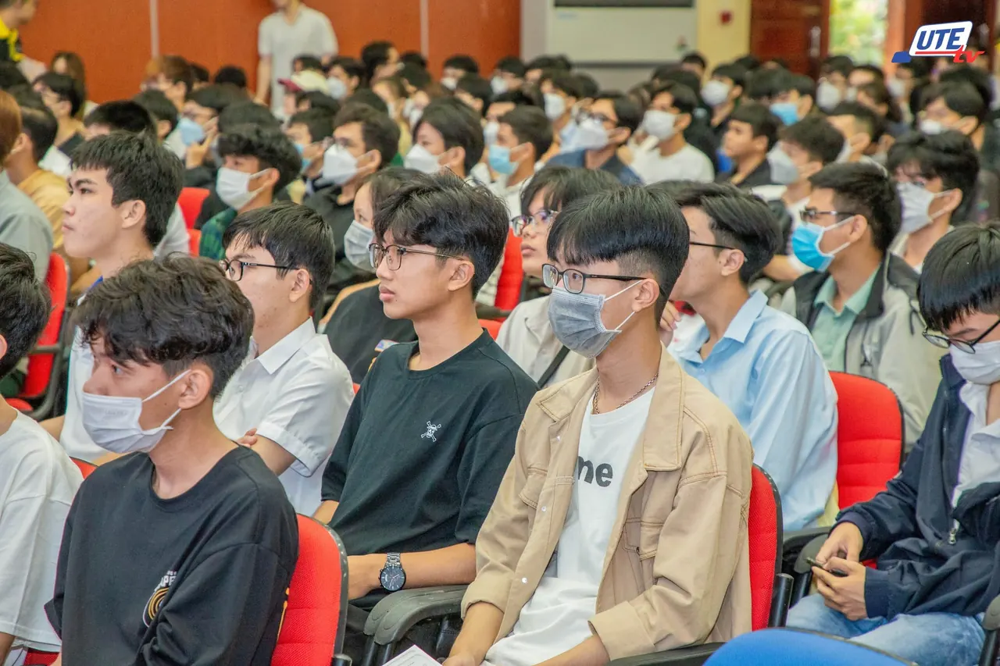
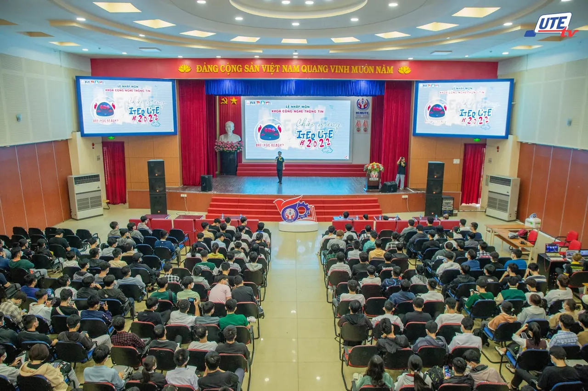

\[INFO SESSION GDSC - HCMUTE\]  
👉 WE’RE WAITING FOR YOU 👈 🤗 Ú òa! Chắc hẳn buổi lễ Nhập môn dành cho Tân Sinh viên vừa qua là một dấu mốc đáng nhớ đối với các bạn sinh viên K22 đúng hong nào!!

<!--truncate-->

🤗 💕 Và trong buổi lễ, CLB chúng mình đã có cơ hội được ra mắt đến với các bạn qua buổi INFO SESSION được chính Chủ nhiệm CLB - anh Lê Văn Cường giới thiệu. Các bạn có cảm thấy hứng thú hơn về CLB khi được nghe phần trình bày của anh hong taa Hãy comment bên dưới bài viết cho chúng mình biết nhé!  
😉 ✌️ Đơn đăng ký Tuyển thành viên Đợt 3 của CLB vẫn đang được mở để chào đón các bạn Tân Sinh viên 2022, cũng như là các bạn sinh viên có niềm đam mê với Công nghệ Thông tin. GDSC - HCMUTE chúng mình vẫn đang ở đây và chờ đợi các bạn trở thành thành viên chính thức của CLB đấy nha!  
💗 Hãy cùng trở thành một phần của GDSC - HCMUTE!  
💗 ▶️▶️▶️ Thông tin Tuyển thành viên Đợt 3:  
⌛ Thời gian đăng ký: 20g00 ngày 10/10 đến 20g00 ngày 23/10 📍 Link đăng ký: gdschcmute.tiny.us/gen3 ✅ Đối tượng: Sinh viên tại các trường Đại học và Cao đẳng trong địa bàn TP.HCM có hiểu biết hoặc đam mê với Công nghệ Thông tin. Nguồn ảnh: UTE-TV và Đoàn - Hội Khoa Công nghệ Thông tin - ĐH Sư phạm Kỹ thuật TP.HCM  
--------------------------------------------------------------------------------------  
✨✨✨ Được hỗ trợ bởi Google Developers, Google Developer Student Clubs (GDSC) là các nhóm cộng đồng cho sinh viên có niềm đam mê với các công nghệ của Google. Khi tham gia vào GDSC, các bạn sinh viên có cơ hội cùng nhau học hỏi trong một môi trường mở và năng động, cùng nhau xây dựng các giải pháp cho các vấn đề thực tế trong cộng đồng.  
👉👉👉 Google Developer Student Clubs - HCMUTE (GDSC - HCMUTE) vô cùng vinh dự khi trở thành một thành viên mới của GDSC toàn cầu. Với khao khát kết nối các bạn sinh viên yêu thích công nghệ thông tin nói chung và các công nghệ của Google nói riêng, GDSC - HCMUTE sẽ xây dựng một cộng đồng thân thiện để mọi người cùng chia sẻ kiến thức và tạo ra nhiều sản phẩm giúp ích cho xã hội.  
📌📌📌 Muốn biết thêm thông tin về GDSC toàn cầu, các bạn hãy vào trang web: developers.google.com/community/gdsc  
--------------------------------------------------------------------------------------  
Mọi ý kiến đóng góp, các bạn có thể liên hệ trực tiếp thông qua fanpage Google Developer Student Clubs - HCM UTE: [https://www.facebook.com/gdsc.hcmute](https://www.facebook.com/gdsc.hcmute)
  
\#GDSC #GoogleDeveloperStudentClubs #GDSC\_HCMUTE #TuyenTVDot3

---

_Bài viết được lưu trữ từ [fanpage HCMUTE Developer Student Club](https://www.facebook.com/hcmute.dsc)._
