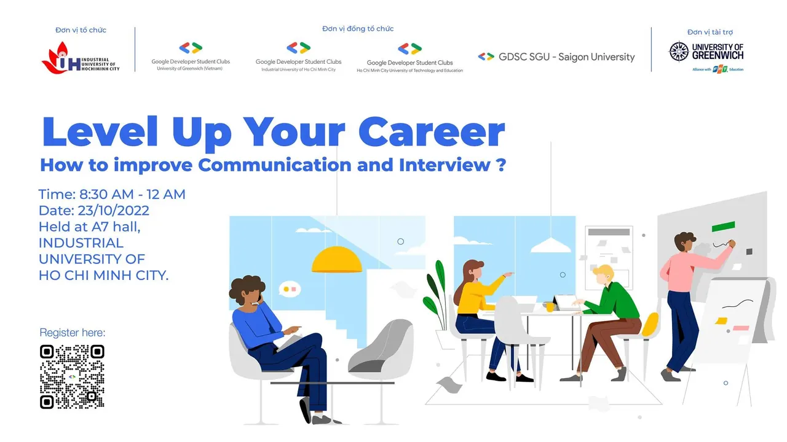

🔥 Workshop “LEVEL UP YOUR CAREER” - How to improve Communication and Interview  
🔍 Nhà tuyển dụng thường mong muốn điều gì

<!--truncate-->

❓Làm sao để xây dựng hồ sơ ấn tượng  
❓Làm sao để chuẩn bị cho buổi phỏng vấn  
📌 Mời các bạn tham gia Workshop: LEVEL UP YOUR CAREER để được tìm hiểu, lắng nghe những chia sẻ, những góc nhìn từ các anh chị diễn giả hiện đang làm việc ở nhiều vị trí khác nhau tại tập đoàn Google và tập đoàn VNG mang đến cho mọi người nhiều câu chuyện, kinh nghiệm, truyền cảm hứng, cũng như nâng cao kỹ năng viết CV và cách để cải thiện kỹ năng giao tiếp nhằm phát triển sự nghiệp trong tương lai. Chúng mình tin rằng, “LEVEL UP YOUR CAREER” còn là dịp để bạn có thể kết nối đến với các doanh nghiệp, kết nối với các bạn sinh viên yêu thích và có niềm đam mê với công nghệ và có cơ hội mở rộng mối quan hệ. Chương trình được tổ chức bởi cộng đồng Google Developer Student Clubs Vietnam (GDSC Vietnam) với sự đồng hành từ 4 GDSC tại: Đại học Công nghiệp Thành phố Hồ Chí Minh, Đại học Greenwich Cần Thơ, Đại học Sài Gòn và Đại học Sư phạm Kỹ thuật Thành phố Hồ Chí Minh và sự hỗ trợ từ cộng đồng Google Developer Group Vietnam.  
👉 Đối tượng tham gia: Sinh viên đang theo học tại các trường trên địa bàn TP. HCM TP.HCM, sinh viên trường Đại học Greenwich Cần Thơ.  
👉 Thời gian: 8:30 AM đến 12:00 AM ngày 23/10/2022 (Chủ nhật)  
👉 Địa điểm: Hội trường A7 - Trường Đại học Công Nghiệp TP.HCM.  
👉 Link đăng ký: [https://tinyurl.com/LeverUpYourCareer2022](https://tinyurl.com/LeverUpYourCareer2022) Hẹn gặp các bạn ở buổi workshop ❣

---

_Bài viết được lưu trữ từ [fanpage HCMUTE Developer Student Club](https://www.facebook.com/hcmute.dsc)._
