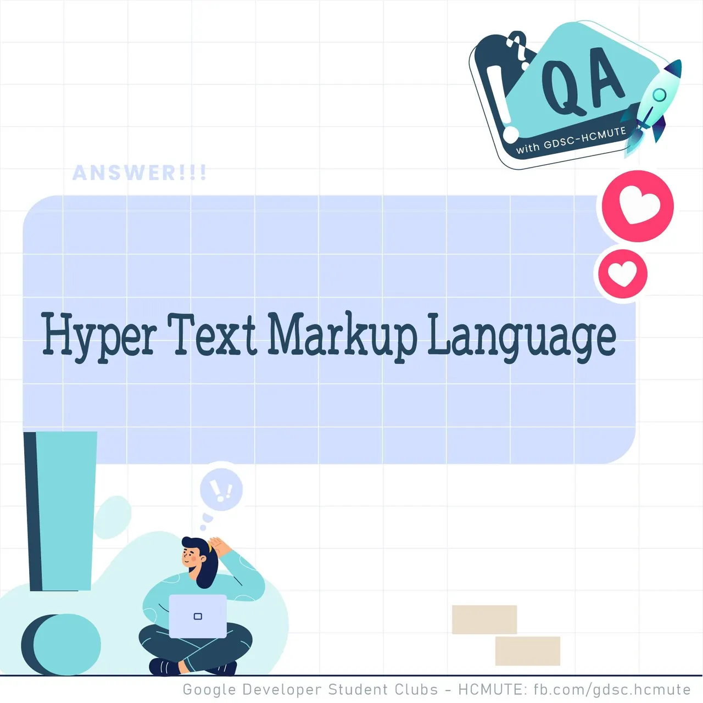

\[QA GDSC - Answer\]
  
Nối tiếp với câu hỏi trước đó thì chúng mình đã trở lại với câu trả lời đây.😉😉

<!--truncate-->

😙 Một câu hỏi về lý thuyết chắc không đủ để cản bước mọi người đâu nhỉ. Đáp án chính xác của tụi mình là Hyper Text Markup Language.
  
✅ Thông tin thêm với mọi người HTML là  là một ngôn ngữ đánh dấu được thiết kế ra để tạo nên các trang web trên World Wide Web.
  
🍀 Các bạn có suy nghĩ thế nào với đáp án lần này? Để lại bình luận bên dưới để Ad cũng như các bạn có thể tham khảo nha ^^🍀  
---------------------------  
👉QA with GDSC - HCMUTE là chuyên mục do GDSC - HCMUTE thực hiện với mong muốn cung cấp các kiến thức và thông tin hữu ích, giúp các bạn có thêm các tips thú vị trong lĩnh vực Công nghệ Thông tin thông qua Question và Answer được lên sóng hàng tuần!  
👉Mọi ý kiến đóng góp, các bạn có thể liên hệ trực tiếp thông qua fanpage Google Developer Student Clubs - HCM UTE: [https://www.facebook.com/gdsc.hcmute](https://www.facebook.com/gdsc.hcmute)  
\#GDSC #GoogleDeveloperStudentClubs #GDSC\_HCMUTE #GDSC\_QA

---

_Bài viết được lưu trữ từ [fanpage HCMUTE Developer Student Club](https://www.facebook.com/hcmute.dsc)._
