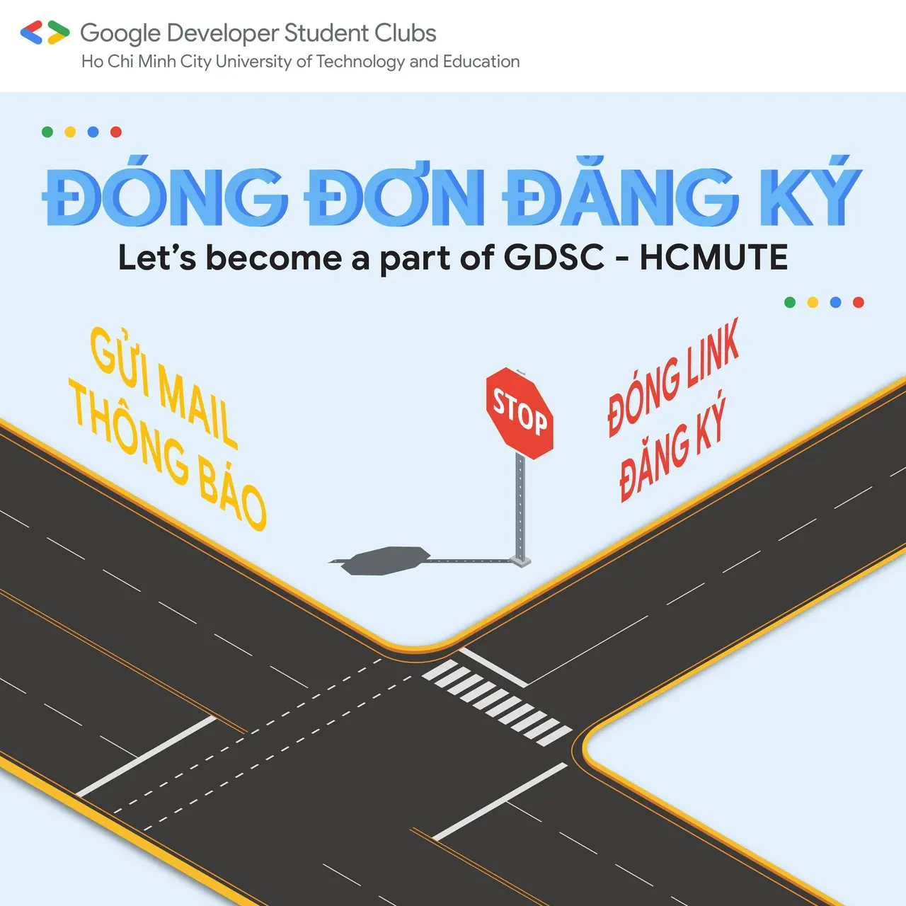
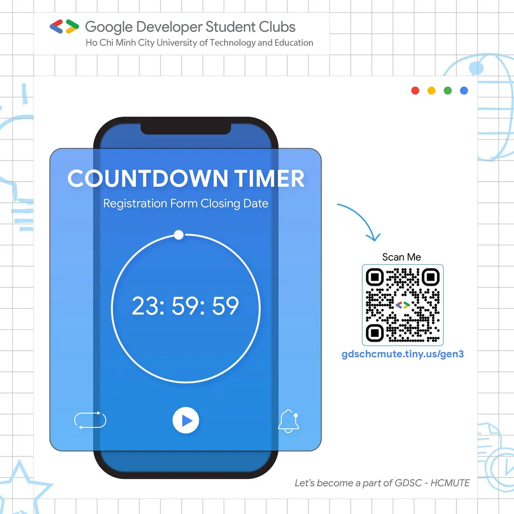

\[TUYỂN THÀNH VIÊN GEN 3 - GDSC HCMUTE CHÍNH THỨC ĐÓNG LINK\]
  
📍 Kingkong, Form tuyển thành viên đã chính thức đóng link!!!

<!--truncate-->

🌟Lời đầu tiên, GDSC- HCMUTE xin gửi lời cảm ơn chân thành nhất đến toàn thể các bạn sinh viên đã quan tâm đến CLB.
  
✅ Sau khi đóng link, chúng mình sẽ tiến hành duyệt hồ sơ. Kết quả duyệt sẽ có vào ngày 25/10 và sẽ được gửi qua email của từng bạn, nhớ check email thật kỹ đó nha 😉.
  
✨ Và quan trọng hơn hết là nhớ follow Fanpage để không bỏ lỡ bất kỳ thông báo quan trọng nào nhaa
  
🍀 Một lần nữa xin cảm ơn tình cảm của mọi người dành cho CLB Sinh viên lập trình Google - HCMUTE.  
Hẹn gặp lại tất cả các bạn!!!  
\_\_\_\_\_\_\_\_\_\_\_\_\_\_\_\_\_\_\_\_\_\_\_\_\_\_\_\_\_\_\_\_\_\_\_\_\_\_\_\_\_\_\_\_\_\_\_\_\_\_\_\_\_\_\_\_\_\_  
 Được hỗ trợ bởi Google Developers, Google Developer Student Clubs (GDSC) là các nhóm cộng đồng cho sinh viên có niềm đam mê với các công nghệ của Google. Khi tham gia vào GDSC, các bạn sinh viên có cơ hội cùng nhau học hỏi trong một môi trường mở và năng động, cùng nhau xây dựng các giải pháp cho các vấn đề thực tế trong cộng đồng.  
 Google Developer Student Clubs - HCMUTE (GDSC - HCMUTE) vô cùng vinh dự khi trở thành một thành viên mới của GDSC toàn cầu. Với khao khát kết nối các bạn sinh viên yêu thích công nghệ thông tin nói chung và các công nghệ của Google nói riêng, GDSC - HCMUTE sẽ xây dựng một cộng đồng thân thiện để mọi người cùng chia sẻ kiến thức và tạo ra nhiều sản phẩm giúp ích cho xã hội.  
 Muốn biết thêm thông tin về GDSC toàn cầu, các bạn hãy vào trang web: developers.google.com/community/gdsc  
\_\_\_\_\_\_\_\_\_\_\_\_\_\_\_\_\_\_\_\_\_\_\_\_\_\_\_\_\_\_\_\_\_\_\_\_\_\_\_\_\_\_\_\_\_\_\_\_\_\_  
 Mọi thắc mắc, xin vui lòng liên hệ:  
 Fanpage Google Developer Student Clubs - HCM UTE: [https://www.facebook.com/gdsc.hcmute](https://www.facebook.com/gdsc.hcmute)  
\#GDSC #GoogleDeveloperStudentClubs #GDSC\_HCMUTE #TuyenTVDot3

---

_Bài viết được lưu trữ từ [fanpage HCMUTE Developer Student Club](https://www.facebook.com/hcmute.dsc)._
