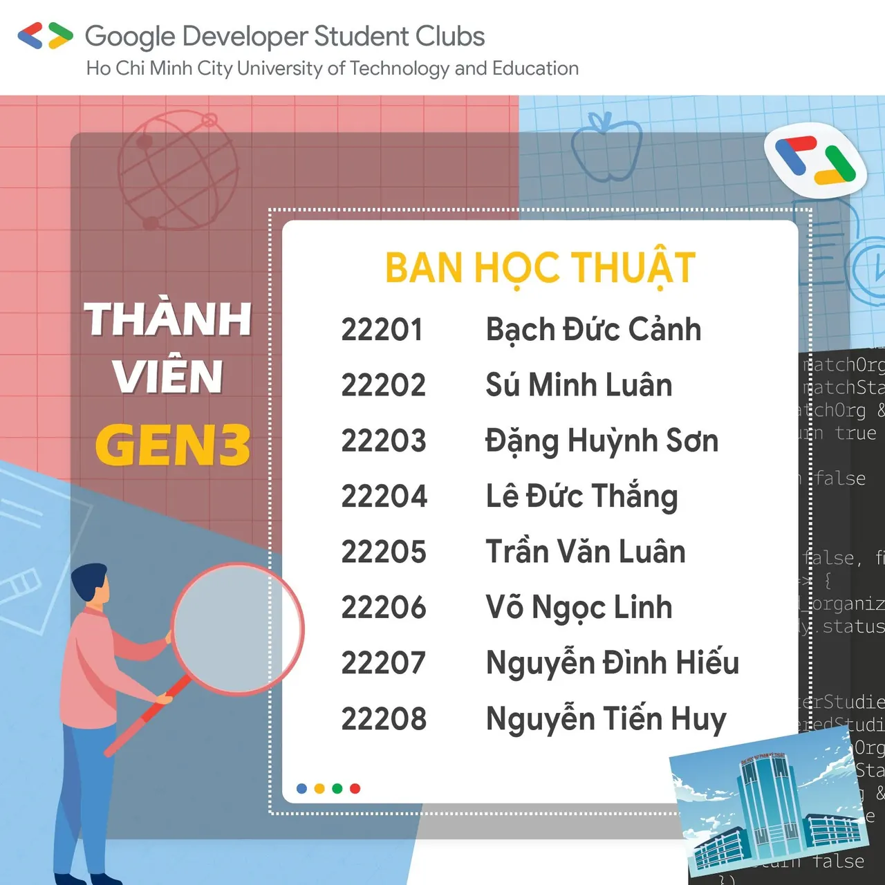
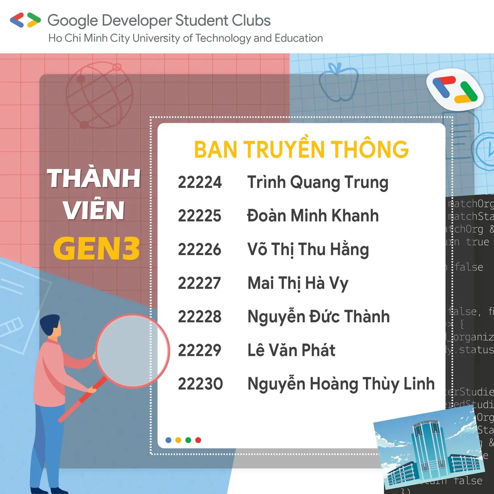
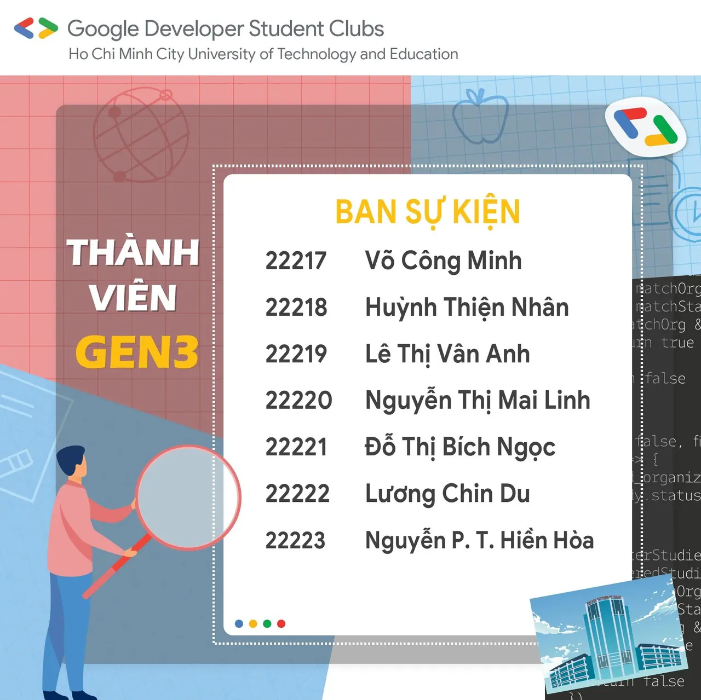
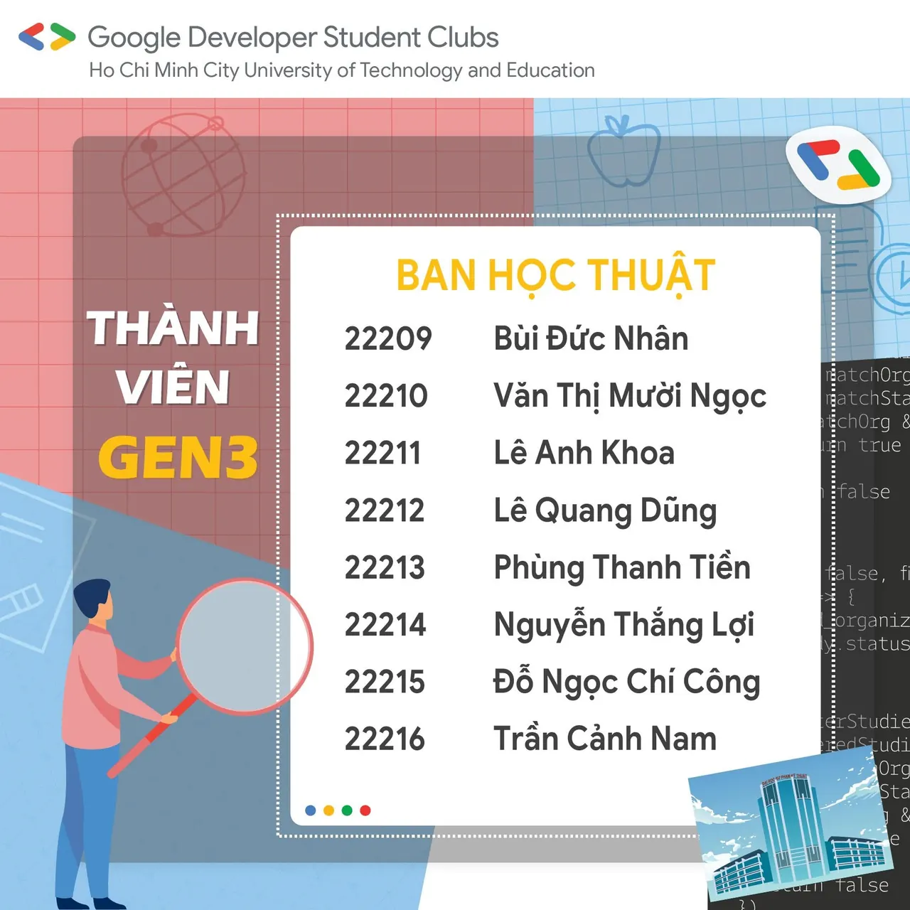

\[DANH SÁCH THÀNH VIÊN CLB GEN 3 GDSC - HCMUTE\] GDSC TIME! BRING THE HEAT 💕Lời đầu tiên, chúng mình xin chân thành cảm ơn tất cả các bạn đã quan tâm và dành thời gian tham gia Phỏng vấn Thành viên GEN 3 CLB GDSC - HCMUTE.  
👉 Sau một khoảng thời gian đầy căng thẳng và miệt mài tìm kiếm để chọn ra Thành viên GEN 3 cho CLB, chúng mình xin chúc mừng 30 bạn thành viên GEN 3 gia nhập vào đại gia đình GDSC - HCMUTE.

<!--truncate-->

💌 Kết quả đã được gửi qua email của các bạn, các bạn vui lòng check mail để nhận thông báo nha, nhớ check luôn cả hộp thư spam nè!  
🙆🙆 🙆 Chúc các bạn sẽ hoạt động sôi nổi, giữ lửa nhiệt huyết, đam mê, luôn đoàn kết sáng tạo cho CLB ngày càng phát triển nhé!  
🤗Tuy nhiên thì các bạn không có tên trong danh sách cũng đừng buồn nhé vì chúng ta vẫn còn cơ hội cho vòng phỏng vấn GEN tiếp theo đó. Ngoài ra các bạn cũng có thể tham gia vào các buổi sinh hoạt của CLB trong năm học tới để cùng chia sẻ kiến thức nè.  
✌️ Và quan trọng hơn hết là hãy follow Fanpage để không bỏ lỡ bất kỳ thông báo quan trọng nào nhaa!!!  
🍀 Một lần nữa xin cảm ơn tình cảm của mọi người dành cho CLB Sinh viên lập trình Google - HCMUTE.  
\_\_\_\_\_\_\_\_\_\_\_\_\_\_\_\_\_\_\_\_\_\_\_\_\_\_\_\_\_\_\_\_\_\_\_\_\_\_\_\_\_\_\_\_\_\_\_\_\_\_\_\_\_\_  
🌟🌟🌟 Được hỗ trợ bởi Google Developers, Google Developer Student Clubs (GDSC) là các nhóm cộng đồng cho sinh viên có niềm đam mê với các công nghệ của Google. Khi tham gia vào GDSC, các bạn sinh viên có cơ hội cùng nhau học hỏi trong một môi trường mở và năng động, cùng nhau xây dựng các giải pháp cho các vấn đề thực tế trong cộng đồng.  
👉👉👉 Google Developer Student Clubs - HCMUTE (GDSC - HCMUTE) vô cùng vinh dự khi trở thành một thành viên mới của GDSC toàn cầu. Với khao khát kết nối các bạn sinh viên yêu thích công nghệ thông tin nói chung và các công nghệ của Google nói riêng, GDSC - HCMUTE sẽ xây dựng một cộng đồng thân thiện để mọi người cùng chia sẻ kiến thức và tạo ra nhiều sản phẩm giúp ích cho xã hội.  
📌📌📌 Muốn biết thêm thông tin về GDSC toàn cầu, các bạn hãy vào trang web: developers.google.com/community/gdsc  
\_\_\_\_\_\_\_\_\_\_\_\_\_\_\_\_\_\_\_\_\_\_\_\_\_\_\_\_\_\_\_\_\_\_\_\_\_\_\_\_\_\_\_\_\_\_\_\_\_\_  
Mọi thắc mắc, xin vui lòng liên hệ: Fanpage Google Developer Student Clubs - HCM UTE: [https://www.facebook.com/gdsc.hcmute](https://www.facebook.com/gdsc.hcmute)
  
\#GDSC #GoogleDeveloperStudentClubs #GDSC\_HCMUTE #TuyenTVDot3

---

_Bài viết được lưu trữ từ [fanpage HCMUTE Developer Student Club](https://www.facebook.com/hcmute.dsc)._
