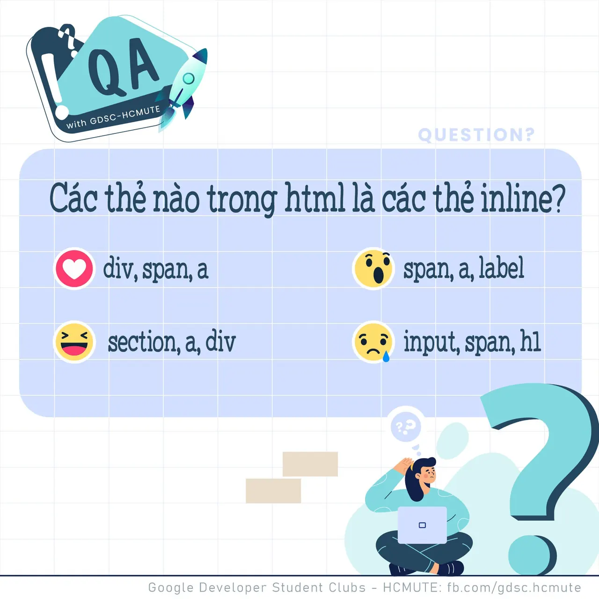

\[QA GDSC - Question\] 2,3 con mực … GDSC mình vui cực.🦑🦑 Sau khi trải qua vòng tuyển thành viên vô cùng căm go, thì chúng mình đã trở lại với các chuyên mục hằng tuần đây. Không để mọi người chờ lâu nữa chúng ta sẽ bắt đầu câu hỏi tuần này nhaa.🤗🤗 Các thẻ nào trong HTML là các thẻ inline?🤔🤔 🍀Các bạn bình tĩnh, tự tin để có thể đưa ra phương án đúng bằng cách thả React cũng như Comment để GDSC-UTE chúng mình xem thử có bao nhiêu bạn vượt qua được thử thách lần này nào.  
🍀Đừng quên Like và Follow Page để đón chờ phần Answer được lên sóng vào ngày mai nha.

<!--truncate-->

------------------------------------------------------------------------------------------------------------------------  
👉QA with GDSC HCMUTE là chuyên mục do GDSC - HCMUTE thực hiện với mong muốn cung cấp các kiến thức và thông tin hữu ích, giúp các bạn có thêm các tips thú vị trong lĩnh vực Công nghệ Thông tin thông qua Question và Answer được lên sóng hàng tuần!  
👉Mọi ý kiến đóng góp, các bạn có thể liên hệ trực tiếp thông qua fanpage Google Developer Student Clubs - HCM UTE: [https://www.facebook.com/gdsc.hcmute](https://www.facebook.com/gdsc.hcmute)
  
\#GDSC #GoogleDeveloperStudentClubs #GDSC\_HCMUTE #GDSC\_QA

---

_Bài viết được lưu trữ từ [fanpage HCMUTE Developer Student Club](https://www.facebook.com/hcmute.dsc)._
