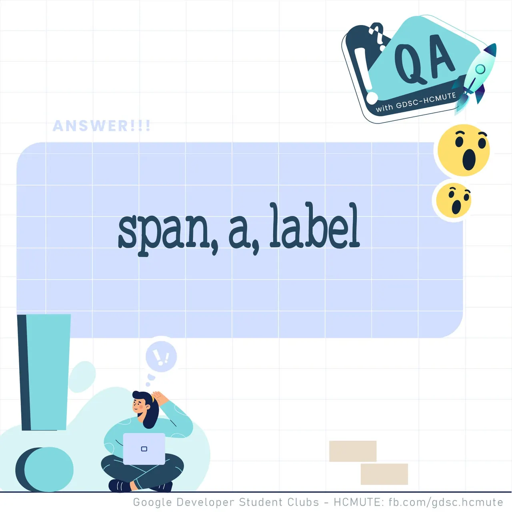

\[QA GDSC - Answer\]  
👋👋 Helu mọi người, chúng mình đã trở lại với phần Answer để đưa ra đáp án chuẩn xác cho mọi người đây.

<!--truncate-->

🙆 Đáp án của tụi mình là: span, a, label 👉 Giải thích: Các thẻ inline là các thẻ hiển thị nội dung trên một dòng. Nghĩa là chiều rộng sẽ bằng chiều rộng của text nên sẽ cùng nằm trên một dòng.  
👉 Còn thẻ block là các thẻ tự động tạo một dòng mới ở đầu và ở cuối của thẻ khi hiển thị trên trình duyệt. Là chiều rộng của thẻ đó sẽ chiếm hết trong trình duyệt.  
🤗Các bạn có suy nghĩ thế nào với đáp án lần này Để lại bình luận bên dưới để Ad cũng như các bạn có thể tham khảo nha.  
🤗  
---------------------------  
👉QA with GDSC - HCMUTE là chuyên mục do GDSC - HCMUTE thực hiện với mong muốn cung cấp các kiến thức và thông tin hữu ích, giúp các bạn có thêm các tips thú vị trong lĩnh vực Công nghệ Thông tin thông qua Question và Answer được lên sóng hàng tuần!  
👉Mọi ý kiến đóng góp, các bạn có thể liên hệ trực tiếp thông qua fanpage Google Developer Student Clubs - HCM UTE: [https://www.facebook.com/gdsc.hcmute](https://www.facebook.com/gdsc.hcmute)
  
\#GDSC #GoogleDeveloperStudentClubs #GDSC\_HCMUTE #GDSC\_QA

---

_Bài viết được lưu trữ từ [fanpage HCMUTE Developer Student Club](https://www.facebook.com/hcmute.dsc)._
