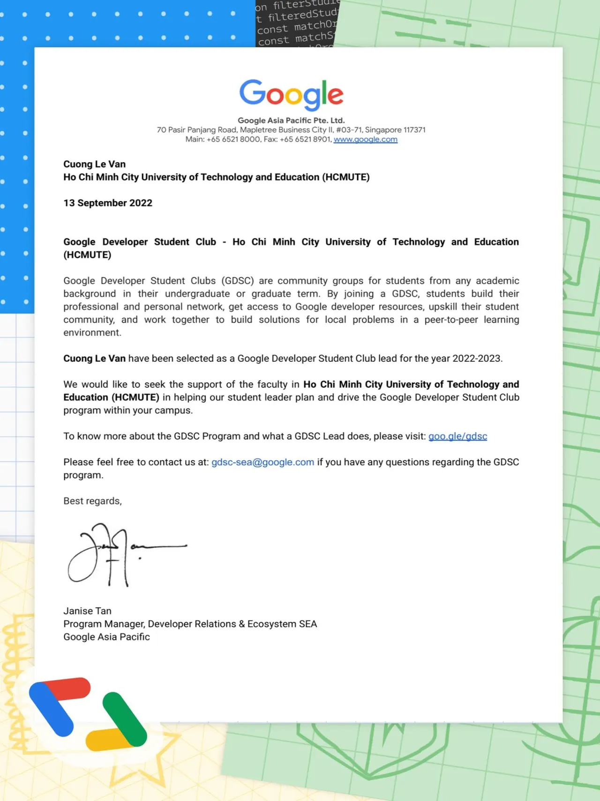

\[GDSC LEAD\] Trở thành Google Developer Student Leader như thế nào  
🌟 Google Developer Student Clubs (GDSC) là sáng kiến của Google nhằm hỗ trợ các sinh viên yêu thích công nghệ thông tin có tiềm năng thành lập, tổ chức các hoạt động cho cộng đồng lập trình viên, sinh viên tại các trường đại học.

<!--truncate-->

🌟 GDSC lần đầu tiên có mặt tại Việt Nam vào năm 2019, từ đó cho đến nay đã có 26 trường đại học trên toàn quốc tham gia ở các thành phố Hà Nội, HCM, Đà Nẵng, Cần Thơ. Quyền lợi của sinh viên khi trở thành Leader 📍Được truy cập vào mạng lưới tài nguyên thông tin, kiến thức công nghệ từ Google hoàn toàn miễn phí.  
📍Được training, hướng dẫn sử dụng Branding GDSC để tự thiết kế các chương trình, sự kiện, đứng ra tổ chức các hoạt động và sinh hoạt trong CLB. Yêu cầu tối thiểu 1 năm là 4 event (không phân biệt quy mô)  
📍Được tham gia sinh hoạt chung cùng gần 30 chapter leaders khắp nơi trên cả nước và giao lưu với cộng đồng GDSC hơn 1100 chapter trên toàn thế giới.  
📍Được ưu tiên giới thiệu speakers, nội dung, kết nối các nguồn lực mentors cho CLB khi Leader vận hành CLB và đưa ra các đề xuất.  
📍Ngoài ra, các bạn có thể cùng nhau xây dựng ứng dụng trên smartphone, desktop cũng như các sản phẩm thực tiễn với sự hỗ trợ của các chuyên gia.  
\_\_\_\_\_\_\_\_\_\_\_\_\_\_\_\_\_\_\_\_\_\_\_\_\_\_\_\_\_\_\_\_\_\_\_\_\_\_\_\_\_\_\_\_\_\_\_\_\_\_  
Mọi thắc mắc, xin vui lòng liên hệ: Fanpage Google Developer Student Clubs - HCM UTE: [https://www.facebook.com/gdsc.hcmute](https://www.facebook.com/gdsc.hcmute)
  
\#GDSC #GoogleDeveloperStudentClubs #GDSC\_HCMUTE

---

_Bài viết được lưu trữ từ [fanpage HCMUTE Developer Student Club](https://www.facebook.com/hcmute.dsc)._
