\[HAPPY BIRTHDAY GDSC - HCMUTE\] WE ARE GDSC - HCMUTE ⭐ Là một CLB có tuổi đời còn khá non trẻ trong bề dày phát triển của khoa Công nghệ Thông tin - Trường ĐH Sư phạm Kỹ thuật TPHCM. GDSC - HCMUTE hiểu rõ rằng, để có thể xây dựng một cộng đồng học thuật - nơi những sinh viên có niềm đam mê với công nghệ thông tin và lập trình nói chung, với những công nghệ của Google nói riêng, thì ắt hẳn sẽ trải qua nhiều khó khăn, thách thức, đặc biệt là trong giai đoạn hình thành và xây dựng CLB.  
❤️‍🔥 Tuy vậy, với tinh thần dấn thân và nhiệt huyết của tuổi trẻ, GDSC - HCMUTE đã phối hợp tổ chức nhiều hoạt động, cuộc thi học thuật và thu hút đông đảo sinh viên TPHCM tham gia. Chẳng hạn như các cuộc thi học thuật “BeCod3r”, “Mastering IT”, talkshow “Cloud computing”, workshop “E-commerce: Gain from growth”, tham quan doanh nghiệp với “KMS virtual office tour”... Bên cạnh đó, là các hoạt động hỗ trợ sinh viên thông qua các lớp “Ôn tập Nhập môn Lập trình”, “Ôn tập Kỹ thuật lập trình”.

<!--truncate-->

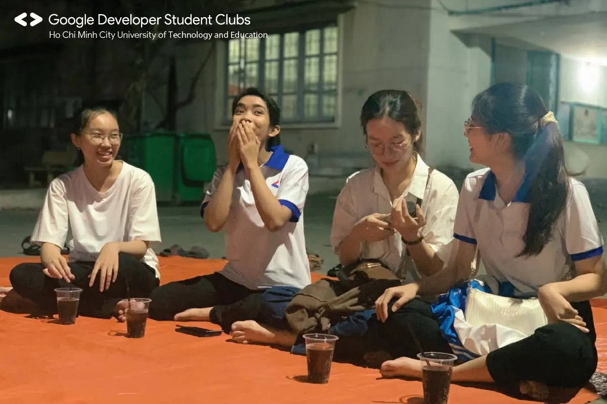

🥰 Thông qua các hoạt động, cuộc thi đã tổ chức, GDSC - HCMUTE đã từng bước để lại dấu ấn tốt đẹp trong các bạn sinh viên. Là địa chỉ tin cậy cho các đơn vị đồng hành, các nhà tài trợ trong các hoạt động hướng đến sinh viên. Là một cộng đồng năng động, nhiệt huyết, nơi gắn kết tình cảm, là mái nhà chung cho tất cả các thành viên CLB, nơi có thể hỗ trợ, giúp đỡ lẫn nhau.  
🤩 Để có được những thành công bước đầu như trên, GDSC - HCMUTE không quên gửi lời cảm ơn đến tất cả các nhà tài trợ, các đơn vị đã đồng hành trong suốt thời gian qua. Đặc biệt, gửi lời tri ân chân thành đến Ban Chủ nhiệm khoa và Đoàn - Hội khoa Công nghệ Thông tin đã tạo điều kiện tốt nhất để giúp đỡ và hỗ trợ hết mình trong các hoạt động của CLB.  
🥰Bước sang tuổi mới, GDSC - HCMUTE hứa hẹn sẽ tiếp tục phát triển hơn nữa, xây dựng các chương trình thiết thực và đáp ứng nhu cầu, nguyện vọng của sinh viên. Bên cạnh đó, CLB hy vọng sẽ tiếp tục có cơ hội để hợp tác và đồng hành cùng các đơn vị, các nhà tài trợ với những hoạt động trong tương lai.  
-----------------------  
Mọi ý kiến đóng góp, các bạn có thể liên hệ trực tiếp thông qua fanpage Google Developer Student Clubs - HCM UTE: [https://www.facebook.com/gdsc.hcmute](https://www.facebook.com/gdsc.hcmute)
  
\#GDSC #GoogleDeveloperStudentClubs #GDSC\_HCMUTE

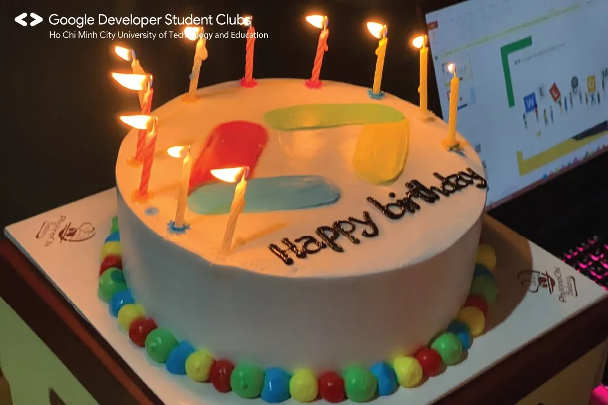
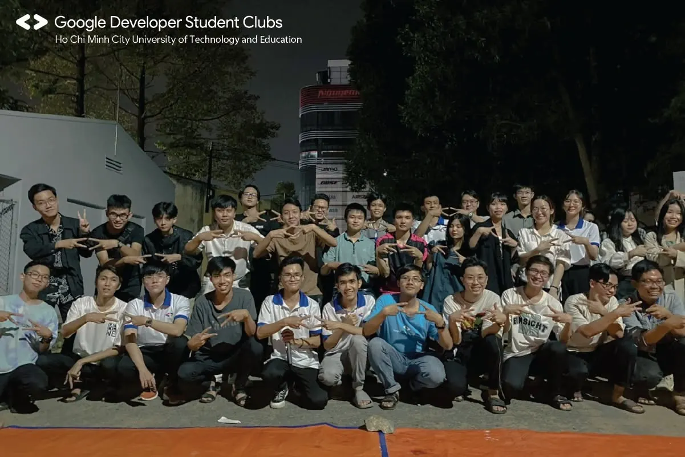
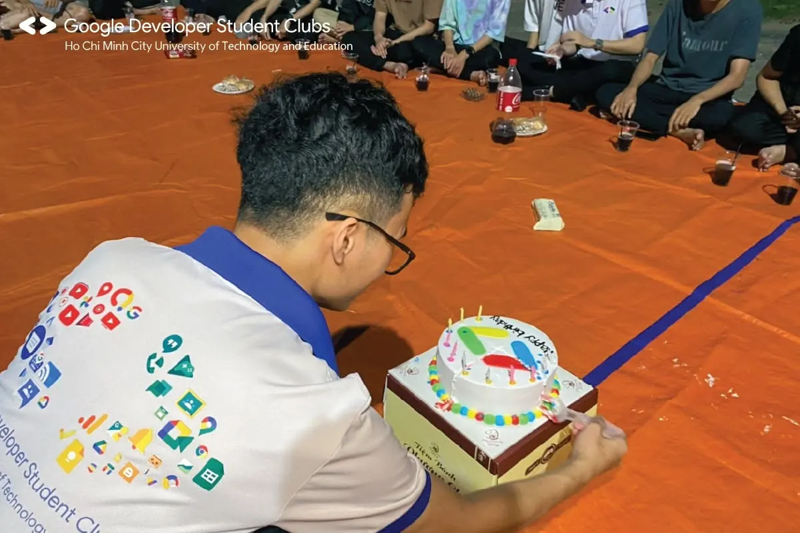
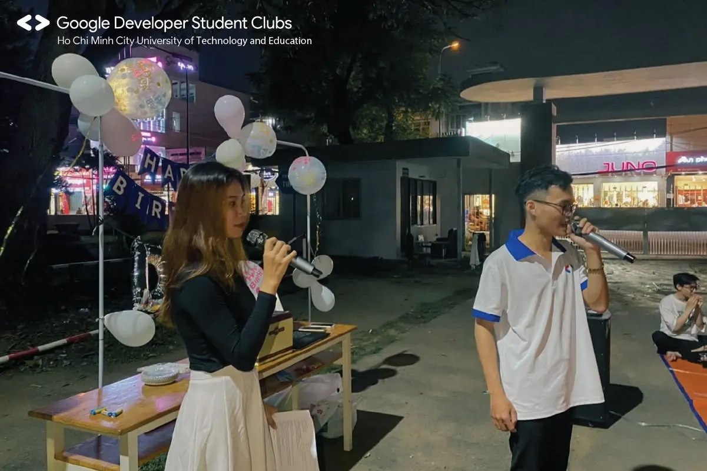
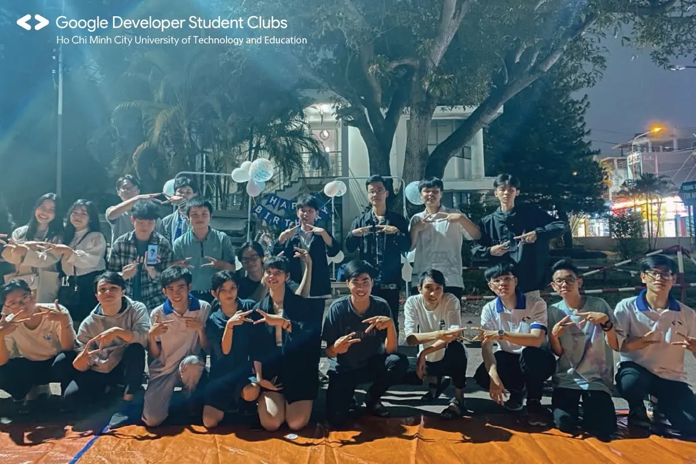
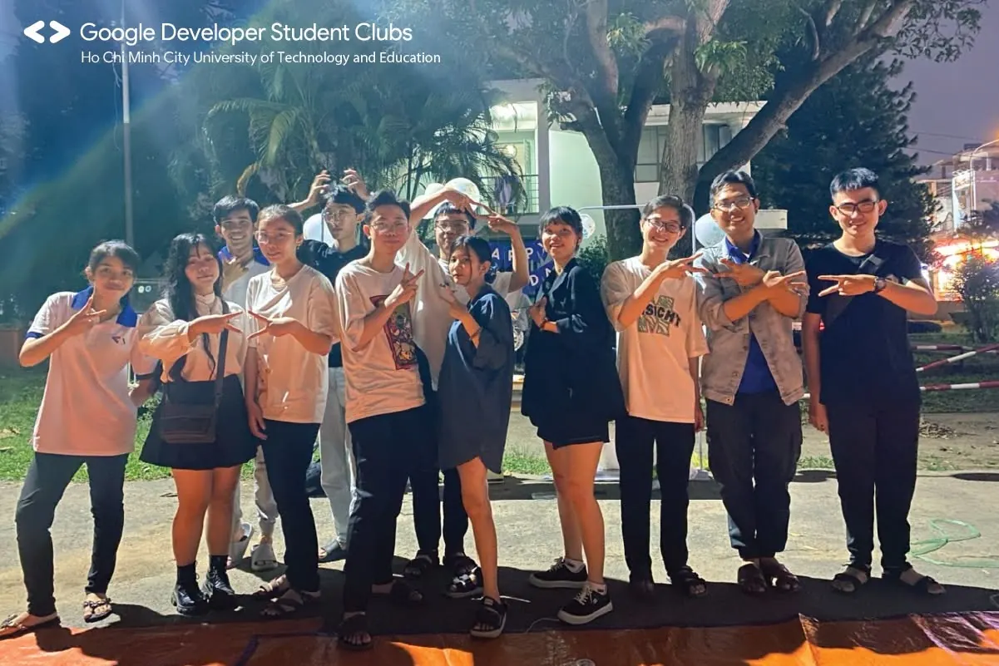
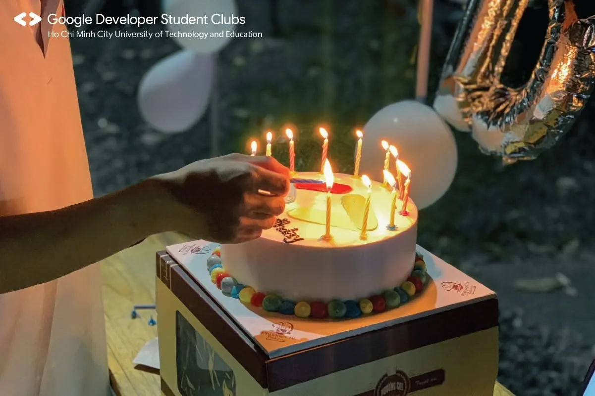
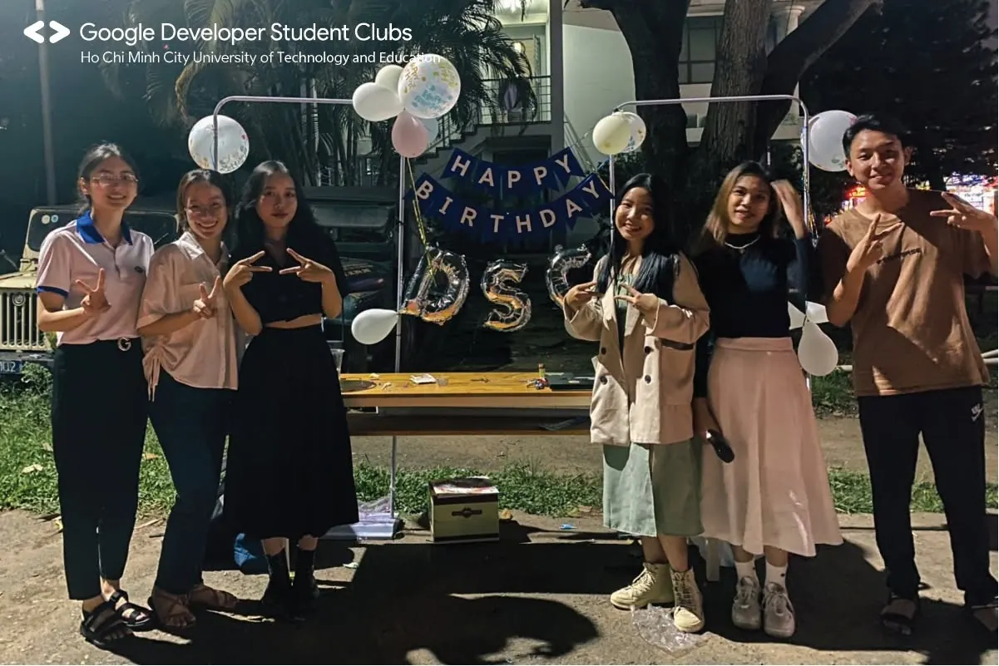
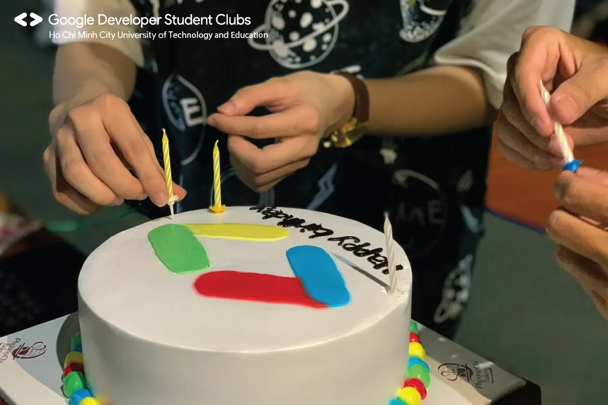
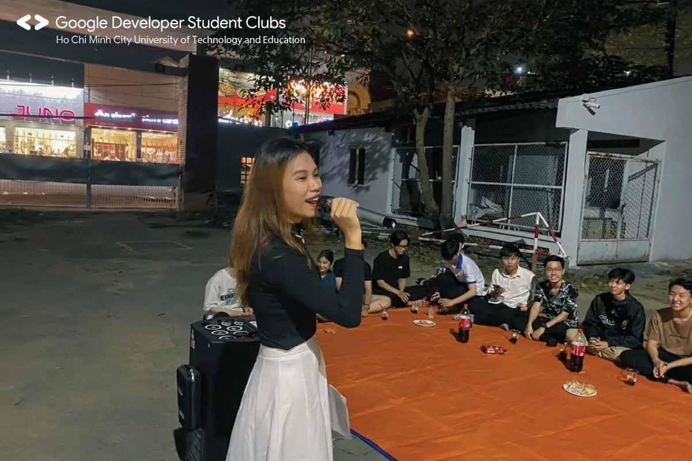
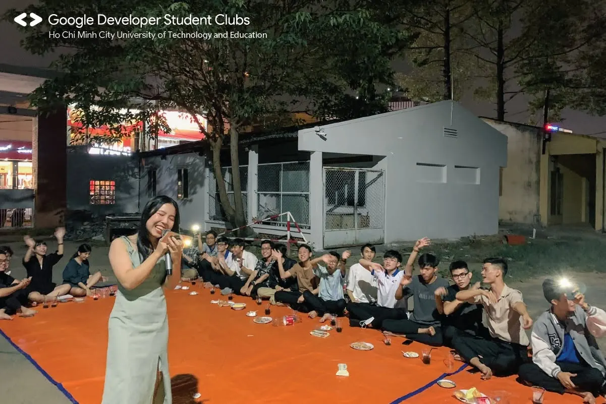

---

_Bài viết được lưu trữ từ [fanpage HCMUTE Developer Student Club](https://www.facebook.com/hcmute.dsc)._
