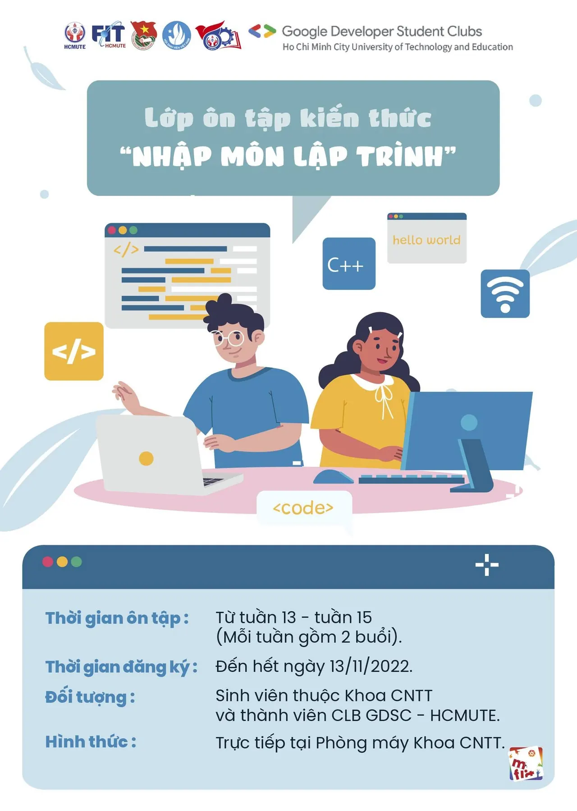

\[ĐĂNG KÝ THAM GIA LỚP ÔN TẬP NHẬP MÔN LẬP TRÌNH HK1 NĂM HỌC 2022 - 2023\]
  
🤔 Bạn còn đang loay hoay trong kiến thức cơ sở của lập trình?

<!--truncate-->

🤓 Bạn muốn rèn luyện khả năng tư duy?  
❌ Bạn khao khát một học kỳ không có tick đỏ?
  
💯 Để cùng “Vượt Vũ Môn” trong lần kiểm tra “Nhập môn Lập trình” sắp tới, Đoàn - Hội Khoa Công nghệ Thông tin phối hợp cùng CLB GDSC - HCMUTE sẽ tổ chức các lớp ôn tập hỗ trợ kiến thức môn “Nhập môn Lập trình” đến cho các bạn sinh viên còn đang gặp khó khăn trong môn học này.
  
🥰 Để tết năm nay được trọn vẹn, hãy đăng ký tham gia ngay thôi nào!!!
  
📌📌  LINK ĐĂNG KÝ: [https://itute.tiny.us/NMLT-22](https://itute.tiny.us/NMLT-22)  
⏰⏰ THỜI GIAN ĐĂNG KÝ: đến hết ngày 13/11/2022.  
(BTC sẽ tiến hành đóng link đăng ký trước thời hạn nếu số lượng đủ 150 bạn)  
👫👫 ĐỐI TƯỢNG: Sinh viên thuộc Khoa Công nghệ Thông tin và thành viên CLB GDSC - HCMUTE Trường Đại học Sư phạm Kỹ thuật TP.HCM có nhu cầu tìm hiểu và cải thiện kiến thức môn Nhập môn Lập trình.  
🕐🕐 THỜI GIAN ÔN TẬP: từ tuần 13 - tuần 15 (Mỗi tuần gồm 2 buổi).  
🔷🔷 HÌNH THỨC: Trực tiếp tại Phòng máy Khoa Công nghệ Thông tin.
  
💌💌 Kết quả đăng ký sẽ được BTC gửi qua email của các bạn, các bạn vui lòng check mail để nhận kết quả, nhớ check luôn cả hộp thư spam nè!!!
  
🍀🍀 Đừng quên like và follow Fanpage để cập nhật những thông tin mới nhất mới nhất nhé!!!  
\_\_\_\_\_\_\_\_\_\_\_\_\_\_\_\_\_\_\_\_\_\_\_\_\_\_\_\_\_\_\_\_\_\_\_\_\_\_\_\_\_\_\_\_\_\_\_\_\_\_  
📎📎 Mọi thắc mắc, xin vui lòng liên hệ:  
💾 Fanpage Google Developer Student Clubs - HCM UTE: [https://www.facebook.com/gdsc.hcmute](https://www.facebook.com/gdsc.hcmute)  
💾 Fanpage Đoàn - Hội Khoa Công Nghệ Thông Tin - ĐH Sư phạm Kỹ thuật TP.HCM: [https://www.facebook.com/DoanHoiITUTE](https://www.facebook.com/DoanHoiITUTE)  
📞 Liên hệ trực tiếp:  
Đ/c Bùi Quốc Tĩnh - [https://www.facebook.com/tinhbuiquoc1010](https://www.facebook.com/tinhbuiquoc1010)
  
\#FITUTE  
\#GDSC #GoogleDeveloperStudentClubs #GDSC\_HCMUTE  
\#NMLT\_2022

---

_Bài viết được lưu trữ từ [fanpage HCMUTE Developer Student Club](https://www.facebook.com/hcmute.dsc)._
