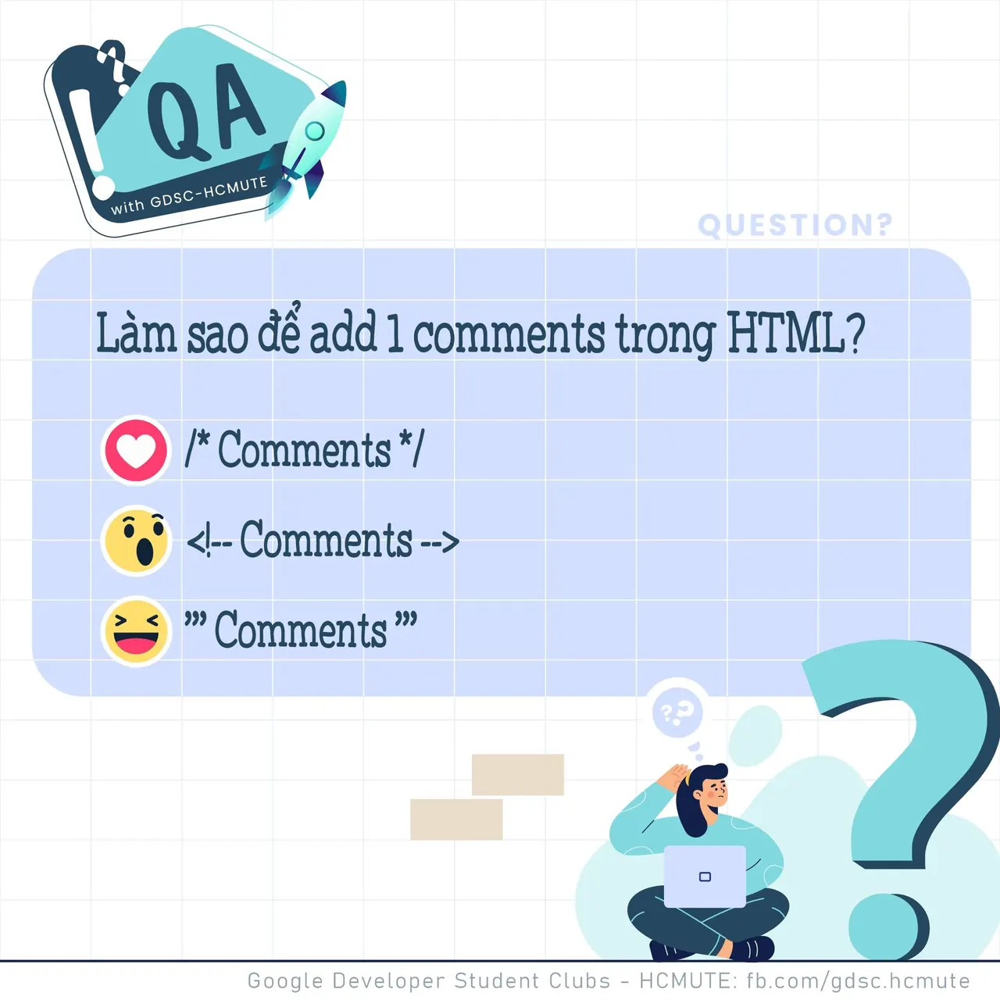

\[QA GDSC - Question\] Heyyo 😉😉 👊👊 Chào tất cả mọi người, sau một vài câu hỏi mở màn về HTML thì chúng mình sẽ nâng cấp và đưa thêm nhiều kiến thức về HTML cho các bạn đây. Các bạn cùng sẵn sàng để bắt đầu đi vào câu hỏi nha.  
🤔🤔 Làm sao để Add một Comment trong HTML?

<!--truncate-->

💚Bình tĩnh tự tin và để lại React cũng như Comment để GDSC - HCMUTE chúng mình xem có bao nhiêu bạn vượt qua thử thách lần này nào.  
🍀 Đừng quên Like và Follow Page để đón chờ phần Answer được lên sóng vào ngày mai nha.  
------------------------------------------------------------------------------------------------------------------------  
👉QA with GDSC HCMUTE là chuyên mục do GDSC - HCMUTE thực hiện với mong muốn cung cấp các kiến thức và thông tin hữu ích, giúp các bạn có thêm các tips thú vị trong lĩnh vực Công nghệ Thông tin thông qua Question và Answer được lên sóng hàng tuần!  
👉Mọi ý kiến đóng góp, các bạn có thể liên hệ trực tiếp thông qua fanpage Google Developer Student Clubs - HCM UTE: [https://www.facebook.com/gdsc.hcmute](https://www.facebook.com/gdsc.hcmute)
  
\#GDSC #GoogleDeveloperStudentClubs #GDSC\_HCMUTE #GDSC\_QA

---

_Bài viết được lưu trữ từ [fanpage HCMUTE Developer Student Club](https://www.facebook.com/hcmute.dsc)._
